# Database Architecture

| Field | Value |
|-------|-------|
| **Document ID** | ARCH-005 |
| **Product** | Founder Portfolio Platform (FounderOS v1.0) |
| **Status** | Approved |
| **Last Updated** | 2026-06-29 |
| **Related** | [Backend Architecture](./Backend_Architecture.md) · [09_Database](../09_Database/) |

---

## Purpose

Define the PostgreSQL database architecture for FounderOS v1.0 — entity relationships, table schemas, indexing strategy, JSON field conventions, and data lifecycle policies.

## Scope

| In Scope | Out of Scope |
|----------|--------------|
| PostgreSQL 16 schema design | Redis cache schema (see [Caching Strategy](./Caching_Strategy.md)) |
| SQLAlchemy ORM model definitions | Alembic migration scripts |
| Indexing and query patterns | Multi-tenant row isolation (v2.0) |
| Seed data strategy | Analytics data warehouse |

## Business Context

PostgreSQL is the **authoritative store** for all CMS content, user accounts, form submissions, and site configuration. Enterprise buyers expect data durability; the schema must support audit trails and future multi-tenant expansion without breaking changes.

## Goals

1. **Normalized core entities** with JSON columns for flexible nested data.
2. **Slug-based URLs** — unique indexes on `slug` for SEO-friendly routes.
3. **Soft-publish workflow** — `is_published` flags on content tables.
4. **Audit timestamps** — `created_at`, `updated_at` on mutable entities.
5. **Extensible settings** — key-value `site_settings` for white-label config.

## Functional Requirements

| ID | Requirement | Priority |
|----|-------------|----------|
| FR-DB-001 | PostgreSQL 16 as primary database | P0 |
| FR-DB-002 | SQLAlchemy 2.0 declarative models | P0 |
| FR-DB-003 | Unique slugs for products, blog, case studies, portfolio | P0 |
| FR-DB-004 | JSON-serialized complex fields (features, metrics, architecture) | P0 |
| FR-DB-005 | Contact and inquiry submission tables | P0 |
| FR-DB-006 | Site settings key-value store | P0 |
| FR-DB-007 | User table for admin authentication | P0 |
| FR-DB-008 | Sort order fields for manual ordering | P1 |

## Non-functional Requirements

| ID | Requirement | Target |
|----|-------------|--------|
| NFR-DB-001 | Query p95 (indexed lookups) | &lt; 50ms |
| NFR-DB-002 | Backup frequency | Daily automated |
| NFR-DB-003 | Connection pool | 10–20 (SQLAlchemy) |
| NFR-DB-004 | Max row size | Within PostgreSQL limits; JSON &lt; 1MB |
| NFR-DB-005 | Charset | UTF-8 |

## User Stories

| ID | As a… | I want… | So that… |
|----|-------|---------|----------|
| US-DB-001 | Admin | reliable content storage | edits persist correctly |
| US-DB-002 | Visitor | fast slug lookups | detail pages load quickly |
| US-DB-003 | Founder | form submissions saved | I can follow up on leads |
| US-DB-004 | DevOps | backup/restore capability | I recover from failures |

## UX Requirements

Database design supports UX indirectly:

- **Fast list pages** — indexes on `is_published`, `sort_order`.
- **Reliable forms** — transactions on submission insert; no duplicate submissions from retries (idempotency key in v1.5).
- **Consistent ordering** — `sort_order` integer for manual curation.

## Technical Considerations

### Entity Relationship Diagram

```mermaid
erDiagram
    users {
        int id PK
        string email UK
        string hashed_password
        boolean is_active
        timestamp created_at
    }

    site_settings {
        int id PK
        string key UK
        text value
        timestamp updated_at
    }

    products {
        int id PK
        string slug UK
        string name
        string tagline
        text description
        text features
        text domains
        text architecture
        text screenshots
        boolean is_flagship
        boolean is_published
        int sort_order
        timestamp created_at
        timestamp updated_at
    }

    blog_posts {
        int id PK
        string slug UK
        string title
        text excerpt
        text content
        string cover_image
        string tags
        boolean is_published
        timestamp published_at
        timestamp created_at
        timestamp updated_at
    }

    case_studies {
        int id PK
        string slug UK
        string title
        string client
        string industry
        text summary
        text challenge
        text solution
        text results
        text metrics
        string cover_image
        boolean is_published
        int sort_order
        timestamp created_at
    }

    testimonials {
        int id PK
        string name
        string role
        string company
        text content
        string avatar_url
        boolean is_published
        int sort_order
        timestamp created_at
    }

    portfolio_items {
        int id PK
        string slug UK
        string title
        string category
        text description
        string technologies
        string image_url
        string project_url
        boolean is_published
        int sort_order
        timestamp created_at
    }

    contact_submissions {
        int id PK
        string name
        string email
        string company
        string inquiry_type
        text message
        boolean is_read
        timestamp created_at
    }

    inquiries {
        int id PK
        string inquiry_type
        string name
        string email
        string company
        string role
        text message
        string budget_range
        boolean is_read
        timestamp created_at
    }
```



### Table Summary

| Table | Rows (est. v1.0) | Primary Access Pattern |
|-------|------------------|------------------------|
| `users` | &lt; 10 | Email lookup (login) |
| `site_settings` | &lt; 50 | Key lookup |
| `products` | 5–20 | List published, slug detail |
| `blog_posts` | 10–100 | List published, slug detail |
| `case_studies` | 5–30 | List published, slug detail |
| `testimonials` | 10–50 | List published, sort_order |
| `portfolio_items` | 10–50 | List published, sort_order |
| `contact_submissions` | Growing | Insert, admin list |
| `inquiries` | Growing | Insert, admin list |

### Index Strategy

| Table | Index | Type | Purpose |
|-------|-------|------|---------|
| `users` | `email` | UNIQUE | Login lookup |
| `site_settings` | `key` | UNIQUE | Settings lookup |
| `products` | `slug` | UNIQUE | URL routing |
| `blog_posts` | `slug` | UNIQUE | URL routing |
| `case_studies` | `slug` | UNIQUE | URL routing |
| `portfolio_items` | `slug` | UNIQUE | URL routing |
| `blog_posts` | `(is_published, published_at DESC)` | COMPOSITE | List query (v1.5) |
| `contact_submissions` | `created_at DESC` | BTREE | Admin inbox (v1.5) |

### JSON Field Conventions

Complex nested data stored as JSON text columns, parsed in application layer:

| Table | Column | JSON Schema |
|-------|--------|-------------|
| `products` | `features` | `[{ title, description, icon }]` |
| `products` | `domains` | `["Financial Services", ...]` |
| `products` | `architecture` | `{ layers: [{ name, components }] }` |
| `products` | `screenshots` | `["url1", "url2"]` |
| `case_studies` | `metrics` | `[{ label, value }]` |

### Connection Configuration

```python
# database.py
engine = create_engine(
    settings.DATABASE_URL,
    pool_pre_ping=True,
    pool_size=10,
    max_overflow=20,
)
SessionLocal = sessionmaker(autocommit=False, autoflush=False, bind=engine)
```

### Data Lifecycle

| Data Type | Retention | Archive Policy |
|-----------|-----------|----------------|
| CMS content | Indefinite | Soft delete via `is_published=false` |
| Contact submissions | 2 years | Export then purge (GDPR) |
| Inquiries | 5 years | Export then purge |
| Admin users | Indefinite | Deactivate via `is_active=false` |

## Security Considerations

| Control | Implementation |
|---------|----------------|
| Credentials | `DATABASE_URL` env var only |
| Network | PostgreSQL not exposed publicly; VPS internal network |
| Encryption at rest | VPS disk encryption; managed DB option |
| Encryption in transit | SSL mode `require` in production |
| Least privilege | App user has DML only; no superuser |
| SQL injection | SQLAlchemy ORM; no raw string queries |
| PII in submissions | Email, name — GDPR export/delete support (v1.5) |

## Acceptance Criteria

- [ ] ERD matches SQLAlchemy models in `backend/app/models/`.
- [ ] All slug columns have unique indexes.
- [ ] JSON fields documented with schema examples.
- [ ] Seed data in `main.py` is idempotent.
- [ ] Backup strategy documented in [Deployment Architecture](./Deployment_Architecture.md).
- [ ] No sensitive data in `site_settings` values (secrets use env vars).

## Future Enhancements

| Enhancement | Version |
|-------------|---------|
| Alembic versioned migrations | v1.5 |
| `tenant_id` column on all tables | v2.0 |
| Full-text search (`tsvector`) on blog | v1.5 |
| Read replica for reporting | v2.0 |
| Audit log table (`content_revisions`) | v1.5 |
| Media assets table (replace URL strings) | v1.5 |

## Open Questions

| ID | Question | Owner | Status |
|----|----------|-------|--------|
| OQ-DB-001 | PostgreSQL JSONB vs. TEXT for flexible fields? | Backend | Open |
| OQ-DB-002 | Managed PostgreSQL (Neon) vs. VPS-hosted? | DevOps | Open |
| OQ-DB-003 | Separate `media_assets` table in v1.0? | Product | Open |

---

## Related Documents

- [Backend Architecture](./Backend_Architecture.md)
- [API Architecture](./API_Architecture.md)
- [Caching Strategy](./Caching_Strategy.md)
- [Media Architecture](./Media_Architecture.md)
- [09_Database](../09_Database/)
