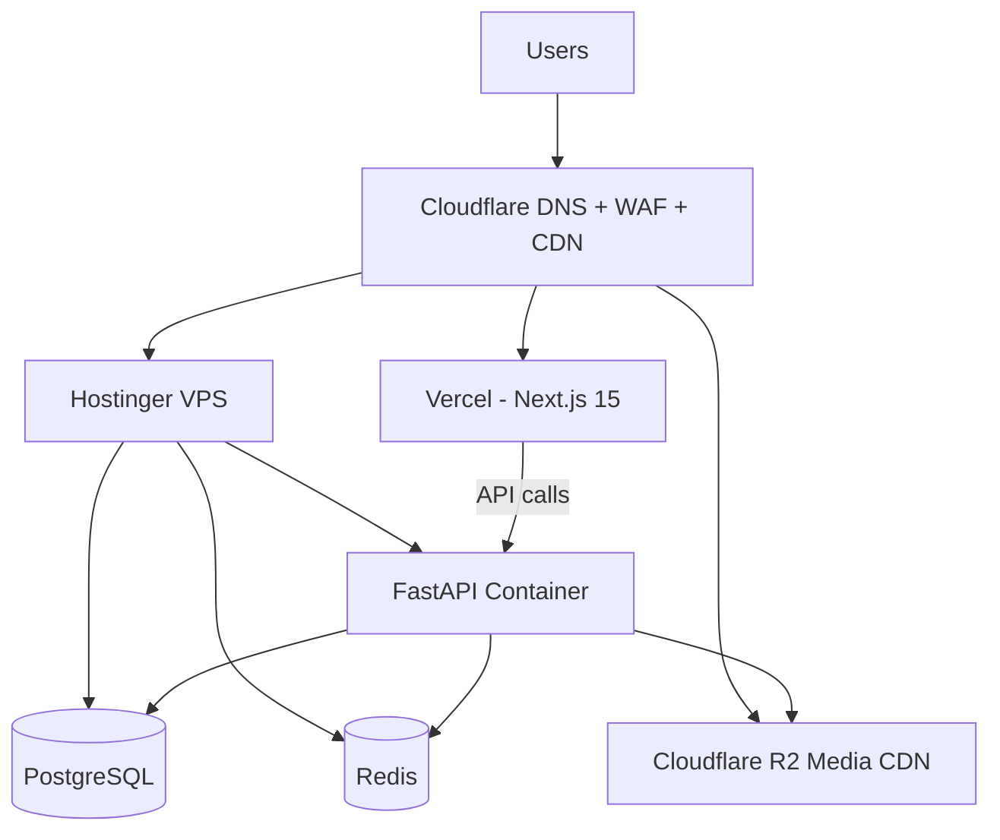
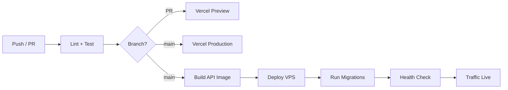

# Deployment Architecture

| Field | Value |
|-------|-------|
| **Document ID** | ARCH-DEP-001 |
| **Product** | Founder Portfolio Platform (FounderOS v1.0) |
| **Status** | Approved |
| **Last Updated** | 2026-06-29 |
| **Owner** | DevOps & Engineering |
| **Related** | [System Architecture](./System_Architecture.md) · [Security Architecture](./Security_Architecture.md) · [Scalability](./Scalability.md) |

---

## Purpose

Define the deployment topology, environments, CI/CD pipeline, and infrastructure components for FounderOS v1.0 — Next.js 15 on Vercel, FastAPI + PostgreSQL + Redis on VPS, Cloudflare edge, and Docker Compose for local development.

---

## Scope

| In Scope | Out of Scope |
|----------|--------------|
| Production topology | Kubernetes orchestration (v2.0) |
| Staging and preview environments | Multi-region active-active |
| Docker Compose local dev | Terraform IaC (future) |
| CI/CD pipeline stages | Managed Kubernetes |
| Environment variables strategy | |
| Rollback procedures | |
| SSL/DNS configuration | |

---

## Business Context

FounderOS must deploy reliably for **white-label tenants** with minimal DevOps overhead. The v1.0 architecture balances cost (single VPS API) with performance (Vercel edge for frontend) and security (Cloudflare WAF).

---

## Goals

1. **Reproducible deploys** — Docker Compose locally mirrors production services.
2. **Zero-downtime frontend** — Vercel atomic deployments.
3. **Safe backend releases** — Blue-green or rolling via container restart.
4. **Environment parity** — Staging mirrors production configuration shape.

---

## Functional Requirements

| ID | Requirement | Priority |
|----|-------------|----------|
| FR-DEP-001 | Local dev SHALL run via Docker Compose | P0 |
| FR-DEP-002 | Frontend SHALL deploy to Vercel on merge to main | P0 |
| FR-DEP-003 | Backend SHALL deploy to VPS via CI/CD or manual script | P0 |
| FR-DEP-004 | PostgreSQL SHALL run on VPS or managed service | P0 |
| FR-DEP-005 | Redis SHALL run alongside API for cache/rate limit | P1 |
| FR-DEP-006 | DNS SHALL route through Cloudflare | P0 |
| FR-DEP-007 | Preview deployments SHALL exist for frontend PRs | P1 |
| FR-DEP-008 | Database migrations SHALL run before API traffic switch | P0 |
| FR-DEP-009 | Health check endpoint SHALL gate deploy success | P0 |
| FR-DEP-010 | Secrets SHALL be injected via environment, not images | P0 |

---

## Non-functional Requirements

| ID | Requirement | Target |
|----|-------------|--------|
| NFR-DEP-001 | Frontend deploy time | &lt; 5 minutes |
| NFR-DEP-002 | Backend deploy RTO | &lt; 10 minutes |
| NFR-DEP-003 | Rollback time | &lt; 5 minutes |
| NFR-DEP-004 | Uptime SLA (public site) | 99.9% |

---

## User Stories

| ID | As a… | I want… | So that… |
|----|-------|---------|----------|
| US-DEP-001 | Developer | one-command local stack | I onboard quickly |
| US-DEP-002 | DevOps | automated deploy on merge | Releases are consistent |
| US-DEP-003 | Founder | minimal downtime on updates | Site stays available |

---

## UX Requirements

Deployment must support zero-downtime releases for public pages. Admin users see a maintenance banner only during planned migrations exceeding 30 seconds. Deployment failures must not corrupt in-progress CMS edits — optimistic UI with rollback per [Feedback_Components.md](../03_Design_System/Feedback_Components.md).

---

## Architecture

### Production Topology

### Environment Matrix

| Environment | Frontend | Backend | Database | Purpose |
|-------------|----------|---------|----------|---------|
| Local | localhost:13000 | localhost:18000 | Docker PostgreSQL (host 15432) | Development |
| Preview | Vercel preview URL | Staging API or mock | Staging DB | PR review |
| Staging | staging.domain.com | staging-api | Staging PostgreSQL | QA |
| Production | www.domain.com | api.domain.com | Production PostgreSQL | Live |

### CI/CD Pipeline

### Docker Compose (Local)

| Service | Image | Port |
|---------|-------|------|
| frontend | Node 20 + Next.js | 3000 |
| api | Python 3.12 + FastAPI | 8000 |
| db | PostgreSQL 16 | 5432 |
| redis | Redis 7 | 6379 |

---

## Technical Considerations

| Topic | Guidance |
|-------|----------|
| **Vercel** | Connect GitHub; env vars per environment |
| **VPS** | Docker Compose or systemd; nginx reverse proxy |
| **Migrations** | Alembic run in deploy script before container restart |
| **Media** | R2 bucket per environment |
| **Backups** | Daily pg_dump to object storage |

---

## Security Considerations

| Concern | Control |
|---------|---------|
| SSH access | Key-only; fail2ban |
| Secrets | VPS env file; Vercel encrypted env |
| TLS | Cloudflare Full (strict) to origin |
| Admin deploy | Protected CI secrets |

See [Security Architecture](./Security_Architecture.md).

---

## Acceptance Criteria

- [ ] Docker Compose starts full local stack
- [ ] Production topology matches diagram
- [ ] CI deploys frontend on main merge
- [ ] Backend health check passes post-deploy
- [ ] Migrations run automatically in deploy pipeline
- [ ] Staging environment documented and accessible
- [ ] Rollback procedure tested

---

## Future Enhancements

| Enhancement | Target |
|-------------|--------|
| Terraform IaC | v1.5 |
| Kubernetes on VPS | v2.0 |
| Managed PostgreSQL (Neon) | v1.5 |
| GitOps (ArgoCD) | v2.0 |
| Multi-region CDN origins | v2.0 |

---

## Open Questions

| ID | Question | Owner | Status |
|----|----------|-------|--------|
| OQ-DEP-001 | GitHub Actions vs. Vercel-only CI for backend? | DevOps | Open |
| OQ-DEP-002 | Single VPS sufficient for v1.0 launch traffic? | Architecture | Open |
| OQ-DEP-003 | Automated staging DB refresh from prod? | DevOps | Open |

---

## Related Documents

- [System Architecture](./System_Architecture.md)
- [Security Architecture](./Security_Architecture.md)
- [Scalability](./Scalability.md)
- [Observability](./Observability.md)
- [Caching Strategy](./Caching_Strategy.md)
- [Folder Structure](./Folder_Structure.md)
