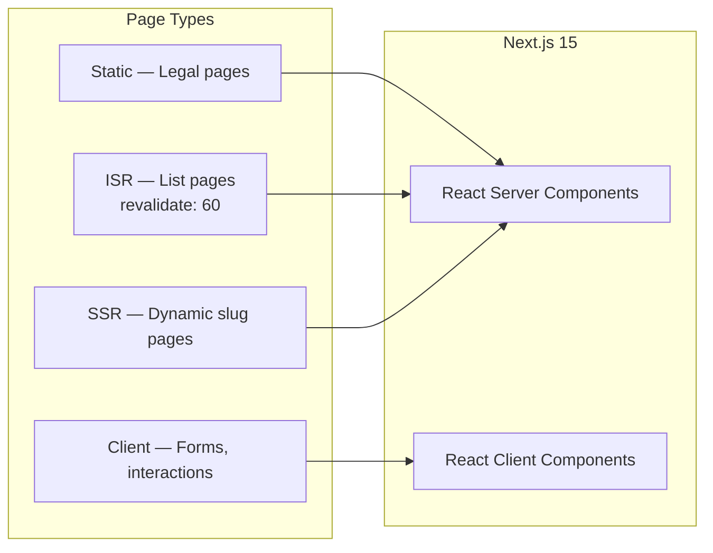
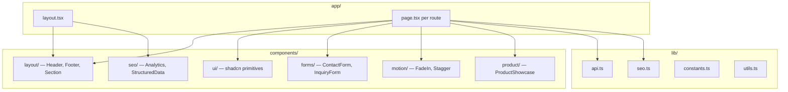

# Frontend Architecture

| Field | Value |
|-------|-------|
| **Document ID** | ARCH-002 |
| **Product** | Founder Portfolio Platform (FounderOS v1.0) |
| **Status** | Approved |
| **Last Updated** | 2026-06-29 |
| **Related** | [System Architecture](./System_Architecture.md) · [Folder Structure](./Folder_Structure.md) |

---

## Purpose

Specify the frontend architecture for FounderOS v1.0 built on **Next.js 15 App Router**, defining rendering strategies, component hierarchy, state management, API integration patterns, and performance budgets.

## Scope

| In Scope | Out of Scope |
|----------|--------------|
| Next.js App Router structure and conventions | Admin panel UI (see `07_Admin`) |
| Component library (shadcn/ui) usage patterns | Native mobile apps |
| Data fetching and caching (ISR) | E2E test implementation |
| SEO and analytics integration | Design token definitions (see `03_Design_System`) |
| Motion and accessibility patterns | Backend API implementation |

## Business Context

The frontend is the **primary revenue surface** — enterprise buyers, licensees, and partners evaluate the founder and products through this experience. It must convey enterprise credibility, load fast globally, and convert visitors into inquiries. White-label deployments require theming and content swaps without architectural changes.

## Goals

1. **Server-first rendering** — Maximize SSR/ISR for SEO and performance.
2. **Type-safe API contracts** — TypeScript interfaces mirror backend Pydantic schemas.
3. **Composable UI** — Reusable layout, section, form, and motion components.
4. **Accessible by default** — WCAG 2.1 AA compliance.
5. **Edge-optimized** — Deploy on Vercel with Cloudflare CDN in front.

## Functional Requirements

| ID | Requirement | Priority |
|----|-------------|----------|
| FR-FE-001 | App Router with file-based routing for all public pages | P0 |
| FR-FE-002 | Root layout provides Header, Footer, Analytics, StructuredData | P0 |
| FR-FE-003 | `api` client module centralizes all backend calls | P0 |
| FR-FE-004 | `createMetadata()` generates per-page SEO metadata | P0 |
| FR-FE-005 | Dark theme as default with CSS variables | P0 |
| FR-FE-006 | Framer Motion fade-in animations on key sections | P1 |
| FR-FE-007 | Contact and inquiry forms with client-side validation | P0 |
| FR-FE-008 | Dynamic routes for `[slug]` pages (products, blog, case studies) | P0 |
| FR-FE-009 | Skip-to-content link for keyboard navigation | P0 |
| FR-FE-010 | Error boundaries and graceful API failure handling | P1 |

## Non-functional Requirements

| ID | Requirement | Target |
|----|-------------|--------|
| NFR-FE-001 | Lighthouse Performance (mobile) | ≥ 90 |
| NFR-FE-002 | Lighthouse Accessibility | ≥ 95 |
| NFR-FE-003 | Lighthouse SEO | ≥ 95 |
| NFR-FE-004 | First Contentful Paint | &lt; 1.5s |
| NFR-FE-005 | Total JS bundle (initial) | &lt; 150 KB gzipped |
| NFR-FE-006 | ISR revalidation default | 60 seconds |
| NFR-FE-007 | Core Web Vitals | All "Good" |

## User Stories

| ID | As a… | I want… | So that… |
|----|-------|---------|----------|
| US-FE-001 | Visitor | pages that load instantly on mobile | I don't abandon the site |
| US-FE-002 | SEO specialist | proper meta tags and JSON-LD on every page | search engines index correctly |
| US-FE-003 | Frontend dev | a clear component hierarchy | I build pages consistently |
| US-FE-004 | Accessibility auditor | semantic HTML and ARIA | the site is usable by everyone |
| US-FE-005 | Founder | my flagship product highlighted on home | enterprise buyers see value immediately |

## UX Requirements

- **Visual hierarchy**: Hero → value props → social proof → CTA on landing pages.
- **Consistent spacing**: `Container`, `Section`, `SectionHeader` layout primitives.
- **Interactive feedback**: Button hover states, form validation messages, loading states.
- **Responsive breakpoints**: Mobile-first; `sm` (640px), `md` (768px), `lg` (1024px), `xl` (1280px).
- **Reduced motion**: Disable Framer Motion animations when `prefers-reduced-motion: reduce`.

## Technical Considerations

### Rendering Strategy



| Page Pattern | Rendering | Revalidation | Example |
|--------------|-----------|--------------|---------|
| Marketing static | Static / RSC | Build time | `/legal/privacy` |
| Content lists | ISR | 60s | `/blog`, `/products` |
| Content detail | ISR + `generateStaticParams` | 60s | `/blog/[slug]` |
| Forms | Client Component | — | Contact form submit |

### Component Architecture



### API Client Pattern

```typescript
// lib/api.ts — canonical pattern
const API_URL = process.env.NEXT_PUBLIC_API_URL;

async function fetchAPI<T>(endpoint: string, options?: RequestInit): Promise<T> {
  const res = await fetch(`${API_URL}${endpoint}`, {
    ...options,
    headers: { "Content-Type": "application/json", ...options?.headers },
    next: { revalidate: 60 }, // ISR
  });
  if (!res.ok) throw new Error(`API error: ${res.status}`);
  return res.json();
}
```

### Environment Variables

| Variable | Required | Description |
|----------|----------|-------------|
| `NEXT_PUBLIC_API_URL` | Yes | Backend API base (e.g., `https://api.example.com/api/v1`) |
| `NEXT_PUBLIC_SITE_URL` | Yes | Canonical site URL for SEO |
| `NEXT_PUBLIC_GA_ID` | No | Google Analytics measurement ID |
| `NEXT_PUBLIC_PLAUSIBLE_DOMAIN` | No | Plausible analytics domain |

### Font & Theme

- **Fonts**: Geist Sans (body), Geist Mono (code) via `next/font/google`.
- **Theme**: Dark mode default; CSS variables in `globals.css`.
- **Icons**: Lucide React (tree-shakeable).

## Security Considerations

| Concern | Mitigation |
|---------|------------|
| XSS in blog content | Sanitize HTML server-side before render; CSP headers |
| API token exposure | Admin tokens only in admin routes; never `NEXT_PUBLIC_*` |
| CSRF on forms | SameSite cookies; API stateless POST with validation |
| Dependency vulnerabilities | `npm audit` in CI; Dependabot |
| Environment leakage | `.env.local` gitignored; Vercel env vars per environment |

## Acceptance Criteria

- [ ] All routes defined in [05_Pages](../05_Pages/Home.md) have corresponding `app/` route files.
- [ ] Every page uses `createMetadata()` or exports `metadata`.
- [ ] API client is the single source for backend communication.
- [ ] Layout components (Header, Footer) shared across all pages.
- [ ] Lighthouse scores meet NFR targets on Home and Product Detail pages.
- [ ] `prefers-reduced-motion` disables animations.
- [ ] TypeScript strict mode enabled with zero errors.

## Future Enhancements

| Enhancement | Version | Notes |
|-------------|---------|-------|
| Admin dashboard (Next.js) | v1.5 | Protected `/admin` routes |
| Internationalization (i18n) | v2.0 | `next-intl` or App Router locales |
| Theme switcher (light/dark) | v1.5 | `next-themes` integration |
| Partial Prerendering (PPR) | v1.5 | Next.js 15 experimental |
| Storybook component catalog | v1.5 | Design-dev handoff |

## Open Questions

| ID | Question | Owner | Status |
|----|----------|-------|--------|
| OQ-FE-001 | Plausible vs. GA4 as default analytics? | Product | Open |
| OQ-FE-002 | MDX for blog content or HTML from CMS? | Content | Open |
| OQ-FE-003 | Image optimization via `next/image` + R2 or Cloudflare Images? | DevOps | Open |

---

## Related Documents

- [System Architecture](./System_Architecture.md)
- [Folder Structure](./Folder_Structure.md)
- [API Architecture](./API_Architecture.md)
- [Caching Strategy](./Caching_Strategy.md)
- [05_Pages — All Page Specs](../05_Pages/Home.md)
