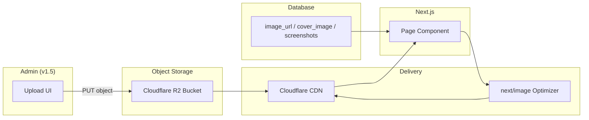
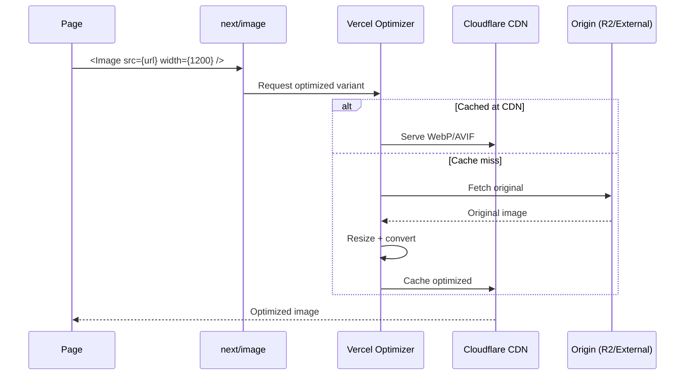

# Media Architecture

| Field | Value |
|-------|-------|
| **Document ID** | ARCH-008 |
| **Product** | Founder Portfolio Platform (FounderOS v1.0) |
| **Status** | Approved |
| **Last Updated** | 2026-06-29 |
| **Related** | [Caching Strategy](./Caching_Strategy.md) · [Deployment Architecture](./Deployment_Architecture.md) |

---

## Purpose

Define the media asset architecture for FounderOS v1.0 — image storage, delivery, optimization, upload workflows, and CDN integration for product screenshots, blog covers, portfolio images, and avatars.

## Scope

| In Scope | Out of Scope |
|----------|--------------|
| Image URL storage in database | Video hosting/transcoding |
| CDN delivery (Cloudflare R2 + CDN) | DAM (Digital Asset Management) UI |
| `next/image` optimization | AI image generation |
| OG image generation | User-generated content moderation |
| Media fields in CMS entities | Podcast audio hosting |

## Business Context

High-quality visuals are critical for founder credibility — product screenshots, case study hero images, and founder photos directly influence enterprise buyer perception. Media must load fast globally without bloating the VPS.

## Goals

1. **Offload storage** from VPS to object storage (Cloudflare R2).
2. **Optimize delivery** via CDN and `next/image` responsive sizing.
3. **Consistent URLs** — stable, cacheable, SEO-friendly.
4. **Simple v1.0 workflow** — URL strings in CMS; upload UI in v1.5 admin.
5. **OG images** — per-page social sharing images.

## Functional Requirements

| ID | Requirement | Priority |
|----|-------------|----------|
| FR-MEDIA-001 | Image URLs stored as strings on CMS entities | P0 |
| FR-MEDIA-002 | `next/image` for all rendered images | P0 |
| FR-MEDIA-003 | Default OG image at `/og-image.png` | P0 |
| FR-MEDIA-004 | Per-entity cover images (blog, case studies) | P1 |
| FR-MEDIA-005 | Product screenshot galleries | P0 |
| FR-MEDIA-006 | Testimonial avatar images | P1 |
| FR-MEDIA-007 | Portfolio project images | P0 |
| FR-MEDIA-008 | External image domains whitelisted in `next.config` | P0 |

## Non-functional Requirements

| ID | Requirement | Target |
|----|-------------|--------|
| NFR-MEDIA-001 | Image LCP | &lt; 2.5s |
| NFR-MEDIA-002 | Max upload size (v1.5) | 10 MB |
| NFR-MEDIA-003 | Supported formats | WebP, AVIF, JPEG, PNG, SVG |
| NFR-MEDIA-004 | CDN cache TTL | 30 days |
| NFR-MEDIA-005 | Responsive breakpoints | 640, 768, 1024, 1280, 1920px |

## User Stories

| ID | As a… | I want… | So that… |
|----|-------|---------|----------|
| US-MEDIA-001 | Visitor | fast-loading optimized images | pages feel professional |
| US-MEDIA-002 | Admin | to set cover images on blog posts | social shares look great |
| US-MEDIA-003 | Founder | product screenshots in a gallery | buyers see the product |
| US-MEDIA-004 | SEO specialist | proper OG images per page | link previews are compelling |

## UX Requirements

- **Lazy loading** — below-fold images use `loading="lazy"`.
- **Aspect ratios** — consistent card image ratios (16:9 for heroes, 1:1 for avatars).
- **Alt text** — required for accessibility; sourced from CMS title/description.
- **Placeholder** — blur placeholder or skeleton during load.
- **Fallback** — gradient placeholder when image URL is null.

## Technical Considerations

### Media Flow Architecture



### Media Fields by Entity

| Entity | Field | Type | Usage |
|--------|-------|------|-------|
| `products` | `screenshots` | JSON array of URLs | Product gallery |
| `blog_posts` | `cover_image` | URL string | Blog hero, OG image |
| `case_studies` | `cover_image` | URL string | Case study hero |
| `portfolio_items` | `image_url` | URL string | Portfolio card |
| `testimonials` | `avatar_url` | URL string | Avatar circle |
| Site | `og-image.png` | Static file | Default OG image |

### Image Optimization Pipeline



### `next.config` Image Domains

| Domain | Source |
|--------|--------|
| `images.unsplash.com` | Seed/demo images |
| `*.r2.cloudflarestorage.com` | R2 bucket |
| Custom CDN domain | Production media |

```typescript
// next.config.ts pattern
images: {
  remotePatterns: [
    { protocol: "https", hostname: "images.unsplash.com" },
    { protocol: "https", hostname: "*.r2.cloudflarestorage.com" },
  ],
}
```

### OG Image Strategy

| Page | OG Image Source |
|------|-----------------|
| Home | `/og-image.png` (static) |
| Product Detail | First screenshot or custom OG |
| Blog Post | `cover_image` or default |
| Case Study | `cover_image` or default |
| Other pages | `/og-image.png` |

### Storage Layout (R2)

```
founderos-media/
├── products/
│   └── {slug}/
│       ├── screenshot-01.webp
│       └── screenshot-02.webp
├── blog/
│   └── {slug}/
│       └── cover.webp
├── case-studies/
│   └── {slug}/
│       └── cover.webp
├── portfolio/
│   └── {slug}/
│       └── hero.webp
├── testimonials/
│   └── {id}/
│       └── avatar.webp
└── site/
    └── og-image.png
```

## Security Considerations

| Concern | Mitigation |
|---------|------------|
| Malicious uploads (v1.5) | MIME type validation; max size; virus scan |
| Hotlinking | Cloudflare hotlink protection |
| SVG XSS | Sanitize SVG or disallow uploads |
| Private media | Signed URLs for admin-only assets (v2.0) |
| CORS on R2 | Restrict to site domain |

## Acceptance Criteria

- [ ] All image renders use `next/image` component.
- [ ] Remote image domains configured in `next.config`.
- [ ] OG images specified per page via `createMetadata({ image })`.
- [ ] Alt text present on all content images.
- [ ] Fallback UI when `image_url` is null.
- [ ] R2 bucket structure documented for production setup.

## Future Enhancements

| Enhancement | Version |
|-------------|---------|
| Admin media library with upload | v1.5 |
| `media_assets` database table | v1.5 |
| Dynamic OG image generation (`@vercel/og`) | v1.5 |
| Automatic WebP conversion on upload | v1.5 |
| Image CDN analytics | v2.0 |
| Video embed support (YouTube only in v1.0) | v1.5 |

## Open Questions

| ID | Question | Owner | Status |
|----|----------|-------|--------|
| OQ-MEDIA-001 | R2 vs. Vercel Blob as default storage? | DevOps | Open |
| OQ-MEDIA-002 | Dynamic OG generation in v1.0 or static only? | Design | Open |
| OQ-MEDIA-003 | Unsplash for demo only or production fallback? | Product | Open |

---

## Related Documents

- [Caching Strategy](./Caching_Strategy.md)
- [Frontend Architecture](./Frontend_Architecture.md)
- [Database Architecture](./Database_Architecture.md)
- [05_Pages/Media.md](../05_Pages/Media.md)
- [Deployment Architecture](./Deployment_Architecture.md)
