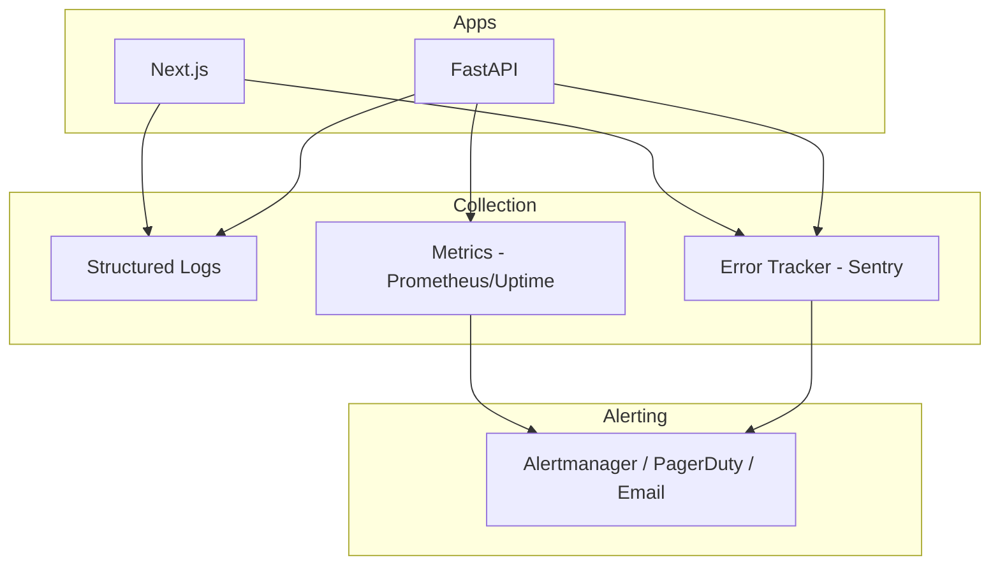

# Observability

| Field | Value |
|-------|-------|
| **Document ID** | ARCH-OBS-001 |
| **Product** | Founder Portfolio Platform (FounderOS v1.0) |
| **Status** | Approved |
| **Last Updated** | 2026-06-29 |
| **Owner** | DevOps & Engineering |
| **Related** | [System Architecture](./System_Architecture.md) · [Deployment Architecture](./Deployment_Architecture.md) · [Security Architecture](./Security_Architecture.md) |

---

## Purpose

Define logging, monitoring, metrics, health checks, alerting, and debugging practices for FounderOS v1.0 — enabling operators to detect, diagnose, and resolve issues across Next.js frontend, FastAPI backend, PostgreSQL, and Redis.

---

## Scope

| In Scope | Out of Scope |
|----------|--------------|
| Structured logging format | Full APM vendor selection |
| Health check endpoints | Custom metrics dashboard UI in product |
| Error tracking integration | On-call rotation management |
| Key metrics and SLIs | |
| Alert thresholds | |
| Correlation IDs | |
| Vercel analytics | |

---

## Business Context

A founder portfolio that goes **down during a launch** or loses inquiry submissions damages revenue and reputation. Observability is the minimum operational bar for a platform marketed as enterprise-grade.

---

## Goals

1. **Detect outages** — Alert within 5 minutes of public site failure.
2. **Diagnose errors** — Trace request from frontend to database.
3. **Measure SLOs** — Track availability, latency, error rate.
4. **Audit admin actions** — Log authentication and content mutations.

---

## Functional Requirements

| ID | Requirement | Priority |
|----|-------------|----------|
| FR-OBS-001 | API SHALL expose `GET /health` returning 200 when DB reachable | P0 |
| FR-OBS-002 | API SHALL expose `GET /ready` for deploy gating | P0 |
| FR-OBS-003 | Logs SHALL be structured JSON in production | P0 |
| FR-OBS-004 | Each request SHALL include correlation ID header | P1 |
| FR-OBS-005 | Unhandled exceptions SHALL be captured by error tracker | P0 |
| FR-OBS-006 | Admin auth events SHALL be logged | P0 |
| FR-OBS-007 | Slow queries (&gt; 1s) SHALL be logged | P1 |
| FR-OBS-008 | Frontend errors SHALL report to error tracker | P1 |

---

## Non-functional Requirements

| ID | Requirement | Target |
|----|-------------|--------|
| NFR-OBS-001 | Log retention | 30 days minimum |
| NFR-OBS-002 | Metric scrape interval | 60 seconds |
| NFR-OBS-003 | Alert notification latency | &lt; 5 minutes |
| NFR-OBS-004 | Trace sampling (if APM) | 10% normal; 100% errors |

---

## User Stories

| ID | As a… | I want… | So that… |
|----|-------|---------|----------|
| US-OBS-001 | DevOps | alerts when API is down | I fix before users notice |
| US-OBS-002 | Engineer | structured logs with request ID | I debug production issues |
| US-OBS-003 | Founder | uptime visibility | I trust site reliability |

---

## UX Requirements

Admin monitoring dashboard displays system health with color-coded status per [Feedback_Components.md](../03_Design_System/Feedback_Components.md). Public users never see internal error details — generic error pages per [404.md](../05_Pages/404.md). Performance degradation surfaces as skeleton loading, not blank screens.

---

## Architecture

### Observability Stack

### Service Level Indicators

| SLI | Measurement | SLO Target |
|-----|-------------|------------|
| Availability | Uptime check on `/` and `/health` | 99.9% monthly |
| API latency | p95 response time | &lt; 300ms |
| Error rate | 5xx / total requests | &lt; 0.1% |
| Form success | Contact submit 2xx rate | &gt; 99% |

### Log Schema

| Field | Type | Description |
|-------|------|-------------|
| timestamp | ISO 8601 | Event time |
| level | string | INFO, WARN, ERROR |
| service | string | `api`, `frontend` |
| correlation_id | string | Request trace ID |
| message | string | Human-readable |
| user_id | string | Admin ID if authenticated |
| path | string | HTTP path |
| duration_ms | number | Request duration |
| error | object | Stack trace if error |

### Health Check Contract

| Endpoint | Checks | Response |
|----------|--------|----------|
| `/health` | Process alive | `{"status": "ok"}` |
| `/ready` | DB + Redis connectivity | `{"status": "ready", "db": true, "redis": true}` |

### Alert Rules

| Alert | Condition | Severity |
|-------|-----------|----------|
| API Down | `/health` fails 3× in 5 min | Critical |
| High Error Rate | 5xx &gt; 1% for 10 min | Critical |
| High Latency | p95 &gt; 1s for 15 min | Warning |
| Disk Space | &gt; 85% on VPS | Warning |
| Failed Logins Spike | &gt; 50 in 5 min | Warning |
| SSL Expiry | &lt; 14 days | Warning |

---

## Technical Considerations

| Topic | Guidance |
|-------|----------|
| **FastAPI** | `structlog` or `python-json-logger` |
| **Middleware** | Correlation ID from `X-Request-ID` header |
| **Sentry** | `@sentry/nextjs` + `sentry-sdk[fastapi]` |
| **Uptime** | UptimeRobot or Better Stack on public URLs |
| **Vercel** | Built-in analytics and function logs |
| **PostgreSQL** | `pg_stat_statements` for slow query analysis |

---

## Security Considerations

| Concern | Rule |
|---------|------|
| PII in logs | Mask email, phone in log output |
| Log access | Restricted to ops; no public log endpoints |
| Error tracker | Scrub passwords, tokens from reports |

---

## Acceptance Criteria

- [ ] `/health` and `/ready` endpoints implemented
- [ ] JSON structured logs in production API
- [ ] Sentry (or equivalent) configured for FE + API
- [ ] Uptime monitoring on production URLs
- [ ] Alert rules configured and tested
- [ ] Correlation ID propagated FE → API
- [ ] Admin login/logout events logged

---

## Future Enhancements

| Enhancement | Notes |
|-------------|-------|
| Grafana dashboards | VPS metrics visualization |
| Distributed tracing | OpenTelemetry |
| Admin monitoring page | [07_Admin](../07_Admin/) Monitoring |
| Synthetic monitoring | Playwright cron checks |
| Log aggregation | Loki or CloudWatch |

---

## Open Questions

| ID | Question | Owner | Status |
|----|----------|-------|--------|
| OQ-OBS-001 | Sentry vs. Datadog for v1.0? | DevOps — Sentry cost-effective | Open |
| OQ-OBS-002 | Self-hosted Prometheus vs. managed? | DevOps | Open |
| OQ-OBS-003 | Public status page for tenants? | Product | Open |

---

## Related Documents

- [System Architecture](./System_Architecture.md)
- [Deployment Architecture](./Deployment_Architecture.md)
- [Security Architecture](./Security_Architecture.md)
- [Scalability](./Scalability.md)
- [Caching Strategy](./Caching_Strategy.md)
