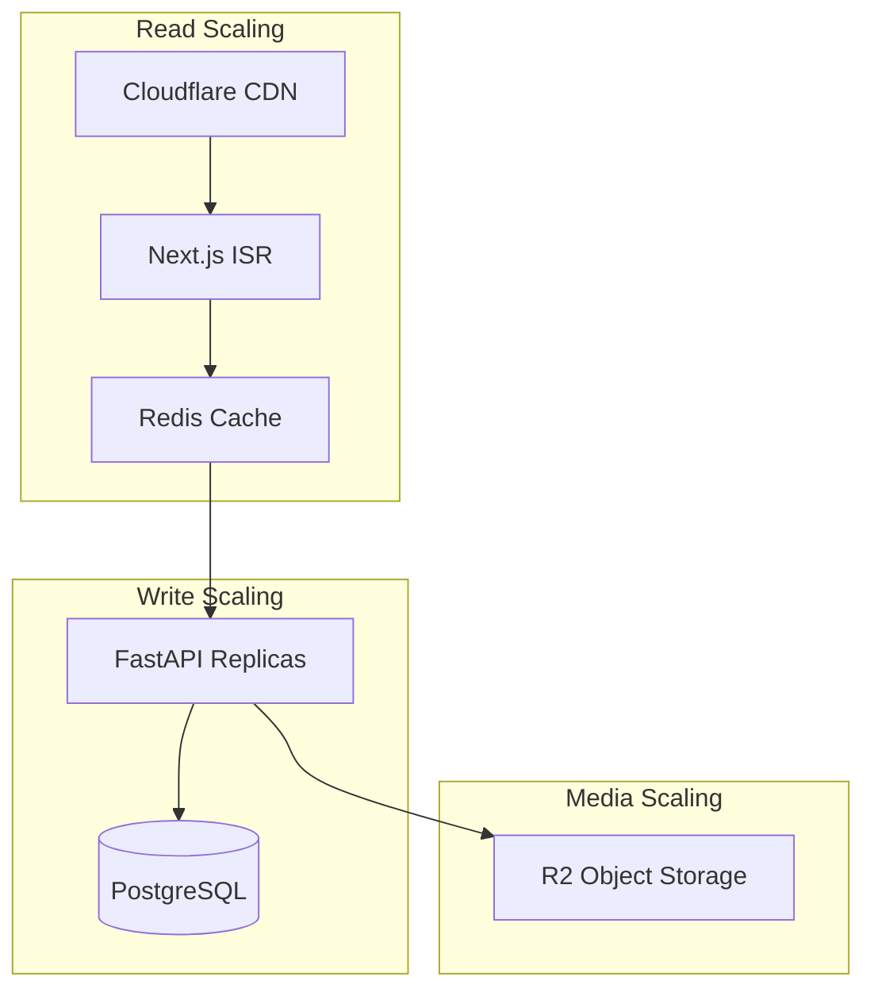
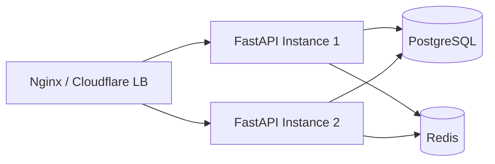

# Scalability

| Field | Value |
|-------|-------|
| **Document ID** | ARCH-SCL-001 |
| **Product** | Founder Portfolio Platform (FounderOS v1.0) |
| **Status** | Approved |
| **Last Updated** | 2026-06-29 |
| **Owner** | Architecture & Engineering |
| **Related** | [System Architecture](./System_Architecture.md) · [Caching Strategy](./Caching_Strategy.md) · [Deployment Architecture](./Deployment_Architecture.md) · [Database Architecture](./Database_Architecture.md) |

---

## Purpose

Define scalability strategy, capacity planning, bottlenecks, and horizontal/vertical scaling paths for FounderOS v1.0 — from single-tenant founder sites to future multi-tenant SaaS at scale.

---

## Scope

| In Scope | Out of Scope |
|----------|--------------|
| v1.0 capacity targets (1K concurrent) | Multi-tenant sharding implementation |
| Frontend scaling (Vercel) | Global active-active DB |
| API vertical/horizontal scale | Custom CDN build |
| Database scaling path | |
| Cache layer scaling | |
| Media delivery scaling | |
| Load testing criteria | |

---

## Business Context

FounderOS v1.0 serves **individual founder portfolios** with traffic spikes from Product Hunt, Hacker News, or viral blog posts. Architecture must handle 10× normal traffic without redesign while documenting the path to **multi-tenant SaaS** commercialization.

---

## Goals

1. **v1.0 headroom** — 1,000 concurrent users without degradation.
2. **Edge-first reads** — 80%+ public page requests never hit origin API.
3. **Documented scale path** — Engineering knows next steps at 10K, 100K users.
4. **Cost predictability** — Scaling decisions tied to measurable metrics.

---

## Functional Requirements

| ID | Requirement | Priority |
|----|-------------|----------|
| FR-SCL-001 | Public pages SHALL use ISR/SSG where content allows | P0 |
| FR-SCL-002 | API responses SHALL be cacheable per [Caching Strategy](./Caching_Strategy.md) | P0 |
| FR-SCL-003 | Stateless API design SHALL enable horizontal replicas | P0 |
| FR-SCL-004 | Media SHALL be served from CDN (R2 + Cloudflare) | P0 |
| FR-SCL-005 | Database connection pooling SHALL be configured | P0 |
| FR-SCL-006 | Rate limiting SHALL protect API from abuse | P0 |
| FR-SCL-007 | Pagination SHALL be required on all list endpoints | P0 |

---

## Non-functional Requirements

| ID | Requirement | Target (v1.0) |
|----|-------------|---------------|
| NFR-SCL-001 | Concurrent users | 1,000 |
| NFR-SCL-002 | API p95 latency under load | &lt; 300ms |
| NFR-SCL-003 | Page LCP under load | &lt; 2.5s |
| NFR-SCL-004 | API throughput | 500 req/s burst |
| NFR-SCL-005 | Database connections max | Pool size 20–50 |

---

## User Stories

| ID | As a… | I want… | So that… |
|----|-------|---------|----------|
| US-SCL-001 | Visitor | fast loads during traffic spike | Site stays responsive |
| US-SCL-002 | DevOps | clear scale-up triggers | I act before outage |
| US-SCL-003 | Product owner | cost-effective v1.0 hosting | We don't over-provision |

---

## UX Requirements

Scalability decisions must preserve user-perceived performance: LCP < 2.5s under 10× traffic via CDN and Redis caching. Admin dashboards must remain responsive during traffic spikes — degrade analytics refresh rate before blocking content edits. Loading states per [Loading_States.md](../03_Design_System/Loading_States.md) during cache miss.

---

## Architecture

### Scaling Dimensions

### Capacity Tiers

| Tier | Monthly Visitors | Architecture | Est. Monthly Cost |
|------|------------------|--------------|-------------------|
| Starter | &lt; 50K | Vercel Hobby + 1 VPS | $20–50 |
| Growth | 50K–500K | Vercel Pro + upgraded VPS + Redis | $50–150 |
| Scale | 500K–2M | Vercel Pro + 2 API replicas + read replica | $150–400 |
| SaaS | 2M+ | Multi-tenant + K8s + managed DB | Custom |

### Bottleneck Analysis

| Component | First Bottleneck | Mitigation |
|-----------|------------------|------------|
| Frontend | Rare (Vercel auto-scales) | ISR, image optimization |
| API | CPU on single VPS | Horizontal replicas + load balancer |
| PostgreSQL | Connection count, read I/O | PgBouncer, read replica |
| Redis | Memory | Eviction policy; separate instance |
| Media | Egress bandwidth | CDN cache; WebP/AVIF |

### Horizontal API Scaling

---

## Technical Considerations

| Topic | Guidance |
|-------|----------|
| **Next.js ISR** | Revalidate 60–3600s per content type |
| **Redis** | Cache GET responses; session optional |
| **PostgreSQL** | Indexes per [09_Database](../09_Database/Indexes.md) |
| **Load testing** | k6 or Locust against staging |
| **Multi-tenant v2** | Row-level `tenant_id`; connection routing |

---

## Security Considerations

| Concern | Scale Impact |
|---------|--------------|
| Rate limiting | Must scale with Redis cluster |
| DDoS | Cloudflare absorbs L3/L4; app rate limits L7 |

---

## Acceptance Criteria

- [ ] Load test passes 1K concurrent simulated users on staging
- [ ] ISR configured on product, blog, case study routes
- [ ] Redis caching active for hot API endpoints
- [ ] Connection pooling configured
- [ ] Scale-up runbook documented
- [ ] Pagination on all list APIs verified

---

## Future Enhancements

| Enhancement | Trigger |
|-------------|---------|
| Read replica | DB CPU &gt; 70% sustained |
| API auto-scale | p95 &gt; 500ms sustained |
| Multi-tenant isolation | SaaS launch v2.0 |
| Event queue (Celery/RQ) | Async jobs &gt; 100/min |
| CDN edge caching API | Global latency requirements |

---

## Open Questions

| ID | Question | Owner | Status |
|----|----------|-------|--------|
| OQ-SCL-001 | When to move DB to managed (Neon/Supabase)? | DevOps | Open |
| OQ-SCL-002 | GraphQL federation at scale? | Architecture — defer | Open |
| OQ-SCL-003 | Per-tenant rate limits in v2? | Product | Open |

---

## Related Documents

- [System Architecture](./System_Architecture.md)
- [Caching Strategy](./Caching_Strategy.md)
- [Deployment Architecture](./Deployment_Architecture.md)
- [Database Architecture](./Database_Architecture.md)
- [Observability](./Observability.md)
- [Media Architecture](./Media_Architecture.md)
