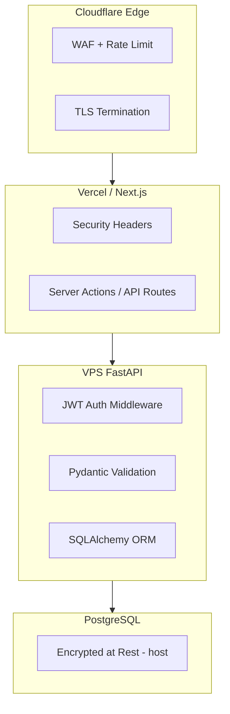
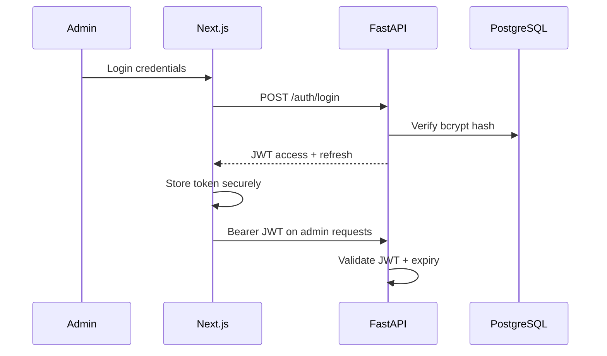

# Security Architecture

| Field | Value |
|-------|-------|
| **Document ID** | ARCH-SEC-001 |
| **Product** | Founder Portfolio Platform (FounderOS v1.0) |
| **Status** | Approved |
| **Last Updated** | 2026-06-29 |
| **Owner** | Engineering & Security |
| **Related** | [System Architecture](./System_Architecture.md) · [Authentication](../06_Modules/Authentication.md) · [Authentication API](../08_API/Authentication_API.md) |

---

## Purpose

Define the security architecture for FounderOS v1.0 — threat model, authentication and authorization, transport security, input validation, secrets management, and edge protection across Next.js 15 frontend, FastAPI backend, and PostgreSQL.

---

## Scope

| In Scope | Out of Scope |
|----------|--------------|
| JWT admin authentication | SOC 2 certification process |
| Public vs. protected API routes | Penetration test execution |
| CORS, rate limiting, WAF | Bug bounty program |
| Secrets and environment config | Hardware security modules |
| Input validation (Pydantic) | Multi-tenant isolation (v2.0) |
| HTTPS/TLS everywhere | PCI DSS (no payment in v1.0) |
| OWASP Top 10 mitigations | |

---

## Business Context

FounderOS handles **inquiry data**, **admin credentials**, and **proprietary content**. Enterprise buyers and acquisition due diligence expect documented security controls. A portfolio breach destroys founder credibility.

---

## Goals

1. **Confidentiality** — Admin and inquiry data accessible only to authorized users.
2. **Integrity** — Content mutations authenticated and validated.
3. **Availability** — Rate limiting and WAF protect against abuse.
4. **Auditability** — Auth events and admin actions logged.

---

## Functional Requirements

| ID | Requirement | Priority |
|----|-------------|----------|
| FR-SEC-001 | Admin API routes SHALL require valid JWT Bearer token | P0 |
| FR-SEC-002 | Passwords SHALL be hashed with bcrypt | P0 |
| FR-SEC-003 | All production traffic SHALL use HTTPS | P0 |
| FR-SEC-004 | CORS SHALL whitelist configured origins only | P0 |
| FR-SEC-005 | Public forms SHALL be rate limited per IP | P0 |
| FR-SEC-006 | All API inputs SHALL validate via Pydantic schemas | P0 |
| FR-SEC-007 | Secrets SHALL NOT be committed to version control | P0 |
| FR-SEC-008 | SQL SHALL use parameterized queries (SQLAlchemy ORM) | P0 |
| FR-SEC-009 | Security headers SHALL be set (CSP, X-Frame-Options, etc.) | P1 |
| FR-SEC-010 | JWT SHALL expire; refresh token flow documented | P0 |

---

## Non-functional Requirements

| ID | Requirement | Target |
|----|-------------|--------|
| NFR-SEC-001 | JWT access token TTL | 15–60 minutes |
| NFR-SEC-002 | Rate limit (contact form) | 5 req/min/IP |
| NFR-SEC-003 | Password minimum length | 12 characters |
| NFR-SEC-004 | Failed login lockout | 5 attempts / 15 min |

---

## User Stories

| ID | As a… | I want… | So that… |
|----|-------|---------|----------|
| US-SEC-001 | Admin | secure login | Only I manage content |
| US-SEC-002 | Visitor | my inquiry data protected | I trust the platform |
| US-SEC-003 | DevOps | secrets in env vars | Keys aren't leaked |

---

## UX Requirements

Security controls must be invisible to legitimate users: no CAPTCHA on first contact attempt, progressive rate limiting on abuse. Admin session timeout shows clear re-auth dialog per [Dialogs.md](../03_Design_System/Dialogs.md). Form validation errors must not leak system information.

---

## Architecture

### Security Layers

### Authentication Flow

### Route Classification

| Class | Examples | Auth |
|-------|----------|------|
| Public read | GET /products, /blog | None |
| Public write | POST /contact | Rate limit + validation |
| Admin read | GET /admin/* | JWT |
| Admin write | POST/PUT/DELETE content | JWT + RBAC (v1.0 basic) |

### Threat Mitigation Matrix

| Threat | Mitigation |
|--------|------------|
| SQL Injection | ORM + parameterized queries |
| XSS | React escaping; sanitize CMS HTML |
| CSRF | SameSite cookies; origin checks |
| Brute force | Rate limit + lockout |
| JWT theft | Short TTL; httpOnly storage preferred |
| DDoS | Cloudflare WAF + rate limits |
| Secret leak | .env gitignore; secret scanning CI |

---

## Technical Considerations

| Topic | Implementation |
|-------|----------------|
| **FastAPI** | `Depends(get_current_user)` on protected routes |
| **Next.js** | Middleware for admin route protection |
| **PostgreSQL** | Least-privilege DB user for app |
| **Redis** | Rate limit counters |
| **Cloudflare** | Managed rules, bot fight mode |

---

## Security Considerations

This document IS the security specification. Additional controls:

| Control | Detail |
|---------|--------|
| Dependency scanning | Dependabot or Snyk in CI |
| Container images | Pin versions; non-root user |
| Backup encryption | VPS provider or pg_dump encrypted |
| Admin session | Logout invalidates client token |

---

## Acceptance Criteria

- [ ] All admin routes return 401 without valid JWT
- [ ] CORS rejects unauthorized origins in production
- [ ] Contact form rate limiting active
- [ ] No secrets in repository history
- [ ] Security headers verified on production deploy
- [ ] Password hashing uses bcrypt
- [ ] OWASP Top 10 checklist reviewed

---

## Future Enhancements

| Enhancement | Target |
|-------------|--------|
| MFA for admin | v1.5 |
| RBAC granular permissions | v1.5 |
| OAuth admin login | v2.0 |
| Row-level tenant isolation | v2.0 |
| WAF custom rules per tenant | v2.0 |

---

## Open Questions

| ID | Question | Owner | Status |
|----|----------|-------|--------|
| OQ-SEC-001 | httpOnly cookie vs. memory JWT for admin? | Backend | Open |
| OQ-SEC-002 | CSP strictness vs. third-party embeds? | Security | Open |
| OQ-SEC-003 | VPAT / security questionnaire template for enterprise? | Business | Open |

---

## Related Documents

- [System Architecture](./System_Architecture.md)
- [API Architecture](./API_Architecture.md)
- [Deployment Architecture](./Deployment_Architecture.md)
- [Authentication](../06_Modules/Authentication.md)
- [Authentication API](../08_API/Authentication_API.md)
- [Observability](./Observability.md)
