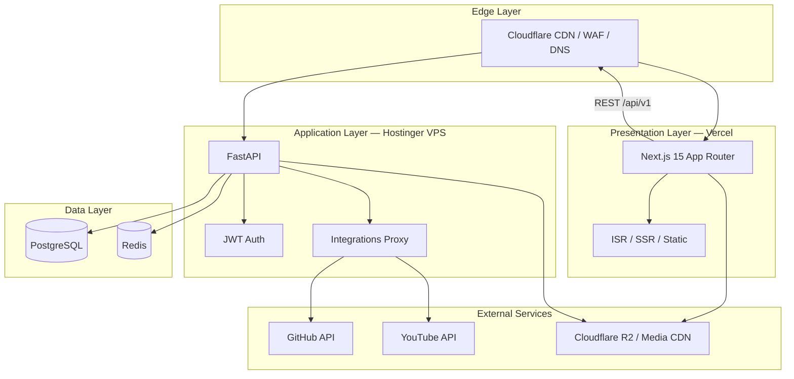
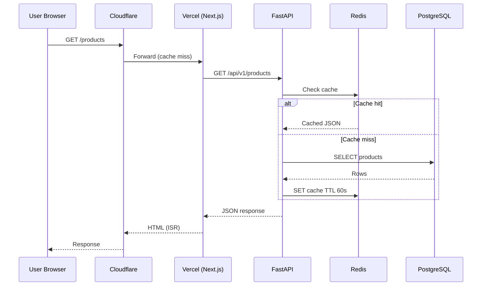
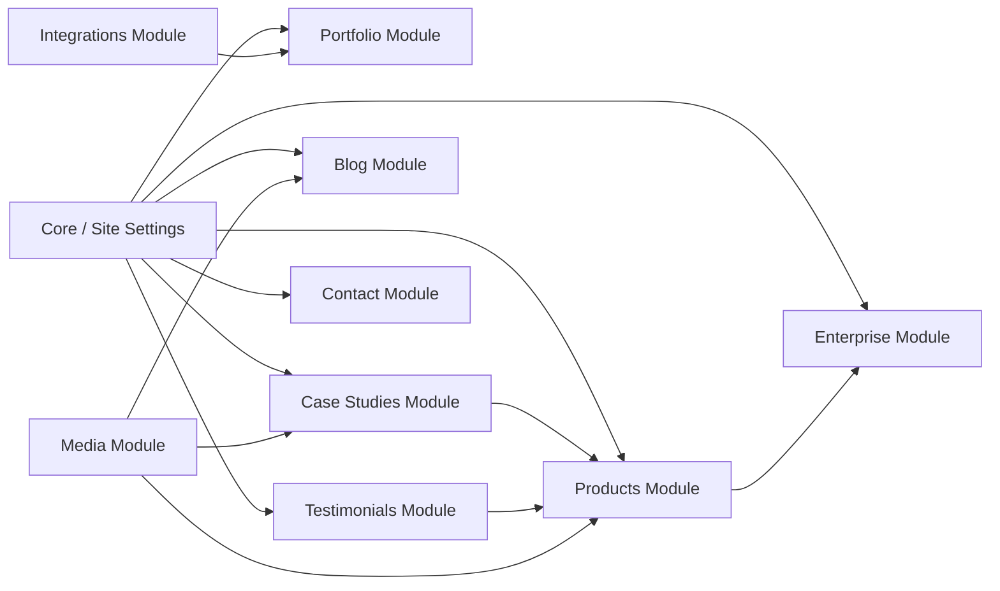

# System Architecture

| Field | Value |
|-------|-------|
| **Document ID** | ARCH-001 |
| **Product** | Founder Portfolio Platform (FounderOS v1.0) |
| **Status** | Approved |
| **Last Updated** | 2026-06-29 |
| **Related** | [Frontend Architecture](./Frontend_Architecture.md) · [Backend Architecture](./Backend_Architecture.md) · [Deployment Architecture](./Deployment_Architecture.md) |

---

## Purpose

Define the end-to-end system architecture for FounderOS v1.0 — a modular, white-label founder portfolio and commercial SaaS platform. This document is the authoritative reference for how frontend, backend, data, caching, media, security, and deployment layers interact.

## Scope

| In Scope | Out of Scope |
|----------|--------------|
| Logical and physical system topology | Vendor contract negotiations |
| Layer boundaries and data flows | Application source code |
| Integration points (Cloudflare, Vercel, VPS) | Multi-tenant SaaS implementation (v2.0) |
| Cross-cutting concerns (auth, cache, media) | Mobile native applications |
| Module dependency graph | Third-party CMS (Headless WordPress, etc.) |

## Business Context

FounderOS serves founders, SaaS companies, and agencies who need a **commercial-grade digital identity** — not a personal blog. The platform must simultaneously:

1. **Market products** (licensing, acquisition, enterprise sales).
2. **Establish credibility** (portfolio, case studies, testimonials).
3. **Drive inbound leads** (contact, enterprise, acquisition portals).
4. **Support content marketing** (blog, travel, media, open source).

The architecture must support **white-label reuse** — swap branding, content, and configuration without structural changes — and a path to **multi-tenant SaaS** commercialization.

## Goals

1. **Separation of concerns** — Presentation (Next.js), API (FastAPI), persistence (PostgreSQL), cache (Redis).
2. **Edge-first delivery** — Static/ISR pages on Vercel + Cloudflare CDN for global latency &lt; 200ms TTFB.
3. **API-first content** — All dynamic content served via versioned REST API (`/api/v1`).
4. **Operational simplicity** — Docker Compose for local dev; VPS + managed services for production.
5. **Security by design** — JWT admin auth, CORS, rate limiting, WAF at edge.
6. **Observable operations** — Health checks, structured logging, metrics hooks.

## Functional Requirements

| ID | Requirement | Priority |
|----|-------------|----------|
| FR-SYS-001 | Public pages render via Next.js 15 App Router with SSR/ISR | P0 |
| FR-SYS-002 | Dynamic content fetched from FastAPI REST API | P0 |
| FR-SYS-003 | Admin mutations require JWT authentication | P0 |
| FR-SYS-004 | Contact and inquiry forms persist to PostgreSQL | P0 |
| FR-SYS-005 | GitHub and YouTube integrations proxy through backend | P1 |
| FR-SYS-006 | Site settings (branding, founder info) configurable via CMS | P0 |
| FR-SYS-007 | Media assets served via CDN with optimized delivery | P1 |
| FR-SYS-008 | Legal pages (privacy, terms, cookies) statically renderable | P0 |

## Non-functional Requirements

| ID | Requirement | Target |
|----|-------------|--------|
| NFR-SYS-001 | Availability (public site) | 99.9% monthly |
| NFR-SYS-002 | API p95 latency | &lt; 300ms |
| NFR-SYS-003 | Page LCP (mobile) | &lt; 2.5s |
| NFR-SYS-004 | Concurrent users (v1.0) | 1,000 simultaneous |
| NFR-SYS-005 | RTO (disaster recovery) | &lt; 4 hours |
| NFR-SYS-006 | RPO (data loss) | &lt; 1 hour |
| NFR-SYS-007 | Horizontal scale path | Documented in [Scalability](./Scalability.md) |

## User Stories

| ID | As a… | I want… | So that… |
|----|-------|---------|----------|
| US-SYS-001 | Visitor | fast page loads globally | I engage with content without friction |
| US-SYS-002 | Founder (admin) | a single CMS/API to manage all content | I don't maintain multiple systems |
| US-SYS-003 | Enterprise buyer | reliable contact/inquiry submission | my acquisition interest is captured |
| US-SYS-004 | DevOps engineer | health endpoints and containerized deploy | I can monitor and roll back safely |
| US-SYS-005 | White-label licensee | swappable branding via site settings | I deploy my own founder brand |

## UX Requirements

- **Perceived performance**: Skeleton loaders on data-dependent sections; no layout shift (CLS &lt; 0.1).
- **Graceful degradation**: API failures show cached/stale content or empty states — never a blank page.
- **Consistent shell**: Header, footer, skip-link, and dark theme applied globally via root layout.
- **Motion**: Framer Motion animations respect `prefers-reduced-motion`.

## Technical Considerations

### High-Level Architecture

### Request Flow (Public Page)

### Module Dependency Graph

### Technology Stack

| Layer | Technology | Role |
|-------|------------|------|
| Frontend | Next.js 15, TypeScript, TailwindCSS, shadcn/ui, Framer Motion | UI, SSR/ISR, SEO |
| Backend | FastAPI, Python 3.12+, SQLAlchemy | REST API, business logic |
| Database | PostgreSQL 16 | Primary persistence |
| Cache | Redis 7 | API response cache, rate limiting |
| Containers | Docker, Docker Compose | Local dev, VPS deployment |
| CDN / Edge | Cloudflare | DNS, WAF, CDN, R2 media |
| Frontend Host | Vercel | Next.js deployment, preview envs |
| Backend Host | Hostinger VPS | API, PostgreSQL, Redis |

## Security Considerations

See [Security Architecture](./Security_Architecture.md) for full detail. System-level controls:

| Control | Implementation |
|---------|----------------|
| Transport | TLS 1.2+ everywhere (Cloudflare → Vercel → VPS) |
| Authentication | JWT Bearer tokens for admin routes |
| Authorization | Route-level `Depends(get_current_user)` |
| CORS | Whitelist `CORS_ORIGINS` per environment |
| Secrets | Environment variables; never committed |
| WAF | Cloudflare managed rules + rate limiting |
| Input validation | Pydantic schemas on all API inputs |

## Acceptance Criteria

- [ ] Architecture diagram reviewed and approved by engineering lead.
- [ ] All layers documented with cross-links to child architecture docs.
- [ ] Request flow covers cache hit and miss paths.
- [ ] Module dependency graph matches [05_Pages](../05_Pages/Home.md) module references.
- [ ] NFR targets are measurable via [Observability](./Observability.md) tooling.
- [ ] White-label deployment path documented without code changes to core.

## Future Enhancements

| Enhancement | Target Version | Reference |
|-------------|----------------|-----------|
| Multi-tenant row-level isolation | v2.0 | [Scalability](./Scalability.md) |
| GraphQL or tRPC API layer | v2.1 | [API Architecture](./API_Architecture.md) |
| Event-driven architecture (webhooks, queues) | v2.0 | — |
| Kubernetes orchestration | v2.0 | [Deployment Architecture](./Deployment_Architecture.md) |
| Read replicas for PostgreSQL | v1.5 | [Database Architecture](./Database_Architecture.md) |

## Open Questions

| ID | Question | Owner | Status |
|----|----------|-------|--------|
| OQ-SYS-001 | Should Redis be mandatory in v1.0 production or optional with in-memory fallback? | Backend Lead | Open |
| OQ-SYS-002 | Single VPS vs. split DB on managed PostgreSQL (e.g., Neon, Supabase)? | DevOps | Open |
| OQ-SYS-003 | Cloudflare R2 vs. Vercel Blob for media storage default? | Architecture | Open |
| OQ-SYS-004 | API gateway (Kong/Traefik) on VPS for v1.0 or defer to v2.0? | DevOps | Open |

---

## Related Documents

- [Frontend Architecture](./Frontend_Architecture.md)
- [Backend Architecture](./Backend_Architecture.md)
- [Database Architecture](./Database_Architecture.md)
- [API Architecture](./API_Architecture.md)
- [Caching Strategy](./Caching_Strategy.md)
- [Security Architecture](./Security_Architecture.md)
- [Deployment Architecture](./Deployment_Architecture.md)
- [Folder Structure](./Folder_Structure.md)
- [Home Page Spec](../05_Pages/Home.md)
