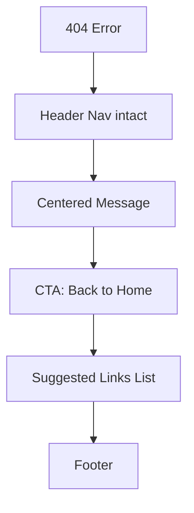

# 404 Not Found Page

| Field | Value |
|-------|-------|
| **Route** | `not-found` (Next.js) |
| **Document ID** | PAGE-404-001 |
| **Product** | Founder Portfolio Platform (FounderOS v1.0) |
| **Status** | Approved for Implementation |
| **Last Updated** | 2026-06-29 |
| **Owner** | Product & UX |
| **Related** | [Navigation](../02_UX/Navigation.md) · [Sitemap](../02_UX/Sitemap.md) · [Home](./Home.md) |

---

## Purpose

Specify the 404 Not Found page — user-friendly error experience when routes or content slugs do not exist — maintaining brand consistency and offering recovery paths to key destinations.

---

## Scope

### In Scope

| Feature | Priority |
|---------|----------|
| Branded 404 message | P0 |
| Link to Home | P0 |
| Suggested links (Products, Contact) | P0 |
| HTTP 404 status | P0 |
| Consistent header/footer | P0 |
| Optional search (future) | P2 |

### Out of Scope

| Area | Rationale |
|------|-----------|
| Custom 500 page | Separate error boundary |
| Redirect rules engine | Server/nginx config |

---

## Business Context

Broken links happen from old URLs, typos, and unpublished content. A polished 404 prevents **dead ends** and preserves trust during due diligence browsing.

---

## Goals

| # | Goal | Metric |
|---|------|--------|
| G1 | Recovery click rate | &gt; 50% leave via suggested link |
| G2 | Bounce without navigation | &lt; 30% |
| G3 | Correct HTTP status | 404 not 200 |

---

## Functional Requirements

| ID | Requirement | Priority |
|----|-------------|----------|
| FR-404-01 | Unknown routes SHALL render `not-found.tsx` | P0 |
| FR-404-02 | Response SHALL return HTTP 404 status | P0 |
| FR-404-03 | Page SHALL include site header and footer | P0 |
| FR-404-04 | H1 SHALL indicate page not found clearly | P0 |
| FR-404-05 | Primary CTA SHALL link to Home | P0 |
| FR-404-06 | Secondary links to Products, Contact, Blog | P1 |
| FR-404-07 | Unpublished slug routes SHALL trigger 404 | P0 |
| FR-404-08 | Page SHALL NOT be in sitemap | P0 |

---

## Non-functional Requirements

| ID | Requirement | Target |
|----|-------------|--------|
| NFR-404-01 | Load time | Static instant |
| NFR-404-02 | Accessibility | Clear heading; focus on H1 |

---

## User Stories

| ID | As a… | I want to… | So that… |
|----|-------|------------|----------|
| US-404-01 | Visitor | know page doesn't exist | I'm not confused |
| US-404-02 | Visitor | find way back to site | I continue browsing |

---

## UX Requirements

### Content

| Element | Copy Guidance |
|---------|---------------|
| H1 | "Page not found" or "404 — Page not found" |
| Body | Brief, helpful — "The page you're looking for doesn't exist or was moved." |
| Primary CTA | "Back to Home" — [Buttons](../03_Design_System/Buttons.md) default |
| Suggested links | Products, Blog, Contact, Enterprise |

### Visual Treatment

| Aspect | Spec |
|--------|------|
| Illustration | Optional subtle icon (`FileQuestion` from [Icons](../03_Design_System/Icons.md)) |
| Layout | Centered vertically in main |
| Tone | Neutral, not humorous (enterprise) |

---

## SEO Requirements

| Field | Policy |
|-------|--------|
| Title | `Page Not Found — {Site Name}` |
| Robots | noindex |
| HTTP Status | **404** (critical) |

---

## Technical Considerations

| Topic | Guidance |
|-------|----------|
| **Next.js 15** | `app/not-found.tsx` global; `notFound()` in dynamic routes |
| **Metadata** | `robots: { index: false }` |
| **Logging** | Log 404 paths in [Observability](../04_Architecture/Observability.md) for broken link detection |

---

## Security Considerations

404 pages must not leak whether admin routes exist; uniform message for all missing paths.

---

## Acceptance Criteria

- [ ] Random URL returns 404 status
- [ ] Unpublished blog/product slug returns 404
- [ ] Header/footer present
- [ ] Home CTA works
- [ ] Suggested links functional
- [ ] noindex meta set
- [ ] Accessible H1 and focus management

---

## Future Enhancements

| Enhancement | Notes |
|-------------|-------|
| Site search on 404 | Find content |
| "Report broken link" | Feedback form |
| Smart suggestions from path | Guess intent |

---

## Open Questions

| ID | Question | Owner | Status |
|----|----------|-------|--------|
| OQ-404-001 | Custom illustration per tenant? | Design | Open |

---

## Related Documents

- [Home](./Home.md)
- [Sitemap](../02_UX/Sitemap.md)
- [Navigation](../02_UX/Navigation.md)
- [Frontend Architecture](../04_Architecture/Frontend_Architecture.md)
- [Canonical](../10_SEO/Canonical.md)
