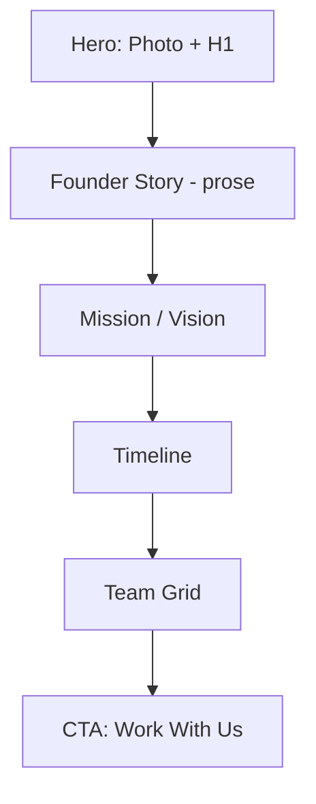

# About Page

| Field | Value |
|-------|-------|
| **Route** | `/about` |
| **Document ID** | PAGE-ABOUT-001 |
| **Product** | Founder Portfolio Platform (FounderOS v1.0) |
| **Status** | Approved for Implementation |
| **Last Updated** | 2026-06-29 |
| **Owner** | Product & UX |
| **Related** | [CMS](../06_Modules/CMS.md) · [Content Strategy](../02_UX/Content_Strategy.md) · [Portfolio](./Portfolio.md) |

---

## Purpose

Specify the About page — founder story, mission, team, timeline, and credibility signals — establishing trust for investors, partners, and enterprise buyers evaluating FounderOS tenants.

---

## Scope

### In Scope

| Section | CMS-Driven |
|---------|------------|
| Founder bio and photo | Yes |
| Company mission/vision | Yes |
| Team members (optional) | Yes |
| Timeline/milestones | Yes |
| Values or principles | Yes |
| Link to portfolio | Partial |
| Press/media mentions | P1 |

### Out of Scope

| Area | Rationale |
|------|-----------|
| Full portfolio grid | [Portfolio](./Portfolio.md) |
| Job listings | Future careers page |

---

## Business Context

Due diligence often lands on **About** after Home. Investors assess founder credibility, domain expertise, and company narrative. Content follows [Content Strategy](../02_UX/Content_Strategy.md) voice guidelines.

---

## Goals

| # | Goal | Metric |
|---|------|--------|
| G1 | Time on page | &gt; 90 seconds |
| G2 | Click-through to Portfolio or Contact | &gt; 15% |
| G3 | Unique founder narrative | Not generic template copy |

---

## Functional Requirements

| ID | Requirement | Priority |
|----|-------------|----------|
| FR-ABOUT-01 | Page SHALL display founder H1 and professional photo | P0 |
| FR-ABOUT-02 | Bio SHALL support rich text from CMS | P0 |
| FR-ABOUT-03 | Mission section SHALL be editable | P0 |
| FR-ABOUT-04 | Timeline SHALL display ordered milestones | P1 |
| FR-ABOUT-05 | Team grid SHALL show name, role, photo, optional LinkedIn | P1 |
| FR-ABOUT-06 | CTA to Contact or Portfolio at page end | P0 |
| FR-ABOUT-07 | ISR with 3600s revalidation | P0 |

---

## Non-functional Requirements

| ID | Requirement | Target |
|----|-------------|--------|
| NFR-ABOUT-01 | Prose readability | `max-w-3xl` for bio |
| NFR-ABOUT-02 | Image optimization | WebP via CDN |

---

## User Stories

| ID | As a… | I want to… | So that… |
|----|-------|------------|----------|
| US-ABOUT-01 | Investor | read founder background | I assess team fit |
| US-ABOUT-02 | Partner | understand company mission | I evaluate alignment |
| US-ABOUT-03 | Job candidate | see team culture | I explore opportunities |

---

## UX Requirements

### Layout

### Section Details

| Section | Typography | Notes |
|---------|------------|-------|
| Hero | H1 founder name | Photo aspect 1:1 or 4:5 |
| Story | Prose body | First-person or company voice per tenant |
| Timeline | Vertical list with year badges | [Badges](../03_Design_System/Feedback_Components.md) |
| Team | 2–4 col card grid | Optional social links |

---

## SEO Requirements

| Field | Template |
|-------|----------|
| Title | `About {Founder/Company Name}` |
| Description | First 160 chars of bio or custom meta |
| Structured data | `Person` or `Organization` |

---

## Technical Considerations

| Topic | Guidance |
|-------|----------|
| **API** | `GET /api/v1/settings/founder`, team endpoint |
| **CMS** | Site settings + team entity |

---

## Security Considerations

Public page; sanitize rich text from CMS.

---

## Acceptance Criteria

- [ ] Founder bio and photo from CMS
- [ ] Timeline renders in chronological order
- [ ] Team section optional (hidden if empty)
- [ ] CTA links to Contact
- [ ] SEO metadata and structured data present
- [ ] Accessible images with alt text

---

## Future Enhancements

| Enhancement | Notes |
|-------------|-------|
| Advisor board section | Credibility |
| Company stats (founded, employees) | Dynamic from settings |

---

## Open Questions

| ID | Question | Owner | Status |
|----|----------|-------|--------|
| OQ-ABOUT-001 | Founder first-person vs. third-person bio? | Content | Open |

---

## Related Documents

- [Home](./Home.md)
- [Portfolio](./Portfolio.md)
- [Contact](./Contact.md)
- [Testimonials](./Testimonials.md)
- [Content Strategy](../02_UX/Content_Strategy.md)
