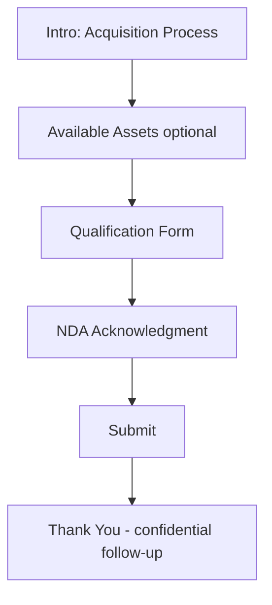

# Acquisition Page

| Field | Value |
|-------|-------|
| **Route** | `/acquisition` |
| **Document ID** | PAGE-ACQ-001 |
| **Product** | Founder Portfolio Platform (FounderOS v1.0) |
| **Status** | Approved for Implementation |
| **Last Updated** | 2026-06-29 |
| **Owner** | Product & UX |
| **Related** | [Enterprise](./Enterprise.md) · [Products](./Products.md) · [Contact](./Contact.md) |

---

## Purpose

Specify the Acquisition portal page — structured funnel for M&A interest, strategic acquisitions, and asset purchases — capturing qualified leads for founders open to selling products or companies.

---

## Scope

### In Scope

| Feature | Priority |
|---------|----------|
| Acquisition overview copy | P0 |
| Qualification form | P0 |
| Product/company asset listing | P1 |
| NDA acknowledgment checkbox | P1 |
| Confidential submission handling | P0 |
| Link from Enterprise page | P0 |

### Out of Scope

| Area | Rationale |
|------|-----------|
| Virtual data room | v2.0 |
| Automated valuation | Not in scope |

---

## Business Context

Some FounderOS tenants market **acquisition readiness**. This page must feel discreet and professional — distinct from general [Contact](./Contact.md) while sharing backend inquiry infrastructure.

---

## Goals

| # | Goal | Metric |
|---|------|--------|
| G1 | Qualified acquisition inquiries | Track monthly |
| G2 | Form completion | &gt; 40% of starters |
| G3 | Spam rate | &lt; 2% |

---

## Functional Requirements

| ID | Requirement | Priority |
|----|-------------|----------|
| FR-ACQ-01 | Page SHALL explain acquisition/licensing interest process | P0 |
| FR-ACQ-02 | Form SHALL collect acquirer company, type, budget range, timeline | P0 |
| FR-ACQ-03 | Inquiry type SHALL be `acquisition` in database | P0 |
| FR-ACQ-04 | NDA acknowledgment checkbox required before submit | P1 |
| FR-ACQ-05 | Assets available MAY list products open for acquisition | P1 |
| FR-ACQ-06 | Admin notification priority flag for acquisition leads | P1 |
| FR-ACQ-07 | Page MAY be unlisted in nav but linked from Enterprise | P0 |

---

## Non-functional Requirements

| ID | Requirement | Target |
|----|-------------|--------|
| NFR-ACQ-01 | Confidentiality messaging | Clear data handling statement |
| NFR-ACQ-02 | Form fields | ≤ 10 to reduce abandonment |

---

## User Stories

| ID | As a… | I want to… | So that… |
|----|-------|------------|----------|
| US-ACQ-01 | Acquirer | express interest formally | Founder receives qualified lead |
| US-ACQ-02 | Founder | filter serious inquiries | I don't waste time on spam |
| US-ACQ-03 | Corp dev | see available assets | I assess targets |

---

## UX Requirements

### Form Fields

| Field | Type | Required |
|-------|------|----------|
| Acquirer Name | text | Yes |
| Work Email | email | Yes |
| Company | text | Yes |
| Acquisition Type | select: Full, Partial, IP, Talent | Yes |
| Target Product/Asset | select/text | P1 |
| Budget Range | select | Yes |
| Timeline | select | Yes |
| Message | textarea | Yes |
| NDA Acknowledgment | checkbox | P1 |

### Tone

Formal, confidential, minimal marketing fluff per [Content Strategy](../02_UX/Content_Strategy.md).

---

## SEO Requirements

| Field | Policy |
|-------|--------|
| Title | `Acquisition — {Site Name}` |
| Robots | `noindex` optional — tenant configurable |
| Description | Generic or omitted if noindex |

Some tenants prefer **not indexed** for discretion — site setting `acquisition_indexable`.

---

## Technical Considerations

| Topic | Guidance |
|-------|----------|
| **API** | Contact/inquiry endpoint with `type=acquisition` |
| **Admin** | Priority queue in inquiry list |
| **Email** | High-priority notification to founder |

---

## Security Considerations

Stricter rate limiting; work email validation; inquiries not publicly listable; access admin-only.

---

## Acceptance Criteria

- [ ] Acquisition form submits with correct type
- [ ] NDA checkbox enforced when enabled
- [ ] Enterprise page links here
- [ ] Admin sees acquisition flag
- [ ] noindex setting respected
- [ ] Thank you message sets expectation for confidential follow-up

---

## Future Enhancements

| Enhancement | Notes |
|-------------|-------|
| Secure document upload | NDA-gated VDR |
| Anonymous inquiry option | Privacy mode |

---

## Open Questions

| ID | Question | Owner | Status |
|----|----------|-------|--------|
| OQ-ACQ-001 | Default noindex for acquisition page? | Product — yes | Open |
| OQ-ACQ-002 | Public asset listing vs. form-only? | Legal | Open |

---

## Related Documents

- [Enterprise](./Enterprise.md)
- [Contact](./Contact.md)
- [Products](./Products.md)
- [Product Details](./Product_Details.md)
- [Security Architecture](../04_Architecture/Security_Architecture.md)
