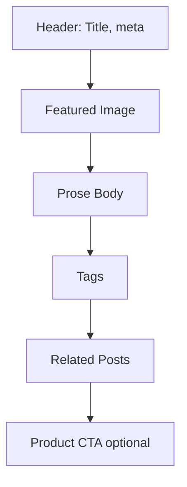

# Blog Page

| Field | Value |
|-------|-------|
| **Route** | `/blog`, `/blog/[slug]` |
| **Document ID** | PAGE-BLOG-001 |
| **Product** | Founder Portfolio Platform (FounderOS v1.0) |
| **Status** | Approved for Implementation |
| **Last Updated** | 2026-06-29 |
| **Owner** | Product & UX |
| **Related** | [Blog Manager](../06_Modules/Blog_Manager.md) · [Blog API](../08_API/Blog_API.md) · [Metadata](../10_SEO/Metadata.md) |

---

## Purpose

Specify the Blog listing and article detail pages — content marketing hub for thought leadership, SEO, and product education — with categories, tags, and author attribution.

---

## Scope

### In Scope

| Route | Purpose |
|-------|---------|
| `/blog` | Post listing with pagination |
| `/blog/[slug]` | Article detail |
| Category filter | `/blog?category=` |
| RSS feed | P1 |

### Out of Scope

| Area | Rationale |
|------|-----------|
| Comments | v2.0 |
| Newsletter signup inline | [Newsletter module](../06_Modules/) |

---

## Business Context

Blog drives **organic traffic** and nurtures buyers through the funnel defined in [Content Strategy](../02_UX/Content_Strategy.md). Posts should link contextually to [Products](./Products.md).

---

## Goals

| # | Goal | Metric |
|---|------|--------|
| G1 | Organic search traffic growth | Month-over-month |
| G2 | Average time on article | &gt; 3 minutes |
| G3 | Internal link to products | ≥ 1 per relevant post |

---

## Functional Requirements

| ID | Requirement | Priority |
|----|-------------|----------|
| FR-BLOG-01 | Listing SHALL show posts reverse chronological | P0 |
| FR-BLOG-02 | Pagination SHALL be 10 posts per page | P0 |
| FR-BLOG-03 | Detail SHALL render markdown/HTML body with prose styles | P0 |
| FR-BLOG-04 | Detail SHALL show author, date, reading time | P0 |
| FR-BLOG-05 | Category and tag filters on listing | P1 |
| FR-BLOG-06 | Related posts at article end | P1 |
| FR-BLOG-07 | Draft posts SHALL 404 publicly | P0 |
| FR-BLOG-08 | `lastmod` in sitemap from `updated_at` | P0 |

---

## Non-functional Requirements

| ID | Requirement | Target |
|----|-------------|--------|
| NFR-BLOG-01 | Article LCP | &lt; 2.5s |
| NFR-BLOG-02 | Code syntax highlighting | Dark theme compatible |

---

## User Stories

| ID | As a… | I want to… | So that… |
|----|-------|------------|----------|
| US-BLOG-01 | Reader | find articles by topic | I learn efficiently |
| US-BLOG-02 | Founder | publish thought leadership | I build audience |
| US-BLOG-03 | SEO lead | optimized article metadata | We rank for keywords |

---

## UX Requirements

### Listing

| Element | Spec |
|---------|------|
| Layout | Card list or 2-col grid |
| Card | Featured image, title, excerpt, date, category |
| Sidebar (desktop) | Categories, recent posts (P1) |

### Article Detail

Typography per [Typography System](../03_Design_System/Typography_System.md) prose classes.

---

## SEO Requirements

| Field | Source |
|-------|--------|
| Title | `{Post Title} — {Site Name}` |
| Description | Post excerpt or custom meta |
| OG | `article` type with published_time |
| Structured data | `BlogPosting` |
| Canonical | `/blog/{slug}` |

See [OpenGraph](../10_SEO/OpenGraph.md), [Twitter Cards](../10_SEO/Twitter_Cards.md).

---

## Technical Considerations

| Topic | Guidance |
|-------|----------|
| **API** | [Blog API](../08_API/Blog_API.md) |
| **ISR** | Revalidate on publish webhook |
| **RSS** | `/blog/rss.xml` route |

---

## Security Considerations

Sanitize HTML body; no script tags from CMS.

---

## Acceptance Criteria

- [ ] Listing paginates correctly
- [ ] Article prose styled light/dark
- [ ] Author and date displayed
- [ ] Draft returns 404
- [ ] BlogPosting schema validates
- [ ] Related posts shown

---

## Future Enhancements

| Enhancement | Notes |
|-------------|-------|
| Full-text search | Site search module |
| Series/collections | Multi-part content |
| AI summary meta | SEO experiment |

---

## Open Questions

| ID | Question | Owner | Status |
|----|----------|-------|--------|
| OQ-BLOG-001 | MDX support for interactive embeds? | Engineering | Open |

---

## Related Documents

- [Case Studies](./Case_Studies.md)
- [Home](./Home.md)
- [Blog Manager](../06_Modules/Blog_Manager.md)
- [Sitemap](../10_SEO/Sitemap.md)
