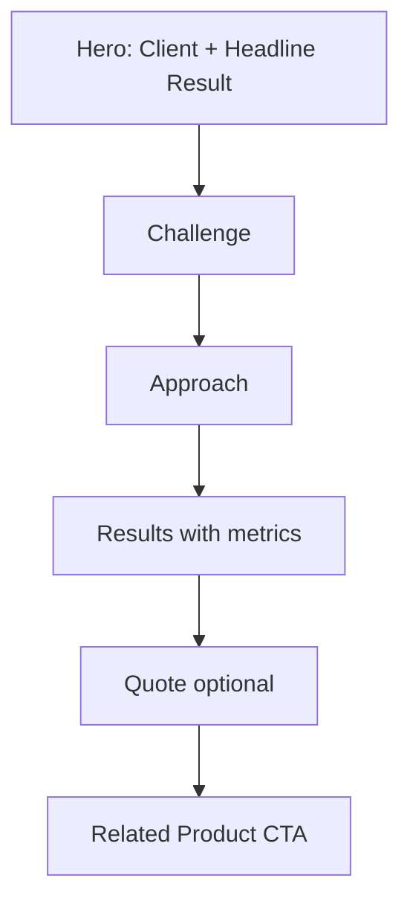

# Case Studies Page

| Field | Value |
|-------|-------|
| **Route** | `/case-studies` |
| **Document ID** | PAGE-CS-001 |
| **Product** | Founder Portfolio Platform (FounderOS v1.0) |
| **Status** | Approved for Implementation |
| **Last Updated** | 2026-06-29 |
| **Owner** | Product & UX |
| **Related** | [Blog](./Blog.md) · [Products](./Products.md) · [Content Strategy](../02_UX/Content_Strategy.md) |

---

## Purpose

Specify the Case Studies listing and detail experience — proof-of-outcome narratives linking products to real results — supporting enterprise sales and investor due diligence.

---

## Scope

### In Scope

| Route | Purpose |
|-------|---------|
| `/case-studies` | Listing grid |
| `/case-studies/[slug]` | Detail article |

### Out of Scope

| Area | Rationale |
|------|-----------|
| PDF export | v1.1 |
| Gated content | v2.0 lead magnets |

---

## Business Context

Case studies answer **"does it work?"** with measurable outcomes. Structure follows Challenge → Approach → Results per [Content Strategy](../02_UX/Content_Strategy.md).

---

## Goals

| # | Goal | Metric |
|---|------|--------|
| G1 | Detail page read-through | &gt; 50% |
| G2 | Click to related product | &gt; 20% |
| G3 | Measurable results in every study | 100% |

---

## Functional Requirements

| ID | Requirement | Priority |
|----|-------------|----------|
| FR-CS-01 | Listing SHALL show published case studies as cards | P0 |
| FR-CS-02 | Cards SHALL highlight key result metric | P0 |
| FR-CS-03 | Detail SHALL follow narrative sections | P0 |
| FR-CS-04 | Detail SHALL link related product(s) | P0 |
| FR-CS-05 | Detail SHALL include client/industry metadata | P1 |
| FR-CS-06 | Unpublished SHALL 404 | P0 |
| FR-CS-07 | ISR + `generateStaticParams` for slugs | P0 |

---

## Non-functional Requirements

| ID | Requirement | Target |
|----|-------------|--------|
| NFR-CS-01 | Prose reading width | `max-w-3xl` |
| NFR-CS-02 | Listing pagination | 9 per page |

---

## User Stories

| ID | As a… | I want to… | So that… |
|----|-------|------------|----------|
| US-CS-01 | Enterprise buyer | read outcome proof | I justify vendor selection |
| US-CS-02 | Investor | see customer traction | I validate market fit |

---

## UX Requirements

### Listing Layout

| Element | Content |
|---------|---------|
| H1 | Case Studies |
| Card | Client logo, title, result metric, excerpt |
| Filter | Industry or product (P1) |

### Detail Structure

---

## SEO Requirements

| Field | Template |
|-------|----------|
| Listing title | `Case Studies — {Site Name}` |
| Detail title | `{Study Title} — Case Study` |
| Structured data | `Article` with `author` |

---

## Technical Considerations

| Topic | Guidance |
|-------|----------|
| **API** | Case studies endpoint (blog-like entity) |
| **CMS** | Rich text body; featured image |

---

## Security Considerations

Client names may require approval before publish; no confidential data in public fields.

---

## Acceptance Criteria

- [ ] Listing shows all published studies
- [ ] Detail sections render correctly
- [ ] Related product link works
- [ ] Result metric visible on card
- [ ] SEO and breadcrumbs on detail

---

## Future Enhancements

| Enhancement | Notes |
|-------------|-------|
| Download PDF case study | Sales enablement |
| Video testimonial embed | Client proof |

---

## Open Questions

| ID | Question | Owner | Status |
|----|----------|-------|--------|
| OQ-CS-001 | Separate entity vs. blog category? | Engineering | Open |

---

## Related Documents

- [Products](./Products.md)
- [Product Details](./Product_Details.md)
- [Testimonials](./Testimonials.md)
- [Blog](./Blog.md)
- [Blog API](../08_API/Blog_API.md)
