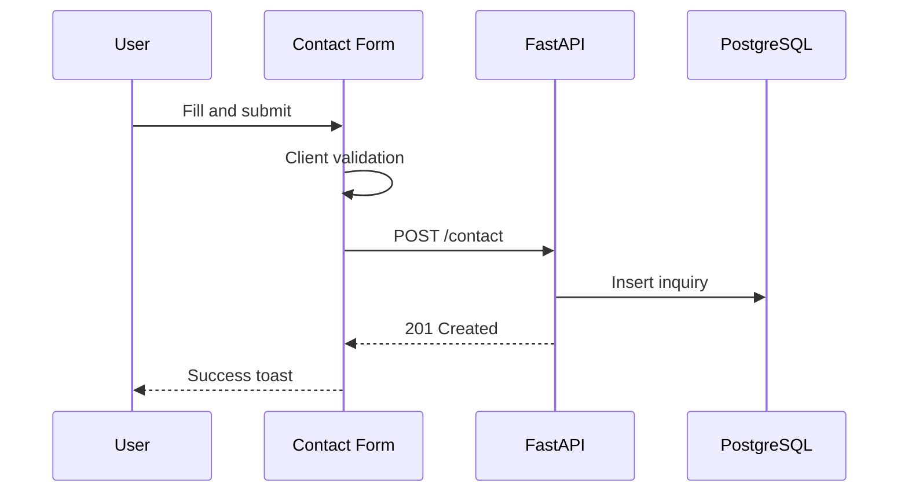

# Contact Page

| Field | Value |
|-------|-------|
| **Route** | `/contact` |
| **Document ID** | PAGE-CONTACT-001 |
| **Product** | Founder Portfolio Platform (FounderOS v1.0) |
| **Status** | Approved for Implementation |
| **Last Updated** | 2026-06-29 |
| **Owner** | Product & UX |
| **Related** | [Forms](../03_Design_System/Forms.md) · [User Flows](../02_UX/User_Flows.md) · [Enterprise](./Enterprise.md) |

---

## Purpose

Specify the Contact page — primary inbound lead capture — with contact form, company information, optional Calendly embed, and persistence to PostgreSQL via FastAPI.

---

## Scope

### In Scope

| Feature | Priority |
|---------|----------|
| Contact form | P0 |
| Form validation | P0 |
| Success/error feedback | P0 |
| Email/address display | P1 |
| Social links | P1 |
| Product context pre-fill | P1 |
| Honeypot spam protection | P1 |

### Out of Scope

| Area | Rationale |
|------|-----------|
| Live chat widget | Third-party v1.1 |
| CRM sync | Webhook v1.1 |

---

## Business Context

Contact is a **P0 conversion endpoint**. Every failed submission is lost revenue. Form design follows [Forms](../03_Design_System/Forms.md) and [Interaction Principles](../02_UX/Interaction_Principles.md).

---

## Goals

| # | Goal | Metric |
|---|------|--------|
| G1 | Form completion rate | &gt; 60% of starters |
| G2 | Submission success rate | &gt; 99% |
| G3 | Spam rate | &lt; 5% of submissions |

---

## Functional Requirements

| ID | Requirement | Priority |
|----|-------------|----------|
| FR-CONTACT-01 | Form SHALL collect name, email, subject, message (min) | P0 |
| FR-CONTACT-02 | Organization field SHALL be optional | P1 |
| FR-CONTACT-03 | Submit SHALL POST to FastAPI contact endpoint | P0 |
| FR-CONTACT-04 | Success SHALL show toast and optional thank-you message | P0 |
| FR-CONTACT-05 | Errors SHALL display inline per field | P0 |
| FR-CONTACT-06 | Query param `?product=` SHALL pre-fill subject | P1 |
| FR-CONTACT-07 | Rate limiting SHALL apply server-side | P0 |
| FR-CONTACT-08 | Honeypot field hidden from users | P1 |

---

## Non-functional Requirements

| ID | Requirement | Target |
|----|-------------|--------|
| NFR-CONTACT-01 | Submit API p95 | &lt; 500ms |
| NFR-CONTACT-02 | Form layout | Single column `max-w-md` |

---

## User Stories

| ID | As a… | I want to… | So that… |
|----|-------|------------|----------|
| US-CONTACT-01 | Prospect | send a message easily | I start a conversation |
| US-CONTACT-02 | Buyer | reference a product in inquiry | Sales has context |
| US-CONTACT-03 | Admin | receive inquiries in dashboard | I respond promptly |

---

## UX Requirements

### Layout

| Section | Content |
|---------|---------|
| Left (desktop) | H1, intro, email, social |
| Right | Contact form |
| Mobile | Stack form below intro |

### Form Fields

See [Forms](../03_Design_System/Forms.md) — default contact field matrix.

---

## SEO Requirements

| Field | Template |
|-------|----------|
| Title | `Contact — {Site Name}` |
| Description | Invitation to get in touch |
| Structured data | `ContactPage` |

---

## Technical Considerations

| Topic | Guidance |
|-------|----------|
| **FastAPI** | Contact API with Pydantic validation |
| **PostgreSQL** | `inquiries` table |
| **Email notification** | Optional SMTP webhook to founder |

---

## Security Considerations

Rate limit 5/min/IP; honeypot; sanitize message body; see [Security Architecture](../04_Architecture/Security_Architecture.md).

---

## Acceptance Criteria

- [ ] Form submits and persists
- [ ] Validation on client and server
- [ ] Success toast displays
- [ ] Rate limiting active
- [ ] Product query param pre-fills subject
- [ ] Accessible form per a11y spec

---

## Future Enhancements

| Enhancement | Notes |
|-------------|-------|
| Calendly inline embed | Schedule call |
| HubSpot/Salesforce webhook | CRM |
| File attachment | RFP uploads |

---

## Open Questions

| ID | Question | Owner | Status |
|----|----------|-------|--------|
| OQ-CONTACT-001 | Email notification on submit? | Product | Open |

---

## Related Documents

- [Enterprise](./Enterprise.md)
- [Acquisition](./Acquisition.md)
- [Forms](../03_Design_System/Forms.md)
- [User Flows](../02_UX/User_Flows.md)
- [Feedback Components](../03_Design_System/Feedback_Components.md)
