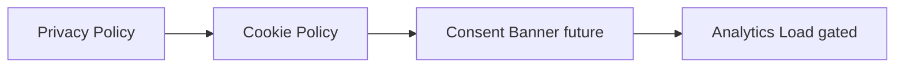

# Cookie Policy Page

| Field | Value |
|-------|-------|
| **Route** | `/legal/cookies` |
| **Document ID** | PAGE-COOKIE-001 |
| **Product** | Founder Portfolio Platform (FounderOS v1.0) |
| **Status** | Approved for Implementation |
| **Last Updated** | 2026-06-29 |
| **Owner** | Legal & Product |
| **Related** | [Privacy](./Privacy.md) · [Terms](./Terms.md) · [Technical SEO](../10_SEO/Technical_SEO.md) |

---

## Purpose

Specify the Cookie Policy page — disclosure of cookies and similar tracking technologies used on FounderOS tenant sites — supporting GDPR/ePrivacy compliance and cookie consent banner integration.

---

## Scope

### In Scope

| Section | Priority |
|---------|----------|
| What cookies are | P0 |
| Cookie categories table | P0 |
| Third-party cookies | P0 |
| How to manage cookies | P0 |
| Consent banner reference | P1 |
| Last updated date | P0 |

### Out of Scope

| Area | Rationale |
|------|-----------|
| Cookie consent UI implementation | Frontend component v1.1 |
| Full CMP integration | OneTrust etc. v2.0 |

---

## Business Context

EU visitors require **cookie transparency**. Policy lists analytics (Vercel, optional GA), theme preference, and session cookies. Linked from footer and future consent banner.

---

## Goals

| # | Goal | Metric |
|---|------|--------|
| G1 | All cookies documented in table | Audit complete |
| G2 | Cross-link from Privacy policy | Present |
| G3 | Manage instructions accurate | Browser guidance |

---

## Functional Requirements

| ID | Requirement | Priority |
|----|-------------|----------|
| FR-COOKIE-01 | Page SHALL render CMS legal entity `cookies` | P0 |
| FR-COOKIE-02 | Cookie table SHALL list name, purpose, duration, type | P0 |
| FR-COOKIE-03 | Categories: Essential, Analytics, Functional | P0 |
| FR-COOKIE-04 | Last updated date visible | P0 |
| FR-COOKIE-05 | Link to browser cookie management instructions | P1 |
| FR-COOKIE-06 | ISR on update | P0 |

---

## Non-functional Requirements

| ID | Requirement | Target |
|----|-------------|--------|
| NFR-COOKIE-01 | Table readability | Responsive scroll on mobile |

---

## User Stories

| ID | As a… | I want to… | So that… |
|----|-------|------------|----------|
| US-COOKIE-01 | EU visitor | know what cookies are used | I make informed consent |
| US-COOKIE-02 | Admin | update cookie list | New tools are disclosed |

---

## UX Requirements

### Cookie Categories

| Category | Consent Required | Examples |
|----------|------------------|----------|
| Essential | No | Session, CSRF, theme preference |
| Analytics | Yes (EU) | Vercel Analytics, GA4 |
| Functional | Yes | Embedded widgets, Calendly |
| Marketing | Yes | Ad pixels (if any) |

### Cookie Inventory Table

| Cookie | Purpose | Duration | Type |
|--------|---------|----------|------|
| `theme` | Dark/light preference | 1 year | Essential |
| `session` | Admin session | Session | Essential |
| `_va` | Vercel Analytics | Session | Analytics |
| `cookie_consent` | Consent choice | 1 year | Essential |

---

## SEO Requirements

| Field | Template |
|-------|----------|
| Title | `Cookie Policy — {Site Name}` |
| Robots | index, follow |
| Canonical | `/legal/cookies` |

---

## Technical Considerations

| Topic | Guidance |
|-------|----------|
| **Theme cookie** | `next-themes` localStorage/class |
| **Analytics** | Load only after consent (EU) v1.1 |
| **CMS** | Editable cookie table rows |

---

## Security Considerations

Essential cookies only without consent; no sensitive data in cookie values.

---

## Acceptance Criteria

- [ ] Cookie policy renders from CMS
- [ ] Cookie table complete for v1.0 stack
- [ ] Last updated displayed
- [ ] Footer link present
- [ ] Cross-link from Privacy page

---

## Future Enhancements

| Enhancement | Notes |
|-------------|-------|
| Cookie consent banner | GDPR compliance |
| Per-category opt-in | CMP pattern |
| Auto-sync cookie scan | Compliance tool |

---

## Open Questions

| ID | Question | Owner | Status |
|----|----------|-------|--------|
| OQ-COOKIE-001 | Cookie banner in v1.0 or v1.1? | Legal — v1.1 | Open |

---

## Related Documents

- [Privacy](./Privacy.md)
- [Terms](./Terms.md)
- [Technical SEO](../10_SEO/Technical_SEO.md)
- [Robots](../10_SEO/Robots.md)
