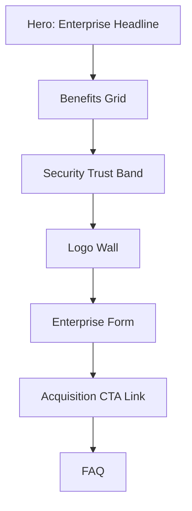

# Enterprise Page

| Field | Value |
|-------|-------|
| **Route** | `/enterprise` |
| **Document ID** | PAGE-ENT-001 |
| **Product** | Founder Portfolio Platform (FounderOS v1.0) |
| **Status** | Approved for Implementation |
| **Last Updated** | 2026-06-29 |
| **Owner** | Product & UX |
| **Related** | [Acquisition](./Acquisition.md) · [Products](./Products.md) · [Contact](./Contact.md) · [User Flows](../02_UX/User_Flows.md) |

---

## Purpose

Specify the Enterprise page — dedicated conversion surface for licensing, partnerships, and high-touch sales — articulating enterprise value proposition, security posture, and paths to [Contact](./Contact.md) or [Acquisition](./Acquisition.md).

---

## Scope

### In Scope

| Section | Priority |
|---------|----------|
| Enterprise value proposition | P0 |
| Feature comparison / benefits | P0 |
| Security & compliance highlights | P0 |
| Customer logos / proof | P1 |
| Enterprise contact form or CTA | P0 |
| Link to acquisition portal | P0 |
| FAQ | P1 |

### Out of Scope

| Area | Rationale |
|------|-----------|
| Self-serve enterprise checkout | v2.0 |
| SOC 2 report download | Gated v1.1 |

---

## Business Context

Enterprise page targets **B2B buyers** with longer sales cycles. Copy is formal per [Content Strategy](../02_UX/Content_Strategy.md). Header "Enterprise" CTA routes here from [Navigation](../02_UX/Navigation.md).

---

## Goals

| # | Goal | Metric |
|---|------|--------|
| G1 | Enterprise form submissions | Track monthly |
| G2 | Click to Acquisition | &gt; 10% of visitors |
| G3 | Time on page | &gt; 2 minutes |

---

## Functional Requirements

| ID | Requirement | Priority |
|----|-------------|----------|
| FR-ENT-01 | Page SHALL present enterprise-specific value props | P0 |
| FR-ENT-02 | Security section SHALL link [Security Architecture](../04_Architecture/Security_Architecture.md) summary | P1 |
| FR-ENT-03 | CTA SHALL route to enterprise inquiry form | P0 |
| FR-ENT-04 | Form SHALL collect company, role, use case (extended) | P0 |
| FR-ENT-05 | Acquisition CTA SHALL link to `/acquisition` | P0 |
| FR-ENT-06 | Case study logos when available | P1 |
| FR-ENT-07 | CMS-editable copy blocks | P0 |

---

## Non-functional Requirements

| ID | Requirement | Target |
|----|-------------|--------|
| NFR-ENT-01 | Trust signal density | ≥ 3 proof elements |
| NFR-ENT-02 | Form completion | Simpler than acquisition form |

---

## User Stories

| ID | As a… | I want to… | So that… |
|----|-------|------------|----------|
| US-ENT-01 | Enterprise buyer | understand licensing options | I evaluate fit |
| US-ENT-02 | CISO | see security overview | I pass internal review |
| US-ENT-03 | Partnership lead | contact sales team | I start negotiation |

---

## UX Requirements

### Enterprise Form Fields

| Field | Required |
|-------|----------|
| Name | Yes |
| Work Email | Yes |
| Company | Yes |
| Job Title | Yes |
| Company Size | Select |
| Use Case | Textarea |
| Products of Interest | Multi-select (P1) |

---

## SEO Requirements

| Field | Template |
|-------|----------|
| Title | `Enterprise — {Site Name}` |
| Description | Enterprise licensing value prop |
| Structured data | `WebPage` with `Speakable` (optional) |
| Robots | index, follow |

---

## Technical Considerations

| Topic | Guidance |
|-------|----------|
| **API** | Extended contact/inquiry type `enterprise` |
| **Analytics** | Event `enterprise_form_submit` |
| **ISR** | 3600s revalidation |

---

## Security Considerations

Work email validation pattern; rate limiting; enterprise inquiries flagged in admin.

---

## Acceptance Criteria

- [ ] All sections render from CMS
- [ ] Enterprise form persists with type flag
- [ ] Acquisition link prominent
- [ ] Security trust content present
- [ ] Header Enterprise CTA routes here
- [ ] SEO metadata configured

---

## Future Enhancements

| Enhancement | Notes |
|-------------|-------|
| ROI calculator | Interactive tool |
| Download enterprise deck | Gated PDF |
| SLA documentation | Trust center |

---

## Open Questions

| ID | Question | Owner | Status |
|----|----------|-------|--------|
| OQ-ENT-001 | Separate form vs. Contact with type? | Product — dedicated fields | Open |

---

## Related Documents

- [Acquisition](./Acquisition.md)
- [Contact](./Contact.md)
- [Products](./Products.md)
- [Security Architecture](../04_Architecture/Security_Architecture.md)
- [User Flows](../02_UX/User_Flows.md)
