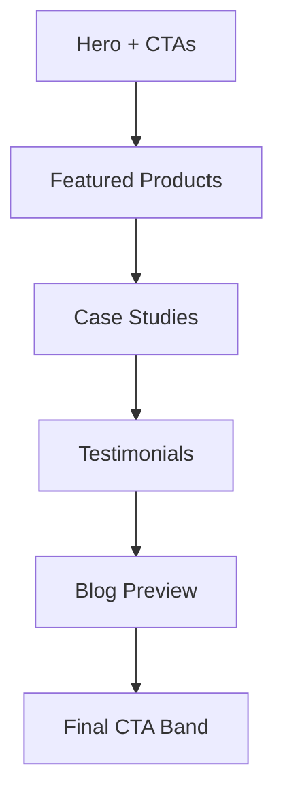

# Home Page

| Field | Value |
|-------|-------|
| **Route** | `/` |
| **Document ID** | PAGE-HOME-001 |
| **Product** | Founder Portfolio Platform (FounderOS v1.0) |
| **Status** | Approved for Implementation |
| **Last Updated** | 2026-06-29 |
| **Owner** | Product & UX |
| **Related** | [CMS](../06_Modules/CMS.md) · [Content Strategy](../02_UX/Content_Strategy.md) · [Design System](../03_Design_System/Design_System.md) · [Metadata](../10_SEO/Metadata.md) |

---

## Purpose

Specify the Home page — the primary entry point and conversion hub for FounderOS v1.0 — showcasing founder value proposition, featured products, social proof, and primary CTAs to drive demo requests and enterprise engagement.

---

## Scope

### In Scope

| Section | CMS-Driven |
|---------|------------|
| Hero with founder intro | Yes |
| Featured products grid | Yes |
| Case study highlights | Yes |
| Testimonial band | Yes |
| Technology/trust logos | Partial |
| Blog preview | Yes |
| CTA band | Yes |
| Global header/footer | Layout |

### Out of Scope

| Area | Rationale |
|------|-----------|
| Full product catalog | [Products](./Products.md) |
| Admin dashboard | [07_Admin](../07_Admin/) |

---

## Business Context

The Home page forms **first impressions** for investors, enterprise buyers, and partners. It must communicate credibility within 5 seconds and provide clear paths to [Products](./Products.md), [Case Studies](./Case_Studies.md), and [Contact](./Contact.md).

---

## Goals

| # | Goal | Metric |
|---|------|--------|
| G1 | Bounce rate | &lt; 50% |
| G2 | CTA click-through (Request Demo) | &gt; 3% |
| G3 | LCP | &lt; 2.5s mobile |
| G4 | Lighthouse Performance | ≥ 90 |

---

## Functional Requirements

| ID | Requirement | Priority |
|----|-------------|----------|
| FR-HOME-01 | Hero SHALL display founder name, tagline, and primary CTA | P0 |
| FR-HOME-02 | Featured products SHALL show up to 6 published products | P0 |
| FR-HOME-03 | Case study section SHALL show 2–3 featured case studies | P0 |
| FR-HOME-04 | Testimonial band SHALL show 1–3 testimonials | P1 |
| FR-HOME-05 | Blog preview SHALL show 3 latest published posts | P1 |
| FR-HOME-06 | All sections SHALL be toggleable via CMS site settings | P1 |
| FR-HOME-07 | Page SHALL be statically generated with ISR revalidation | P0 |

---

## Non-functional Requirements

| ID | Requirement | Target |
|----|-------------|--------|
| NFR-HOME-01 | ISR revalidate | 3600s |
| NFR-HOME-02 | Above-fold image priority | `priority` on hero image |
| NFR-HOME-03 | Accessibility score | ≥ 95 |

---

## User Stories

| ID | As a… | I want to… | So that… |
|----|-------|------------|----------|
| US-HOME-01 | First-time visitor | understand what the founder builds | I decide to explore further |
| US-HOME-02 | Investor | see traction proof quickly | I assess opportunity |
| US-HOME-03 | Buyer | request a demo in one click | I start evaluation |

---

## UX Requirements

### Page Flow

### Section Specifications

| Section | Content | Layout |
|---------|---------|--------|
| Hero | H1, subhead, 2 CTAs, founder image/illustration | 2-col desktop; stack mobile |
| Products | 3–6 [Cards](../03_Design_System/Cards.md) | 3-col grid |
| Case Studies | 2–3 cards with result metric | 2-col grid |
| Testimonials | Quote carousel or static band | Full width muted bg |
| Blog | 3 post cards | 3-col grid |
| CTA | Headline + Request Demo + Enterprise link | Centered |

### CTAs

| Button | Variant | Destination |
|--------|---------|-------------|
| Request Demo | Primary lg | [Contact](./Contact.md) or Calendly |
| View Products | Outline | `/products` |
| Enterprise | Ghost (header) | `/enterprise` |

---

## SEO Requirements

| Field | Template |
|-------|----------|
| Title | `{Founder Name} — {Tagline}` |
| Description | Site settings meta description (150–160 chars) |
| OG image | Founder hero or brand OG image |
| Structured data | `Organization`, `WebSite` with `SearchAction` |

See [Metadata](../10_SEO/Metadata.md) and [Structured Data](../10_SEO/Structured_Data.md).

---

## Technical Considerations

| Topic | Guidance |
|-------|----------|
| **Next.js 15** | RSC fetch from FastAPI; ISR `revalidate` |
| **API** | Aggregated `/api/v1/home` or parallel fetches |
| **Images** | `next/image` for hero and product thumbs |

---

## Security Considerations

Public read-only page; no user input on page itself.

---

## Acceptance Criteria

- [ ] All sections render with CMS data
- [ ] Empty sections hidden when no content
- [ ] CTAs link correctly
- [ ] ISR and metadata configured
- [ ] Responsive per [Responsive System](../03_Design_System/Responsive_System.md)
- [ ] Lighthouse targets met

---

## Future Enhancements

| Enhancement | Notes |
|-------------|-------|
| Personalized hero by UTM | Marketing |
| Video hero background | Founder intro |
| Live metrics ticker | GitHub stars, users |

---

## Open Questions

| ID | Question | Owner | Status |
|----|----------|-------|--------|
| OQ-HOME-001 | Calendly embed in hero vs. Contact page? | Product | Open |

---

## Related Documents

- [About](./About.md)
- [Products](./Products.md)
- [Enterprise](./Enterprise.md)
- [Content Strategy](../02_UX/Content_Strategy.md)
- [Navigation](../02_UX/Navigation.md)
- [CMS](../06_Modules/CMS.md)
