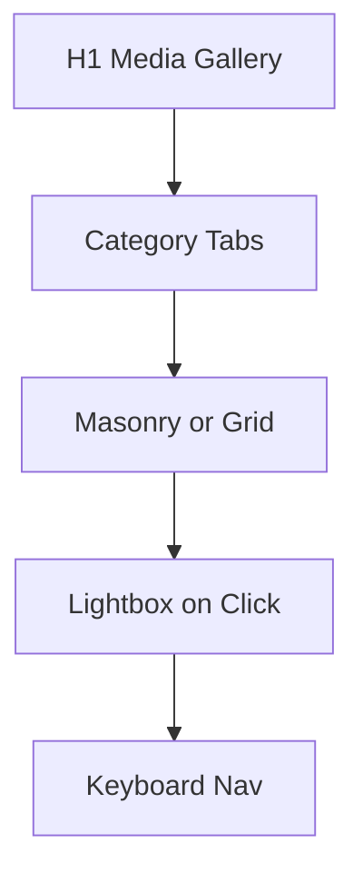

# Media Page

| Field | Value |
|-------|-------|
| **Route** | `/media` |
| **Document ID** | PAGE-MEDIA-001 |
| **Product** | Founder Portfolio Platform (FounderOS v1.0) |
| **Status** | Approved for Implementation |
| **Last Updated** | 2026-06-29 |
| **Owner** | Product & UX |
| **Related** | [Media Manager](../06_Modules/Media_Manager.md) · [Gallery](../06_Modules/Gallery.md) · [Media Architecture](../04_Architecture/Media_Architecture.md) |

---

## Purpose

Specify the Media gallery page — public showcase of photos, videos, and press media — aggregating visual content from the media library for brand storytelling and press kits.

---

## Scope

### In Scope

| Feature | Priority |
|---------|----------|
| Image gallery grid | P0 |
| Lightbox viewer | P0 |
| Video embeds (YouTube) | P1 |
| Album/category filter | P1 |
| Module enable/disable | P0 |

### Out of Scope

| Area | Rationale |
|------|-----------|
| Public upload | Admin only |
| DRM-protected video | v2.0 |

---

## Business Context

Media page supports **press**, **events**, and **brand** assets. Optional module — enterprise SaaS tenants may disable in favor of product-focused navigation.

---

## Goals

| # | Goal | Metric |
|---|------|--------|
| G1 | Gallery load performance | LCP &lt; 2.5s |
| G2 | Lightbox accessibility | Keyboard navigable |
| G3 | CDN delivery | 100% media via CDN |

---

## Functional Requirements

| ID | Requirement | Priority |
|----|-------------|----------|
| FR-MEDIA-01 | Page SHALL 404 if media gallery module disabled | P0 |
| FR-MEDIA-02 | Grid SHALL show published gallery items | P0 |
| FR-MEDIA-03 | Click SHALL open lightbox with prev/next | P0 |
| FR-MEDIA-04 | Images SHALL serve WebP/AVIF from CDN | P0 |
| FR-MEDIA-05 | Alt text required for all images | P0 |
| FR-MEDIA-06 | YouTube items SHALL embed responsively | P1 |
| FR-MEDIA-07 | Category tabs filter grid | P1 |

---

## Non-functional Requirements

| ID | Requirement | Target |
|----|-------------|--------|
| NFR-MEDIA-01 | Thumbnail size | 400px width variants |
| NFR-MEDIA-02 | Lazy load | Below-fold images |

---

## User Stories

| ID | As a… | I want to… | So that… |
|----|-------|------------|----------|
| US-MEDIA-01 | Press contact | download brand photos | I write articles |
| US-MEDIA-02 | Visitor | browse event photos | I see company culture |

---

## UX Requirements

| Pattern | Spec |
|---------|------|
| Grid | 2–4 columns responsive |
| Lightbox | Full screen, Escape close, focus trap |
| Video | 16:9 embed in grid or lightbox |

See [Dialogs](../03_Design_System/Dialogs.md) for overlay behavior.

---

## SEO Requirements

| Field | Template |
|-------|----------|
| Title | `Media — {Site Name}` |
| Description | Gallery meta description |
| Image SEO | `ImageObject` in structured data (P1) |

---

## Technical Considerations

| Topic | Guidance |
|-------|----------|
| **CDN** | [Media Architecture](../04_Architecture/Media_Architecture.md) |
| **API** | Media gallery public endpoint |
| **next/image** | Thumbnails with `sizes` |

---

## Security Considerations

Only `published` media public; no EXIF GPS in served images.

---

## Acceptance Criteria

- [ ] Gallery grid renders published items
- [ ] Lightbox keyboard accessible
- [ ] Module gate works
- [ ] CDN URLs on all images
- [ ] Alt text on every image

---

## Future Enhancements

| Enhancement | Notes |
|-------------|-------|
| Press kit ZIP download | Brand assets |
| AI auto-tagging | Admin helper |

---

## Open Questions

| ID | Question | Owner | Status |
|----|----------|-------|--------|
| OQ-MEDIA-001 | Masonry vs. uniform grid? | Design | Open |

---

## Related Documents

- [Media Manager](../06_Modules/Media_Manager.md)
- [Gallery](../06_Modules/Gallery.md)
- [Travel](./Travel.md)
- [Media Architecture](../04_Architecture/Media_Architecture.md)
