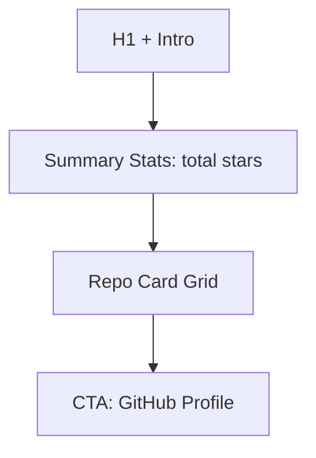

# Open Source Page

| Field | Value |
|-------|-------|
| **Route** | `/open-source` |
| **Document ID** | PAGE-OSS-001 |
| **Product** | Founder Portfolio Platform (FounderOS v1.0) |
| **Status** | Approved for Implementation |
| **Last Updated** | 2026-06-29 |
| **Owner** | Product & UX |
| **Related** | [GitHub module](../06_Modules/) · [Portfolio](./Portfolio.md) · [Products](./Products.md) |

---

## Purpose

Specify the Open Source page — showcase of public GitHub repositories, contributions, and community projects — demonstrating technical leadership and community engagement.

---

## Scope

### In Scope

| Feature | Priority |
|---------|----------|
| Repository card grid | P0 |
| GitHub stats (stars, forks) | P0 |
| Language badges | P0 |
| Link to GitHub | P0 |
| Manual + API-synced repos | P1 |
| Contribution graph (optional) | P2 |

### Out of Scope

| Area | Rationale |
|------|-----------|
| In-browser code browsing | GitHub hosts |
| Package registry | npm/PyPI links P1 |

---

## Business Context

Open source credibility matters for **developer tools** and **AI infrastructure** founders. Page complements [Portfolio](./Portfolio.md) with live GitHub metrics.

---

## Goals

| # | Goal | Metric |
|---|------|--------|
| G1 | GitHub outbound clicks | Track per repo |
| G2 | Data freshness | Sync daily |
| G3 | Star count accuracy | Match GitHub API |

---

## Functional Requirements

| ID | Requirement | Priority |
|----|-------------|----------|
| FR-OSS-01 | Page SHALL list configured repositories | P0 |
| FR-OSS-02 | Cards SHALL show name, description, stars, forks, language | P0 |
| FR-OSS-03 | Links SHALL open GitHub in new tab | P0 |
| FR-OSS-04 | Stats SHALL refresh via backend GitHub proxy | P1 |
| FR-OSS-05 | Pinned repos order configurable in admin | P1 |
| FR-OSS-06 | ISR with 24h revalidation for stats | P1 |

---

## Non-functional Requirements

| ID | Requirement | Target |
|----|-------------|--------|
| NFR-OSS-01 | GitHub API rate limit | Cache 24h |
| NFR-OSS-02 | Graceful degradation | Show cached if API fails |

---

## User Stories

| ID | As a… | I want to… | So that… |
|----|-------|------------|----------|
| US-OSS-01 | Developer | see popular repos | I evaluate code quality |
| US-OSS-02 | Founder | highlight OSS work | I attract contributors |

---

## UX Requirements

| Card Element | Source |
|--------------|--------|
| Name | Repo name |
| Description | GitHub description |
| Stars / Forks | GitHub API |
| Language | Primary language badge |
| Topics | GitHub topics as tags (P1) |

---

## SEO Requirements

| Field | Template |
|-------|----------|
| Title | `Open Source — {Site Name}` |
| Description | OSS contribution summary |
| Structured data | `ItemList` of `SoftwareSourceCode` |

---

## Technical Considerations

| Topic | Guidance |
|-------|----------|
| **API** | Backend GitHub proxy per [System Architecture](../04_Architecture/System_Architecture.md) |
| **Cache** | Redis 24h for repo stats |
| **Fallback** | Manual stats in CMS if API down |

---

## Security Considerations

GitHub token server-side only; never expose PAT to frontend.

---

## Acceptance Criteria

- [ ] Repo cards render with stats
- [ ] GitHub links open correctly
- [ ] API failure shows cached or manual data
- [ ] Empty state when no repos configured
- [ ] External link icons accessible

---

## Future Enhancements

| Enhancement | Notes |
|-------------|-------|
| Contribution heatmap | GitHub API |
| Sponsor button | GitHub Sponsors link |

---

## Open Questions

| ID | Question | Owner | Status |
|----|----------|-------|--------|
| OQ-OSS-001 | Auto-import all user repos vs. curated? | Product — curated | Open |

---

## Related Documents

- [Portfolio](./Portfolio.md)
- [Products](./Products.md)
- [About](./About.md)
- [Caching Strategy](../04_Architecture/Caching_Strategy.md)
