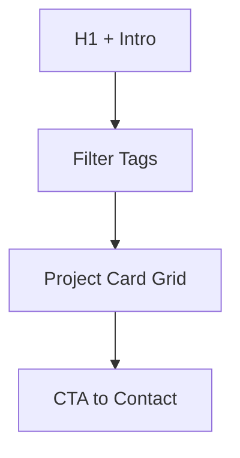

# Portfolio Page

| Field | Value |
|-------|-------|
| **Route** | `/portfolio` |
| **Document ID** | PAGE-PORT-001 |
| **Product** | Founder Portfolio Platform (FounderOS v1.0) |
| **Status** | Approved for Implementation |
| **Last Updated** | 2026-06-29 |
| **Owner** | Product & UX |
| **Related** | [Portfolio Manager](../06_Modules/Portfolio_Manager.md) · [Portfolio API](../08_API/Portfolio_API.md) · [About](./About.md) |

---

## Purpose

Specify the Portfolio page — showcase of projects, client work, and technical achievements — demonstrating founder expertise to investors, hiring managers, and enterprise buyers.

---

## Scope

### In Scope

| Feature | Priority |
|---------|----------|
| Project card grid | P0 |
| Tech stack tags | P0 |
| External project links | P0 |
| Category filter | P1 |
| Featured projects | P1 |
| Empty state | P0 |

### Out of Scope

| Area | Rationale |
|------|-----------|
| Case study long-form | [Case Studies](./Case_Studies.md) |
| GitHub auto-sync detail | [Open Source](./Open_Source.md) |

---

## Business Context

Portfolio complements [Case Studies](./Case_Studies.md) with **breadth** — many projects vs. deep narratives. Critical for technical credibility and agency-style tenants.

---

## Goals

| # | Goal | Metric |
|---|------|--------|
| G1 | External link clicks | Track via analytics |
| G2 | Time on page | &gt; 60 seconds |
| G3 | Projects displayed | All published items |

---

## Functional Requirements

| ID | Requirement | Priority |
|----|-------------|----------|
| FR-PORT-01 | Page SHALL list published portfolio items | P0 |
| FR-PORT-02 | Cards SHALL show image, title, description, tech tags | P0 |
| FR-PORT-03 | External URL SHALL open in new tab with icon | P0 |
| FR-PORT-04 | Featured items MAY sort first | P1 |
| FR-PORT-05 | Category filter SHALL filter grid | P1 |
| FR-PORT-06 | ISR on portfolio publish | P0 |

---

## Non-functional Requirements

| ID | Requirement | Target |
|----|-------------|--------|
| NFR-PORT-01 | Grid layout | 1/2/3 columns responsive |
| NFR-PORT-02 | Image aspect | 16:9 thumbnails |

---

## User Stories

| ID | As a… | I want to… | So that… |
|----|-------|------------|----------|
| US-PORT-01 | Hiring manager | see technical projects | I assess skills |
| US-PORT-02 | Client prospect | view past work quality | I trust delivery ability |

---

## UX Requirements

| Card Element | Source |
|--------------|--------|
| Image | Project thumbnail |
| Title | Project name |
| Description | Short excerpt |
| Tags | Tech stack badges |
| Link | Live demo / GitHub |

---

## SEO Requirements

| Field | Template |
|-------|----------|
| Title | `Portfolio — {Site Name}` |
| Description | Founder portfolio meta |
| Structured data | `ItemList` of `CreativeWork` |

---

## Technical Considerations

| Topic | Guidance |
|-------|----------|
| **API** | `GET /api/v1/portfolio` |
| **Module** | [Portfolio Manager](../06_Modules/Portfolio_Manager.md) |

---

## Security Considerations

Public read-only; validate external URLs are http(s).

---

## Acceptance Criteria

- [ ] Portfolio grid renders CMS items
- [ ] External links open safely
- [ ] Tags display correctly
- [ ] Empty state when no items
- [ ] Responsive grid

---

## Future Enhancements

| Enhancement | Notes |
|-------------|-------|
| Masonry layout | Gallery variant |
| Project detail subpages | `/portfolio/[slug]` |

---

## Open Questions

| ID | Question | Owner | Status |
|----|----------|-------|--------|
| OQ-PORT-001 | Dedicated detail pages v1.0? | Product — cards only | Open |

---

## Related Documents

- [Case Studies](./Case_Studies.md)
- [About](./About.md)
- [Open Source](./Open_Source.md)
- [Portfolio API](../08_API/Portfolio_API.md)
