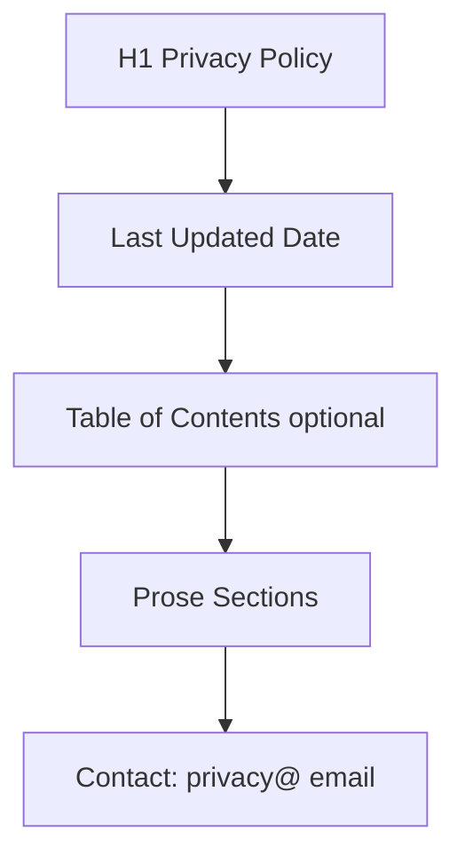

# Privacy Policy Page

| Field | Value |
|-------|-------|
| **Route** | `/legal/privacy` |
| **Document ID** | PAGE-PRIV-001 |
| **Product** | Founder Portfolio Platform (FounderOS v1.0) |
| **Status** | Approved for Implementation |
| **Last Updated** | 2026-06-29 |
| **Owner** | Legal & Product |
| **Related** | [Terms](./Terms.md) · [Cookie](./Cookie.md) · [CMS](../06_Modules/CMS.md) |

---

## Purpose

Specify the Privacy Policy page — legal disclosure of data collection, processing, retention, and user rights — CMS-editable per tenant with version date and compliance baseline for GDPR/CCPA readiness.

---

## Scope

### In Scope

| Section | Priority |
|---------|----------|
| Data controller identity | P0 |
| Data collected (forms, analytics, cookies) | P0 |
| Legal basis for processing | P0 |
| Third-party processors | P0 |
| Retention periods | P0 |
| User rights (access, delete) | P0 |
| Contact for privacy requests | P0 |
| Last updated date | P0 |

### Out of Scope

| Area | Rationale |
|------|-----------|
| Legal text authoring | Tenant counsel responsibility |
| DPA generation | Enterprise v1.1 |

---

## Business Context

Privacy policy is **legally required** for forms collecting PII on [Contact](./Contact.md) and analytics. Footer link required on all pages per [Navigation](../02_UX/Navigation.md).

---

## Goals

| # | Goal | Metric |
|---|------|--------|
| G1 | Policy accessible from every page footer | 100% |
| G2 | Last updated date visible | Always |
| G3 | Covers all data collection points | Audit checklist |

---

## Functional Requirements

| ID | Requirement | Priority |
|----|-------------|----------|
| FR-PRIV-01 | Page SHALL render CMS legal entity `privacy` | P0 |
| FR-PRIV-02 | Last updated date SHALL display prominently | P0 |
| FR-PRIV-03 | Content SHALL use prose typography | P0 |
| FR-PRIV-04 | Page SHALL be statically generated with ISR | P0 |
| FR-PRIV-05 | Table of contents for long documents | P1 |
| FR-PRIV-06 | Print-friendly layout | P2 |
| FR-PRIV-07 | Included in sitemap with `changefreq: yearly` | P1 |

---

## Non-functional Requirements

| ID | Requirement | Target |
|----|-------------|--------|
| NFR-PRIV-01 | Reading width | `max-w-3xl` prose |
| NFR-PRIV-02 | Heading hierarchy | H1 title, H2 sections |

---

## User Stories

| ID | As a… | I want to… | So that… |
|----|-------|------------|----------|
| US-PRIV-01 | Visitor | understand data use | I trust submitting forms |
| US-PRIV-02 | EU user | know my GDPR rights | I exercise them if needed |
| US-PRIV-03 | Admin | update policy without deploy | Legal changes go live |

---

## UX Requirements

### Required Sections (Template)

| Section | Content |
|---------|---------|
| Introduction | Who we are |
| Data We Collect | Forms, logs, cookies |
| How We Use Data | Service delivery, analytics |
| Legal Basis | Consent, legitimate interest |
| Third Parties | Vercel, Cloudflare, analytics |
| Retention | Inquiry data retention period |
| Your Rights | Access, rectification, erasure |
| Contact | Privacy email |
| Changes | Update notification policy |

---

## SEO Requirements

| Field | Policy |
|-------|--------|
| Title | `Privacy Policy — {Site Name}` |
| Robots | index, follow |
| Canonical | `/legal/privacy` |

---

## Technical Considerations

| Topic | Guidance |
|-------|----------|
| **CMS** | Legal content entity with versioning |
| **ISR** | Revalidate on legal content publish |
| **Sanitization** | Allow safe HTML headings and lists |

---

## Security Considerations

No PII displayed on page; privacy request email monitored securely.

---

## Acceptance Criteria

- [ ] Privacy content from CMS renders
- [ ] Last updated date visible
- [ ] Footer link on all pages
- [ ] Prose styles applied
- [ ] Sitemap includes URL
- [ ] Covers contact form and cookie data

---

## Future Enhancements

| Enhancement | Notes |
|-------------|-------|
| Multi-language legal | i18n |
| Consent management platform | Cookie sync |
| Data export self-service | GDPR portal |

---

## Open Questions

| ID | Question | Owner | Status |
|----|----------|-------|--------|
| OQ-PRIV-001 | Seed template from FounderOS legal kit? | Legal | Open |

---

## Related Documents

- [Terms](./Terms.md)
- [Cookie](./Cookie.md)
- [Contact](./Contact.md)
- [Sitemap](../10_SEO/Sitemap.md)
- [Content Strategy](../02_UX/Content_Strategy.md)
