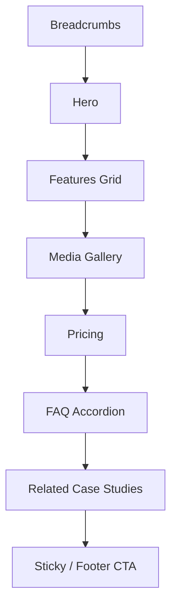

# Product Details Page

| Field | Value |
|-------|-------|
| **Route** | `/products/[slug]` |
| **Document ID** | PAGE-PRODDET-001 |
| **Product** | Founder Portfolio Platform (FounderOS v1.0) |
| **Status** | Approved for Implementation |
| **Last Updated** | 2026-06-29 |
| **Owner** | Product & UX |
| **Related** | [Products](./Products.md) · [Products API](../08_API/Products_API.md) · [Enterprise](./Enterprise.md) |

---

## Purpose

Specify the Product detail page — comprehensive product information, features, screenshots, pricing overview, FAQ, and conversion CTAs for demos, licensing, and acquisition discussions.

---

## Scope

### In Scope

| Section | Priority |
|---------|----------|
| Product hero | P0 |
| Feature list | P0 |
| Screenshots/media gallery | P0 |
| Pricing summary (if applicable) | P1 |
| FAQ accordion | P1 |
| Related case studies | P1 |
| Breadcrumbs | P1 |
| Demo / Contact CTAs | P0 |

### Out of Scope

| Area | Rationale |
|------|-----------|
| In-app product UI | External link only |
| Payment checkout | v2.0 |

---

## Business Context

Product detail is the **deepest evaluation surface** before enterprise contact. Content must answer: what it does, who it's for, proof it works, and how to buy or license.

---

## Goals

| # | Goal | Metric |
|---|------|--------|
| G1 | CTA conversion (demo/contact) | &gt; 5% of page views |
| G2 | Scroll depth | &gt; 60% reach features |
| G3 | Bounce to Products | &lt; 30% |

---

## Functional Requirements

| ID | Requirement | Priority |
|----|-------------|----------|
| FR-PRODDET-01 | Page SHALL resolve slug to published product or 404 | P0 |
| FR-PRODDET-02 | Hero SHALL show name, tagline, primary CTA | P0 |
| FR-PRODDET-03 | Features SHALL render as icon + title + description grid | P0 |
| FR-PRODDET-04 | Screenshots SHALL use optimized gallery | P0 |
| FR-PRODDET-05 | FAQ SHALL use accessible accordion | P1 |
| FR-PRODDET-06 | Related case studies SHALL link to `/case-studies/[slug]` | P1 |
| FR-PRODDET-07 | `generateStaticParams` for known slugs + ISR | P0 |

---

## Non-functional Requirements

| ID | Requirement | Target |
|----|-------------|--------|
| NFR-PRODDET-01 | 404 for unpublished slug | Immediate |
| NFR-PRODDET-02 | Image LCP | Hero image prioritized |

---

## User Stories

| ID | As a… | I want to… | So that… |
|----|-------|------------|----------|
| US-PRODDET-01 | Buyer | see features and screenshots | I evaluate fit |
| US-PRODDET-02 | Buyer | request demo from product page | I start sales process |
| US-PRODDET-03 | Acquirer | understand product scope | I assess acquisition target |

---

## UX Requirements

### Page Structure

### Tabs (Optional)

| Tab | Content |
|-----|---------|
| Overview | Features + description |
| Pricing | Tiers table |
| FAQ | Accordion |

See [Navigation Components](../03_Design_System/Navigation_Components.md) tabs pattern.

### CTAs

| CTA | Destination |
|-----|-------------|
| Request Demo | [Contact](./Contact.md)?product={slug} |
| Enterprise Licensing | [Enterprise](./Enterprise.md) |
| View Live Product | External URL (new tab) |

---

## SEO Requirements

| Field | Source |
|-------|--------|
| Title | `{Product Name} — {Site Name}` |
| Description | Product meta description |
| OG image | Product featured image |
| Structured data | `SoftwareApplication` or `Product` |

---

## Technical Considerations

| Topic | Guidance |
|-------|----------|
| **API** | `GET /api/v1/products/{slug}` |
| **Dynamic route** | `app/products/[slug]/page.tsx` |
| **404** | `notFound()` for missing slug |

---

## Security Considerations

Sanitize product HTML body from CMS; external links use `rel="noopener noreferrer"`.

---

## Acceptance Criteria

- [ ] Valid slug renders full product
- [ ] Invalid slug returns 404
- [ ] Breadcrumbs: Home → Products → Product
- [ ] CTAs pass product context to Contact
- [ ] FAQ accordion accessible
- [ ] Structured data validates

---

## Future Enhancements

| Enhancement | Notes |
|-------------|-------|
| Interactive demo embed | iframe sandbox |
| Changelog per product | Version history |
| ROI calculator | Enterprise tool |

---

## Open Questions

| ID | Question | Owner | Status |
|----|----------|-------|--------|
| OQ-PRODDET-001 | Sticky CTA bar on scroll? | UX | Open |

---

## Related Documents

- [Products](./Products.md)
- [Case Studies](./Case_Studies.md)
- [Contact](./Contact.md)
- [Enterprise](./Enterprise.md)
- [Products API](../08_API/Products_API.md)
