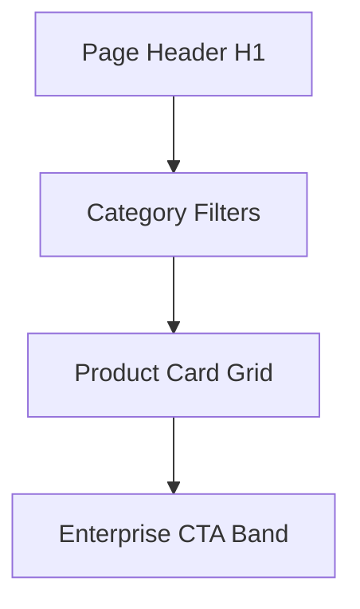

# Products Page

| Field | Value |
|-------|-------|
| **Route** | `/products` |
| **Document ID** | PAGE-PROD-001 |
| **Product** | Founder Portfolio Platform (FounderOS v1.0) |
| **Status** | Approved for Implementation |
| **Last Updated** | 2026-06-29 |
| **Owner** | Product & UX |
| **Related** | [Product Manager](../06_Modules/Product_Manager.md) · [Products API](../08_API/Products_API.md) · [Product Details](./Product_Details.md) |

---

## Purpose

Specify the Products listing page — catalog of SaaS/AI products offered by the founder — with filtering, categorization, and paths to detail pages, enterprise licensing, and acquisition interest.

---

## Scope

### In Scope

| Feature | Priority |
|---------|----------|
| Product card grid | P0 |
| Category filter | P1 |
| Status badges (live, beta) | P1 |
| Search (optional v1.0) | P2 |
| Empty state | P0 |
| Enterprise CTA band | P0 |

### Out of Scope

| Area | Rationale |
|------|-----------|
| Checkout/payments | Not v1.0 |
| Product detail content | [Product_Details](./Product_Details.md) |

---

## Business Context

Products are the **commercial core** of FounderOS. This page supports licensing inquiries, demos, and M&A conversations documented in [Enterprise](./Enterprise.md).

---

## Goals

| # | Goal | Metric |
|---|------|--------|
| G1 | Product detail click-through | &gt; 40% of visitors |
| G2 | Enterprise CTA clicks | &gt; 2% |
| G3 | Page load with 20 products | LCP &lt; 2.5s |

---

## Functional Requirements

| ID | Requirement | Priority |
|----|-------------|----------|
| FR-PROD-01 | Page SHALL list all published products | P0 |
| FR-PROD-02 | Each card SHALL link to `/products/[slug]` | P0 |
| FR-PROD-03 | Cards SHALL show image, name, excerpt, category badge | P0 |
| FR-PROD-04 | Category filter SHALL filter client or server side | P1 |
| FR-PROD-05 | Unpublished products SHALL NOT appear | P0 |
| FR-PROD-06 | Empty state SHALL prompt admin or show message | P0 |
| FR-PROD-07 | ISR revalidation on product publish | P0 |

---

## Non-functional Requirements

| ID | Requirement | Target |
|----|-------------|--------|
| NFR-PROD-01 | Pagination if &gt; 12 products | 12 per page |
| NFR-PROD-02 | Grid responsive | 1/2/3 columns |

---

## User Stories

| ID | As a… | I want to… | So that… |
|----|-------|------------|----------|
| US-PROD-01 | Buyer | browse all offerings | I compare solutions |
| US-PROD-02 | Buyer | filter by category | I find relevant products |
| US-PROD-03 | Founder | showcase product portfolio | I attract licensing interest |

---

## UX Requirements

### Layout

### Card Content

| Field | Source |
|-------|--------|
| Image | Product featured image |
| Title | Product name |
| Excerpt | Short description (160 chars) |
| Badge | Category or status |
| CTA | "Learn more" link |

See [Cards](../03_Design_System/Cards.md).

---

## SEO Requirements

| Field | Template |
|-------|----------|
| Title | `Products — {Site Name}` |
| Description | Custom or default catalog description |
| Canonical | `/products` |
| Structured data | `ItemList` of `Product` |

---

## Technical Considerations

| Topic | Guidance |
|-------|----------|
| **API** | `GET /api/v1/products?status=published` |
| **ISR** | `revalidate` on webhook or 3600s |

---

## Security Considerations

Public read-only; draft products excluded at API level.

---

## Acceptance Criteria

- [ ] Published products display in grid
- [ ] Cards link to correct slugs
- [ ] Category filter works
- [ ] Empty state when no products
- [ ] Enterprise CTA present
- [ ] SEO ItemList structured data

---

## Future Enhancements

| Enhancement | Notes |
|-------------|-------|
| Full-text search | [Search module](../06_Modules/) |
| Compare products | Side-by-side table |
| Pricing tier preview on cards | If pricing public |

---

## Open Questions

| ID | Question | Owner | Status |
|----|----------|-------|--------|
| OQ-PROD-001 | Default sort: newest vs. featured? | Product | Open |

---

## Related Documents

- [Product Details](./Product_Details.md)
- [Enterprise](./Enterprise.md)
- [Home](./Home.md)
- [Products API](../08_API/Products_API.md)
- [Product Manager](../06_Modules/Product_Manager.md)
