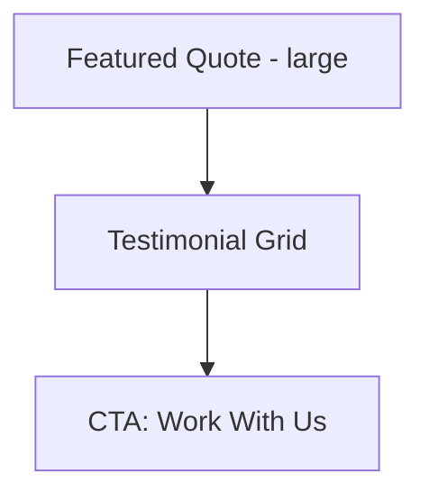

# Testimonials Page

| Field | Value |
|-------|-------|
| **Route** | `/testimonials` |
| **Document ID** | PAGE-TEST-001 |
| **Product** | Founder Portfolio Platform (FounderOS v1.0) |
| **Status** | Approved for Implementation |
| **Last Updated** | 2026-06-29 |
| **Owner** | Product & UX |
| **Related** | [Case Studies](./Case_Studies.md) · [Home](./Home.md) · [Content Strategy](../02_UX/Content_Strategy.md) |

---

## Purpose

Specify the Testimonials page — aggregated social proof from clients, partners, and users — supporting conversion on [Enterprise](./Enterprise.md) and [Products](./Products.md) with credible attributed quotes.

---

## Scope

### In Scope

| Feature | Priority |
|---------|----------|
| Testimonial card grid | P0 |
| Quote, name, role, organization | P0 |
| Photo/avatar optional | P1 |
| Featured testimonial hero | P1 |
| Link to related case study | P1 |

### Out of Scope

| Area | Rationale |
|------|-----------|
| Video testimonials | Embed on case studies P1 |
| Third-party review sync | G2/Capterra v2.0 |

---

## Business Context

Testimonials reduce **perceived risk** for enterprise buyers. Attribution (name, role, company) is required per [Content Strategy](../02_UX/Content_Strategy.md).

---

## Goals

| # | Goal | Metric |
|---|------|--------|
| G1 | Every testimonial attributed | 100% |
| G2 | Click-through to Contact | &gt; 5% |
| G3 | Featured on Home sync | Same CMS source |

---

## Functional Requirements

| ID | Requirement | Priority |
|----|-------------|----------|
| FR-TEST-01 | Page SHALL list published testimonials | P0 |
| FR-TEST-02 | Each item SHALL include quote, author name, role, organization | P0 |
| FR-TEST-03 | Featured testimonial MAY display large at top | P1 |
| FR-TEST-04 | Avatar image optional with alt text | P1 |
| FR-TEST-05 | Related case study link when associated | P1 |
| FR-TEST-06 | ISR revalidation | P0 |

---

## Non-functional Requirements

| ID | Requirement | Target |
|----|-------------|--------|
| NFR-TEST-01 | Grid layout | 1/2/3 columns |
| NFR-TEST-02 | Quote typography | Larger text, italic optional |

---

## User Stories

| ID | As a… | I want to… | So that… |
|----|-------|------------|----------|
| US-TEST-01 | Buyer | read peer endorsements | I trust the vendor |
| US-TEST-02 | Founder | showcase client praise | I support sales |

---

## UX Requirements

| Element | Spec |
|---------|------|
| Quote | Blockquote styling |
| Attribution | Name — Role, Organization |
| Avatar | 48px circle |
| Card | [Cards](../03_Design_System/Cards.md) variant flat |

---

## SEO Requirements

| Field | Template |
|-------|----------|
| Title | `Testimonials — {Site Name}` |
| Description | Social proof summary |
| Structured data | `Review` aggregate (if ratings added) |

---

## Technical Considerations

| Topic | Guidance |
|-------|----------|
| **CMS** | Testimonials entity in site content |
| **API** | `GET /api/v1/testimonials` |
| **Home** | Shared data source for testimonial band |

---

## Security Considerations

Consent required for public attribution; ability to unpublish on request.

---

## Acceptance Criteria

- [ ] All testimonials have full attribution
- [ ] Featured testimonial displays when set
- [ ] Grid responsive
- [ ] CTA to Contact present
- [ ] Home band uses same data

---

## Future Enhancements

| Enhancement | Notes |
|-------------|-------|
| Star ratings | Aggregate score |
| Video testimonial section | YouTube embed |

---

## Open Questions

| ID | Question | Owner | Status |
|----|----------|-------|--------|
| OQ-TEST-001 | Carousel vs. static grid on Home? | Design | Open |

---

## Related Documents

- [Home](./Home.md)
- [Case Studies](./Case_Studies.md)
- [Enterprise](./Enterprise.md)
- [Content Strategy](../02_UX/Content_Strategy.md)
