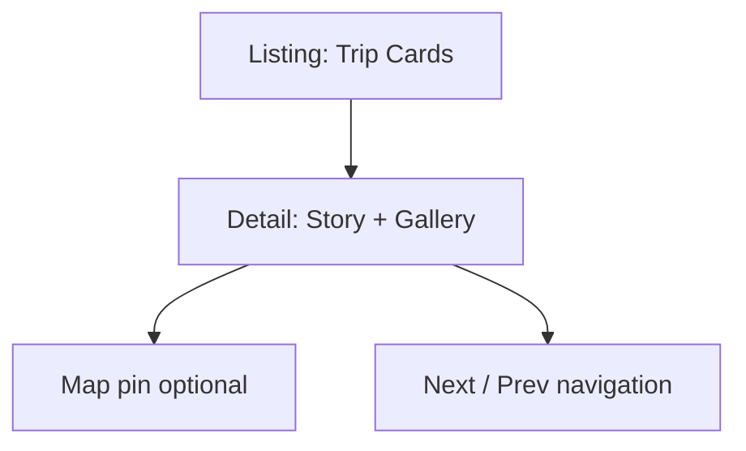

# Travel Page

| Field | Value |
|-------|-------|
| **Route** | `/travel` |
| **Document ID** | PAGE-TRAVEL-001 |
| **Product** | Founder Portfolio Platform (FounderOS v1.0) |
| **Status** | Approved for Implementation |
| **Last Updated** | 2026-06-29 |
| **Owner** | Product & UX |
| **Related** | [Travel Manager](../06_Modules/Travel_Manager.md) · [Travel API](../08_API/Travel_API.md) · [Media](./Media.md) |

---

## Purpose

Specify the Travel page — founder travel log showcasing destinations, stories, and media — optional module for creator-style tenants building personal brand alongside commercial products.

---

## Scope

### In Scope

| Feature | Priority |
|---------|----------|
| Travel entry listing | P0 |
| Entry detail `/travel/[slug]` | P0 |
| Map or location metadata | P1 |
| Photo galleries per trip | P0 |
| Module enable/disable | P0 |

### Out of Scope

| Area | Rationale |
|------|-----------|
| Booking integration | Not product scope |
| Real-time GPS tracking | Privacy |

---

## Business Context

Travel module differentiates **lifestyle founder** tenants. Module-gated per site settings — disabled tenants return 404 or nav hide.

---

## Goals

| # | Goal | Metric |
|---|------|--------|
| G1 | Engagement (time on page) | &gt; 2 min when enabled |
| G2 | Social shares | Track OG clicks |
| G3 | Module off by default | Enterprise SaaS tenants |

---

## Functional Requirements

| ID | Requirement | Priority |
|----|-------------|----------|
| FR-TRAVEL-01 | Page SHALL 404 if travel module disabled | P0 |
| FR-TRAVEL-02 | Listing SHALL show entries with cover image and location | P0 |
| FR-TRAVEL-03 | Detail SHALL show prose story + image gallery | P0 |
| FR-TRAVEL-04 | Dates SHALL display trip date range | P1 |
| FR-TRAVEL-05 | Location metadata for SEO | P1 |
| FR-TRAVEL-06 | ISR on publish | P0 |

---

## Non-functional Requirements

| ID | Requirement | Target |
|----|-------------|--------|
| NFR-TRAVEL-01 | Gallery image load | Lazy load below fold |
| NFR-TRAVEL-02 | Grid | 1/2/3 col cards |

---

## User Stories

| ID | As a… | I want to… | So that… |
|----|-------|------------|----------|
| US-TRAVEL-01 | Follower | read travel stories | I connect with founder personally |
| US-TRAVEL-02 | Founder | document trips | I build lifestyle brand |

---

## UX Requirements

| Card Field | Content |
|------------|---------|
| Cover | Hero photo |
| Title | Trip name |
| Location | City, country |
| Date | Month year range |

---

## SEO Requirements

| Field | Template |
|-------|----------|
| Listing title | `Travel — {Site Name}` |
| Detail title | `{Trip Title} — Travel Log` |
| Structured data | `BlogPosting` or `TravelAction` (optional) |

---

## Technical Considerations

| Topic | Guidance |
|-------|----------|
| **API** | [Travel API](../08_API/Travel_API.md) |
| **Media** | [Media Architecture](../04_Architecture/Media_Architecture.md) |
| **Module gate** | Site settings `modules.travel_enabled` |

---

## Security Considerations

EXIF stripping on upload; no precise home addresses in public location data.

---

## Acceptance Criteria

- [ ] Module gate works (404 when disabled)
- [ ] Listing and detail render
- [ ] Gallery images optimized
- [ ] Nav item hidden when disabled
- [ ] ISR configured

---

## Future Enhancements

| Enhancement | Notes |
|-------------|-------|
| Interactive map | Mapbox embed |
| Instagram sync | Social import |

---

## Open Questions

| ID | Question | Owner | Status |
|----|----------|-------|--------|
| OQ-TRAVEL-001 | Default enabled for reference tenant? | Product | Open |

---

## Related Documents

- [Travel Manager](../06_Modules/Travel_Manager.md)
- [Media](./Media.md)
- [Blog](./Blog.md)
- [Sitemap](../02_UX/Sitemap.md)
