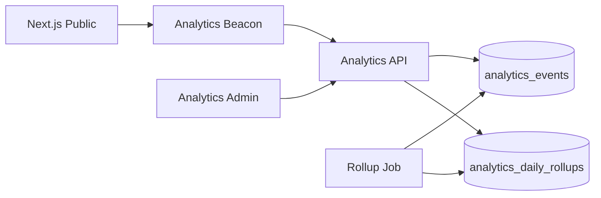

# Analytics Module

| Field | Value |
|-------|-------|
| Module ID | `MOD-ANALYTICS` |
| Version | 1.0 |
| Status | Specification |
| Owner | Growth & Insights |
| Last Updated | 2026-06-29 |

## Purpose

The Analytics module aggregates first-party usage metrics—page views, form conversions, content engagement, and integration health—into dashboards for founders and admin users, complementing optional third-party tools (Plausible, Google Analytics) configured via [Settings](Settings.md).

## Scope

| In Scope | Out of Scope |
|----------|--------------|
| Server-side event ingestion API | Full data warehouse / BI platform |
| Page view and conversion event tracking | Session replay |
| Admin analytics dashboard summaries | Real-time visitor map |
| Daily rollups for key metrics | Custom SQL report builder |
| Privacy-conscious, cookieless page views (v1.0 target) | Cross-site user profiling |

## Business Context

Founders need visibility into what content drives inbound leads. First-party analytics respects privacy positioning while providing actionable metrics without requiring every tenant to configure external tools.

## Goals

1. Track page views and key conversion events (contact submit, newsletter signup).
2. Provide admin dashboard with traffic and conversion trends.
3. Respect visitor privacy — no third-party ad trackers by default.
4. Support optional external analytics script injection via Settings.
5. Enable content performance comparison (blog posts, products).

## Functional Requirements

| ID | Requirement | Priority |
|----|-------------|----------|
| ANA-FR-01 | Ingest `page_view` events from public site | Must |
| ANA-FR-02 | Ingest conversion events (contact, inquiry, newsletter) | Must |
| ANA-FR-03 | Daily rollup aggregation job | Must |
| ANA-FR-04 | Admin dashboard: 7/30-day page views | Must |
| ANA-FR-05 | Admin dashboard: top pages by views | Must |
| ANA-FR-06 | Admin dashboard: conversion counts | Must |
| ANA-FR-07 | Filter metrics by date range | Must |
| ANA-FR-08 | Exclude admin routes from tracking | Must |

## Non-functional Requirements

| ID | Requirement | Target |
|----|-------------|--------|
| ANA-NFR-01 | Event ingest p95 | < 50 ms (async) |
| ANA-NFR-02 | Raw event retention | 90 days |
| ANA-NFR-03 | Rollup retention | 2 years |
| ANA-NFR-04 | Dashboard query p95 | < 500 ms |

## User Stories

| ID | As a… | I want to… | So that… |
|----|-------|-------------|----------|
| ANA-US-01 | Founder | See weekly traffic trends | I know if marketing works |
| ANA-US-02 | Founder | See which blog posts get views | I double down on popular topics |
| ANA-US-03 | Growth lead | Track contact form conversions | I measure funnel performance |
| ANA-US-04 | Privacy-conscious founder | Avoid invasive tracking | Visitors trust the site |
| ANA-US-05 | Admin | Compare this month vs last | I spot growth or decline |

## UX Requirements

- Admin dashboard: line chart for page views, stat cards for conversions.
- Date range picker: 7d, 30d, 90d, custom.
- Top pages table: path, views, unique visitors (hashed).
- Empty state during first 24 hours: "Collecting data…"
- No analytics UI on public site — invisible tracking snippet only.
- Export summary CSV (v1.1).

## Technical Considerations

### Architecture

### Module Dependencies

| Module | Purpose |
|--------|---------|
| [Analytics API](../08_API/Analytics_API.md) | Event ingestion and queries |
| [Contact Manager](Contact_Manager.md) | Conversion events |
| [Newsletter](Newsletter.md) | Subscription events |
| [Analytics Admin](../07_Admin/Analytics.md) | Dashboard UI |
| [Settings](Settings.md) | External script injection |

### Data Entities

| Entity | Table | Purpose |
|--------|-------|---------|
| AnalyticsEvent | `analytics_events` | Raw event stream |
| AnalyticsDailyRollup | `analytics_daily_rollups` | Aggregated metrics |

## Security Considerations

- Public ingest endpoint rate-limited; no PII in event payload.
- Hash visitor identifier from IP + UA + daily salt — not reversible.
- Admin queries require `analytics:read` permission.
- Do not log query strings containing tokens or emails.
- GDPR: no persistent cross-session fingerprinting in v1.0.

## Acceptance Criteria

- [ ] Page views recorded on public routes within 5 seconds.
- [ ] Admin routes excluded from tracking.
- [ ] Daily rollup job runs without duplicate counts.
- [ ] Dashboard loads within 500 ms for 30-day range.
- [ ] Conversion events appear within 1 minute of action.
- [ ] Raw events purged after 90 days.

## Future Enhancements

| Version | Enhancement |
|---------|-------------|
| v1.1 | Referrer and UTM parameter tracking |
| v1.2 | Content-type breakdown (blog vs product) |
| v1.5 | Funnel visualization |
| v2.0 | Multi-tenant analytics isolation |

## Open Questions

| ID | Question | Owner | Status |
|----|----------|-------|--------|
| OQ-ANA-01 | Plausible self-hosted vs first-party only? | Product | Open |
| OQ-ANA-02 | Store geo country from IP (anonymized)? | Privacy | Open |
| OQ-ANA-03 | Real-time dashboard vs daily rollups only? | Product | Open |

## Related Documents

- [Analytics API](../08_API/Analytics_API.md)
- [Analytics Admin](../07_Admin/Analytics.md)
- [Monitoring Admin](../07_Admin/Monitoring.md)
