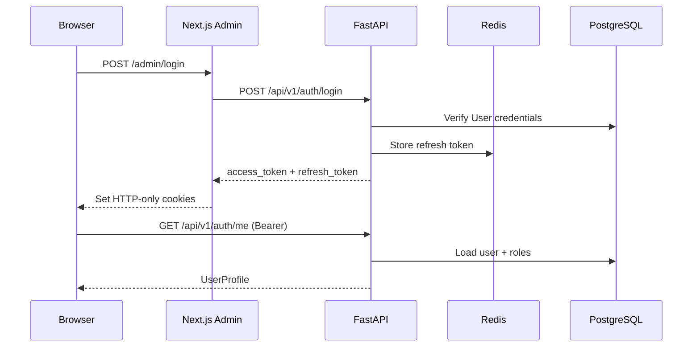
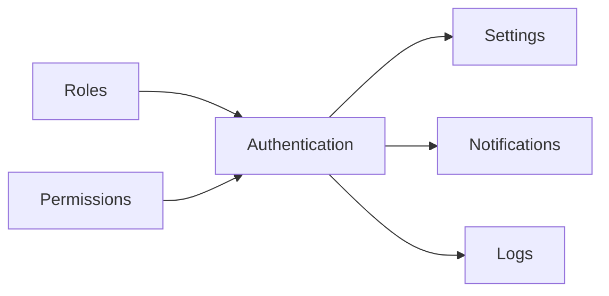

# Authentication Module

| Field | Value |
|-------|-------|
| Module ID | `MOD-AUTH` |
| Version | 1.0 |
| Status | Specification |
| Owner | Platform Engineering |
| Last Updated | 2026-06-29 |

## Purpose

The Authentication module provides identity verification, session management, and token issuance for all protected admin and API operations across FounderOS. It is the security foundation upon which RBAC, audit logging, and multi-tenant isolation depend.

## Scope

| In Scope | Out of Scope |
|----------|--------------|
| Email/password login for admin users | Public visitor registration |
| JWT access and refresh token lifecycle | OAuth social login (v1.1) |
| Password hashing and validation | SAML/OIDC enterprise SSO (v2.0) |
| Session invalidation and logout | Multi-factor authentication (v1.2) |
| Current-user (`/me`) endpoint | Customer-facing auth portals |

## Business Context

FounderOS is sold as a white-label SaaS product. Each tenant deployment requires a secure admin boundary so founders, content editors, and agency staff can manage site content without exposing write APIs publicly. Authentication is the gatekeeper for all monetizable admin capabilities.

## Goals

1. Provide stateless, horizontally scalable auth using JWT stored in HTTP-only cookies or Authorization headers.
2. Integrate seamlessly with the [Roles](../07_Admin/Roles.md) and [Permissions](../07_Admin/Permissions.md) modules.
3. Support secure bootstrap of the first admin user on tenant provisioning.
4. Meet OWASP authentication best practices for v1.0.

## Functional Requirements

| ID | Requirement | Priority |
|----|-------------|----------|
| AUTH-FR-01 | System SHALL authenticate users via email and password | Must |
| AUTH-FR-02 | System SHALL issue JWT access tokens with configurable TTL (default 30 min) | Must |
| AUTH-FR-03 | System SHALL issue refresh tokens stored in Redis with rotation on use | Must |
| AUTH-FR-04 | System SHALL expose `POST /auth/login` returning token pair | Must |
| AUTH-FR-05 | System SHALL expose `POST /auth/logout` invalidating refresh token | Must |
| AUTH-FR-06 | System SHALL expose `POST /auth/refresh` for token renewal | Must |
| AUTH-FR-07 | System SHALL expose `GET /auth/me` returning current user profile | Must |
| AUTH-FR-08 | System SHALL hash passwords with bcrypt (cost ≥ 12) | Must |
| AUTH-FR-09 | System SHALL reject inactive user accounts | Must |
| AUTH-FR-10 | System SHALL rate-limit login attempts (5/min per IP) | Should |

## Non-functional Requirements

| ID | Requirement | Target |
|----|-------------|--------|
| AUTH-NFR-01 | Login API p95 latency | < 200 ms |
| AUTH-NFR-02 | Token verification overhead per request | < 5 ms |
| AUTH-NFR-03 | Availability | 99.9% |
| AUTH-NFR-04 | Password hash algorithm | bcrypt, cost ≥ 12 |
| AUTH-NFR-05 | JWT signing algorithm | HS256 (v1.0); RS256 (v2.0) |

## User Stories

| ID | As a… | I want to… | So that… |
|----|-------|-------------|----------|
| AUTH-US-01 | Admin | Log in with email and password | I can access the admin panel |
| AUTH-US-02 | Admin | Stay logged in across browser sessions | I don't re-enter credentials hourly |
| AUTH-US-03 | Admin | Log out securely | My session cannot be reused |
| AUTH-US-04 | Platform operator | Bootstrap first admin on deploy | The tenant is immediately operable |
| AUTH-US-05 | Security auditor | See failed login attempts in logs | I can detect brute-force attacks |

## UX Requirements

- Login page at `/admin/login` with email, password, and "Remember me" toggle.
- Inline validation for email format and required fields.
- Generic error message on failure ("Invalid credentials") — no user enumeration.
- Redirect to intended admin route after successful login.
- Session expiry banner with one-click re-authentication modal.
- Loading state on submit; disable form during request.

## Technical Considerations

### Architecture



### Stack Integration

| Layer | Technology | Role |
|-------|------------|------|
| API | FastAPI + `python-jose` | JWT issue/verify |
| ORM | SQLAlchemy | User entity persistence |
| Cache | Redis | Refresh token store, rate limiting |
| Frontend | Next.js 15 middleware | Route protection |

### Reusable Interfaces

```typescript
// IAuthService — consumed by all admin modules
interface IAuthService {
  login(credentials: LoginCredentials): Promise<TokenPair>;
  logout(refreshToken: string): Promise<void>;
  refresh(refreshToken: string): Promise<TokenPair>;
  getCurrentUser(accessToken: string): Promise<UserProfile>;
  verifyToken(accessToken: string): Promise<TokenPayload>;
}

interface LoginCredentials {
  email: string;
  password: string;
  rememberMe?: boolean;
}

interface TokenPair {
  accessToken: string;
  refreshToken: string;
  expiresIn: number;
  tokenType: 'bearer';
}

interface TokenPayload {
  sub: string;       // user ID
  email: string;
  roles: string[];
  permissions: string[];
  exp: number;
  iat: number;
}

interface UserProfile {
  id: number;
  email: string;
  isActive: boolean;
  roles: RoleSummary[];
  createdAt: string;
}
```

```python
# Python — FastAPI dependency
class ICurrentUser(Protocol):
    id: int
    email: str
    is_active: bool
    permissions: set[str]

def get_current_user(token: str = Depends(oauth2_scheme)) -> User: ...
def require_permission(permission: str) -> Callable: ...
```

### Module Dependencies



| Dependency | Direction | Purpose |
|------------|-----------|---------|
| [Settings](Settings.md) | Outbound | JWT TTL, lockout thresholds |
| [Notifications](Notifications.md) | Outbound | Login alerts, password reset (v1.1) |
| [Roles](../07_Admin/Roles.md) | Inbound | Role claims in JWT |
| [Permissions](../07_Admin/Permissions.md) | Inbound | Permission enforcement |

### Data Entities

| Entity | Table | Key Fields |
|--------|-------|------------|
| `User` | `users` | `id`, `email`, `hashed_password`, `is_active`, `created_at` |
| `RefreshToken` | Redis key `rt:{jti}` | `user_id`, `expires_at`, `revoked` |
| `LoginAttempt` | `login_attempts` (v1.1) | `ip`, `email`, `success`, `created_at` |

See [09_Database Schema](../09_Database/Entities.md#users).

### API Endpoints

| Method | Path | Auth | Description | API Doc |
|--------|------|------|-------------|---------|
| POST | `/api/v1/auth/login` | Public | Issue token pair | [Authentication_API](../08_API/Authentication_API.md#post-login) |
| POST | `/api/v1/auth/logout` | Bearer | Revoke refresh token | [Authentication_API](../08_API/Authentication_API.md#post-logout) |
| POST | `/api/v1/auth/refresh` | Refresh cookie | Renew access token | [Authentication_API](../08_API/Authentication_API.md#post-refresh) |
| GET | `/api/v1/auth/me` | Bearer | Current user profile | [Authentication_API](../08_API/Authentication_API.md#get-me) |

### Permissions

| Permission Key | Description | Default Roles |
|----------------|-------------|---------------|
| `auth.login` | Access login endpoint | All admin roles |
| `auth.me` | Read own profile | All authenticated |
| `auth.manage_sessions` | Revoke other user sessions | `super_admin` |

### Admin UI Requirements

No dedicated admin CRUD screen in v1.0 — login is the primary UI surface. User management is delegated to [Users](../07_Admin/Users.md).

| Screen | Route | Notes |
|--------|-------|-------|
| Login | `/admin/login` | Public |
| Session expired modal | Global admin layout | Triggered on 401 |

## Security Considerations

- Never log passwords or raw tokens.
- Store `SECRET_KEY` in environment variables; rotate on compromise.
- Use HTTP-only, Secure, SameSite=Lax cookies for refresh tokens in browser clients.
- Implement account lockout after 10 failed attempts within 15 minutes (configurable via [Settings](Settings.md)).
- JWT `sub` must be numeric user ID; validate on every protected route.
- See [11_Security Authentication](../11_Security/Authentication.md).

## Acceptance Criteria

- [ ] Valid credentials return 200 with access and refresh tokens.
- [ ] Invalid credentials return 401 with generic message.
- [ ] Expired access token returns 401; refresh flow restores session.
- [ ] Logout invalidates refresh token in Redis.
- [ ] `/auth/me` returns user with roles and flattened permissions.
- [ ] Inactive users cannot authenticate.
- [ ] Login rate limiting triggers 429 after threshold.

## Future Enhancements

| Version | Enhancement |
|---------|-------------|
| v1.1 | Password reset via email |
| v1.2 | TOTP multi-factor authentication |
| v2.0 | OIDC/SAML enterprise SSO |
| v2.0 | API key auth for headless integrations |

## Open Questions

| # | Question | Owner | Status |
|---|----------|-------|--------|
| OQ-AUTH-01 | RS256 vs HS256 for multi-service deployments? | Platform Eng | Open |
| OQ-AUTH-02 | Refresh token in cookie vs localStorage for admin SPA? | Frontend | Open |
| OQ-AUTH-03 | Per-tenant JWT secret vs global secret in multi-tenant v2? | Security | Deferred |

## Related Documents

- [Users Admin](../07_Admin/Users.md)
- [Roles Admin](../07_Admin/Roles.md)
- [Permissions Admin](../07_Admin/Permissions.md)
- [Settings Module](Settings.md)
- [Backend Architecture](../04_Architecture/Backend_Architecture.md)
