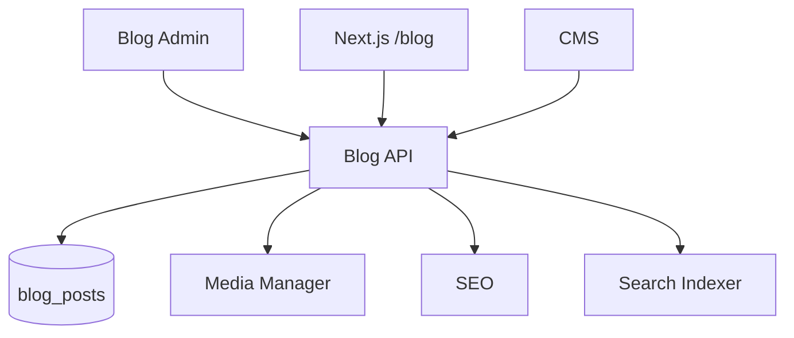

# Blog Manager Module

| Field | Value |
|-------|-------|
| Module ID | `MOD-BLOG` |
| Version | 1.0 |
| Status | Specification |
| Owner | Content Platform |
| Last Updated | 2026-06-29 |

## Purpose

The Blog Manager module provides long-form publishing capabilities—posts with rich content, excerpts, tags, cover images, and publish scheduling—for thought leadership, technical articles, and SEO-driven inbound marketing.

## Scope

| In Scope | Out of Scope |
|----------|--------------|
| Blog post CRUD and publishing | Comment system (v1.2) |
| Slug-based public URLs | Multi-author bylines with profiles (v1.1) |
| Tags and excerpt fields | Newsletter auto-send on publish (see [Newsletter](Newsletter.md)) |
| Cover image via media library | RSS feed (v1.1 — partial via SEO) |
| Draft / published states | |

## Business Context

Founders use blogs to establish authority, improve organic search, and nurture enterprise leads. Blog content feeds [Search](Search.md), [SEO](SEO.md), and optional [Newsletter](Newsletter.md) campaigns.

## Goals

1. Enable markdown or rich HTML authoring with preview.
2. Support SEO-optimized post URLs and metadata.
3. Integrate with CMS for featured post blocks on homepage.
4. Maintain clear separation between draft and live content.

## Functional Requirements

| ID | Requirement | Priority |
|----|-------------|----------|
| BLOG-FR-01 | CRUD blog posts with slug, title, excerpt, content | Must |
| BLOG-FR-02 | `is_published` and `published_at` timestamps | Must |
| BLOG-FR-03 | Tag storage and filtering | Must |
| BLOG-FR-04 | Cover image optional field | Must |
| BLOG-FR-05 | Public list: published only, newest first | Must |
| BLOG-FR-06 | Public detail by slug | Must |
| BLOG-FR-07 | Auto-generate slug from title if omitted | Should |
| BLOG-FR-08 | Reading time estimate on public page | Should |

## Non-functional Requirements

| ID | Requirement | Target |
|----|-------------|--------|
| BLOG-NFR-01 | Post list p95 | < 100 ms |
| BLOG-NFR-02 | Max post body size | 500 KB |
| BLOG-NFR-03 | ISR revalidation on publish | < 60 s |

## User Stories

| ID | As a… | I want to… | So that… |
|----|-------|-------------|----------|
| BLOG-US-01 | Founder | Write and publish blog posts | I share expertise publicly |
| BLOG-US-02 | Reader | Browse posts by tag | I find relevant topics |
| BLOG-US-03 | SEO manager | Set per-post meta title/description | Posts rank in search |
| BLOG-US-04 | Editor | Save drafts without publishing | I iterate before go-live |

## UX Requirements

- Public index: card layout with cover, excerpt, date, tags.
- Post detail: typography-optimized reading layout, share buttons, related posts.
- Admin: split editor (markdown/HTML) + live preview pane.
- Tag input with autocomplete from existing tags.
- Publish scheduler datetime picker.
- Status badge: Draft / Published.

## Technical Considerations

### Architecture



### Reusable Interfaces

```typescript
interface IBlogPost {
  id: number;
  slug: string;
  title: string;
  excerpt: string;
  content: string;
  coverImage?: string;
  tags: string[];
  isPublished: boolean;
  publishedAt?: string;
  readingTimeMinutes?: number;
  seo?: ISEOMetadata;
  createdAt: string;
  updatedAt: string;
}

interface IBlogService {
  list(params?: { tag?: string; page?: number; limit?: number }): Promise<Paginated<IBlogPost>>;
  getBySlug(slug: string): Promise<IBlogPost>;
  create(data: BlogPostCreateInput): Promise<IBlogPost>;
  update(id: number, data: BlogPostUpdateInput): Promise<IBlogPost>;
  delete(id: number): Promise<void>;
  publish(id: number, publishedAt?: string): Promise<IBlogPost>;
}
```

### Module Dependencies

| Module | Purpose |
|--------|---------|
| [Authentication](Authentication.md) | Admin writes |
| [Media Manager](Media_Manager.md) | Cover images |
| [SEO](SEO.md) | Post metadata, OG images |
| [CMS](CMS.md) | Featured posts block |
| [Search](Search.md) | Full-text indexing |
| [Newsletter](Newsletter.md) | Optional publish notification |
| [Analytics](Analytics.md) | Page view tracking |

### Data Entities

| Entity | Table | Key Fields |
|--------|-------|------------|
| `BlogPost` | `blog_posts` | `slug`, `title`, `excerpt`, `content`, `cover_image`, `tags`, `is_published`, `published_at` |

### API Endpoints

| Method | Path | Auth | Permission | API Doc |
|--------|------|------|------------|---------|
| GET | `/api/v1/blog` | Public | — | [Blog_API](../08_API/Blog_API.md#list) |
| GET | `/api/v1/blog/{slug}` | Public | — | [Blog_API](../08_API/Blog_API.md#get) |
| POST | `/api/v1/blog` | Bearer | `blog.write` | [Blog_API](../08_API/Blog_API.md#create) |
| PUT | `/api/v1/blog/{post_id}` | Bearer | `blog.write` | [Blog_API](../08_API/Blog_API.md#update) |
| DELETE | `/api/v1/blog/{post_id}` | Bearer | `blog.delete` | [Blog_API](../08_API/Blog_API.md#delete) |
| POST | `/api/v1/blog/{post_id}/publish` | Bearer | `blog.publish` | [Blog_API](../08_API/Blog_API.md#publish) |

### Permissions

| Permission | Description | Roles |
|------------|-------------|-------|
| `blog.read` | View all posts including drafts | `editor`, `admin` |
| `blog.write` | Create/edit posts | `editor`, `admin` |
| `blog.publish` | Publish posts | `admin`, `publisher` |
| `blog.delete` | Delete posts | `admin` |

### Admin UI Requirements

[Content Admin](../07_Admin/Content.md) → Blog tab.

| Screen | Features |
|--------|----------|
| List | Filter draft/published, tag filter, search |
| Editor | Title, slug, excerpt, content editor, cover picker, tags, SEO panel |
| Preview | Opens `/blog/{slug}?preview=true` |

## Security Considerations

- Sanitize HTML content server-side before storage and render.
- Draft posts MUST NOT appear in public list or sitemap.
- XSS prevention in markdown rendering pipeline.
- CSRF protection on admin mutations (cookie + header pattern).

## Acceptance Criteria

- [ ] Published posts visible at `/blog` and `/blog/{slug}`.
- [ ] Draft posts return 404 on public slug access.
- [ ] Tags filter works on list endpoint.
- [ ] Cover image renders with responsive `srcset`.
- [ ] Publish sets `published_at` if not provided.
- [ ] Search index updates within 2 minutes of publish.

## Future Enhancements

- Comments with moderation
- Multi-author support and author pages
- RSS/Atom feed generation
- AI-assisted excerpt generation
- Series/collections grouping

## Open Questions

| # | Question | Status |
|---|----------|--------|
| OQ-BLOG-01 | Markdown vs TipTap rich text as canonical? | TipTap v1.0 |
| OQ-BLOG-02 | Auto newsletter on publish — opt-in default? | Off by default |

## Related Documents

- [05_Pages Blog](../05_Pages/Blog.md)
- [SEO Module](SEO.md)
- [Newsletter](Newsletter.md)
