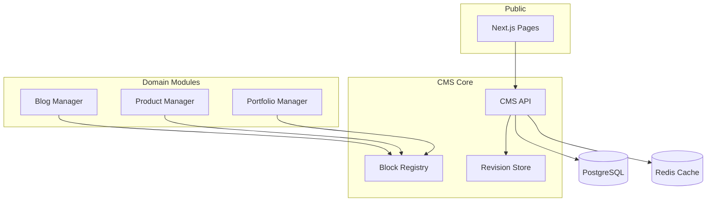
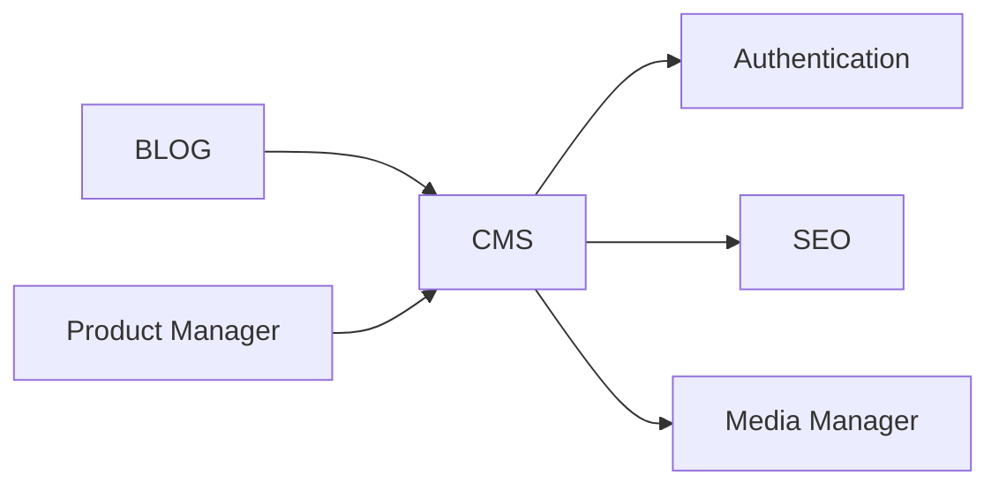

# CMS Module

| Field | Value |
|-------|-------|
| Module ID | `MOD-CMS` |
| Version | 1.0 |
| Status | Specification |
| Owner | Content Platform |
| Last Updated | 2026-06-29 |

## Purpose

The CMS (Content Management System) module is the **central content orchestration layer** for FounderOS. It provides reusable primitives—pages, blocks, revisions, publishing workflow, and content types—that power public pages and feed domain-specific modules (Blog, Products, Portfolio).

## Scope

| In Scope | Out of Scope |
|----------|--------------|
| Page and block-based content model | Full WYSIWYG page builder (v1.2) |
| Draft / published / scheduled states | Real-time collaborative editing |
| Content revision history | Headless CMS multi-locale (v2.0) |
| Reusable content blocks registry | Third-party CMS import (WordPress) |
| Integration hooks for domain modules | |

## Business Context

White-label customers need to edit marketing copy, hero sections, and legal pages without developer involvement. CMS abstracts content from presentation so tenants can rebrand and restructure pages while preserving module boundaries.

## Goals

1. Unify content lifecycle (draft → review → publish) across all editable surfaces.
2. Provide a block registry extensible by other modules.
3. Enable preview of unpublished content for authenticated editors.
4. Support SEO metadata attachment at the page level.

## Functional Requirements

| ID | Requirement | Priority |
|----|-------------|----------|
| CMS-FR-01 | System SHALL model content as `Page` + ordered `Block` children | Must |
| CMS-FR-02 | System SHALL support draft and published versions per page | Must |
| CMS-FR-03 | System SHALL maintain revision history (last 10 per page) | Must |
| CMS-FR-04 | System SHALL expose public read of published pages only | Must |
| CMS-FR-05 | System SHALL allow preview token for draft content | Should |
| CMS-FR-06 | System SHALL register block types from domain modules | Must |
| CMS-FR-07 | System SHALL attach SEO metadata per page via [SEO](SEO.md) | Must |
| CMS-FR-08 | System SHALL support scheduled publish datetime | Should |

## Non-functional Requirements

| ID | Requirement | Target |
|----|-------------|--------|
| CMS-NFR-01 | Public page fetch p95 | < 100 ms (cached) |
| CMS-NFR-02 | Block registry load at startup | < 500 ms |
| CMS-NFR-03 | Revision storage growth | Bounded; archive after 10 |
| CMS-NFR-04 | Cache invalidation on publish | < 2 s propagation |

## User Stories

| ID | As a… | I want to… | So that… |
|----|-------|-------------|----------|
| CMS-US-01 | Content editor | Edit page blocks in admin | I update site copy without code |
| CMS-US-02 | Founder | Preview draft pages | I approve content before go-live |
| CMS-US-03 | Developer | Register custom block types | Domain modules extend CMS |
| CMS-US-04 | SEO manager | Set meta title/description per page | Pages rank correctly |
| CMS-US-05 | Admin | Roll back to a previous revision | I recover from bad edits |

## UX Requirements

- Page list in admin with status badges: Draft, Published, Scheduled.
- Block editor panel: add, reorder (drag), duplicate, delete blocks.
- Side-by-side preview toggle (desktop/mobile breakpoints).
- Autosave draft every 30 seconds with "Saved" indicator.
- Publish confirmation modal with schedule option.
- Revision timeline with diff view (text fields).

## Technical Considerations

### Architecture



### Reusable Interfaces

```typescript
interface ICMSBlock {
  id: string;
  type: string;
  order: number;
  data: Record<string, unknown>;
  visibility: 'public' | 'authenticated' | 'hidden';
}

interface ICMSPage {
  id: number;
  slug: string;
  title: string;
  status: 'draft' | 'published' | 'scheduled';
  blocks: ICMSBlock[];
  seo: ISEOMetadata;
  publishedAt?: string;
  scheduledAt?: string;
}

interface IBlockTypeRegistration {
  type: string;
  label: string;
  icon: string;
  schema: JSONSchema;
  component: string; // Next.js component path
  adminEditor: string; // Admin editor component path
}

interface ICMSService {
  getPage(slug: string, preview?: boolean): Promise<ICMSPage>;
  savePage(page: ICMSPage): Promise<ICMSPage>;
  publishPage(pageId: number, scheduledAt?: string): Promise<void>;
  listRevisions(pageId: number): Promise<RevisionSummary[]>;
  restoreRevision(pageId: number, revisionId: number): Promise<ICMSPage>;
}
```

### Module Dependencies

| Module | Relationship | Purpose |
|--------|--------------|---------|
| [Authentication](Authentication.md) | Required | Editor auth |
| [SEO](SEO.md) | Required | Page metadata |
| [Media Manager](Media_Manager.md) | Optional | Block image assets |
| [Settings](Settings.md) | Optional | Site-wide defaults |
| [Search](Search.md) | Consumer | Index published pages |
| [Blog Manager](Blog_Manager.md) | Extends | Blog block types |
| [Product Manager](Product_Manager.md) | Extends | Product showcase blocks |



### Data Entities

| Entity | Table | Description |
|--------|-------|-------------|
| `Page` | `cms_pages` | `id`, `slug`, `title`, `status`, `seo_id`, `published_at` |
| `Block` | `cms_blocks` | `id`, `page_id`, `type`, `order`, `data` (JSONB) |
| `Revision` | `cms_revisions` | `id`, `page_id`, `snapshot` (JSONB), `created_by`, `created_at` |
| `BlockType` | `cms_block_types` | Registry metadata (optional DB mirror of code registry) |

### API Endpoints

| Method | Path | Auth | Permission | API Doc |
|--------|------|------|------------|---------|
| GET | `/api/v1/cms/pages` | Bearer | `cms.read` | [CMS_API](../08_API/CMS_API.md#list-pages) |
| GET | `/api/v1/cms/pages/{slug}` | Public/Bearer | `cms.read` / preview | [CMS_API](../08_API/CMS_API.md#get-page) |
| POST | `/api/v1/cms/pages` | Bearer | `cms.write` | [CMS_API](../08_API/CMS_API.md#create-page) |
| PUT | `/api/v1/cms/pages/{id}` | Bearer | `cms.write` | [CMS_API](../08_API/CMS_API.md#update-page) |
| POST | `/api/v1/cms/pages/{id}/publish` | Bearer | `cms.publish` | [CMS_API](../08_API/CMS_API.md#publish-page) |
| GET | `/api/v1/cms/pages/{id}/revisions` | Bearer | `cms.read` | [CMS_API](../08_API/CMS_API.md#list-revisions) |
| POST | `/api/v1/cms/pages/{id}/revisions/{rev_id}/restore` | Bearer | `cms.write` | [CMS_API](../08_API/CMS_API.md#restore-revision) |

### Permissions

| Permission | Description | Roles |
|------------|-------------|-------|
| `cms.read` | View pages and drafts | `editor`, `admin` |
| `cms.write` | Create/edit pages and blocks | `editor`, `admin` |
| `cms.publish` | Publish or schedule pages | `admin`, `publisher` |
| `cms.delete` | Delete pages | `admin` |

### Admin UI Requirements

See [Content Admin](../07_Admin/Content.md).

| Feature | Requirement |
|---------|-------------|
| Page list | Filter by status, search by title/slug |
| Block editor | Type-specific forms from block registry |
| Preview | New tab with `?preview_token=` |
| Revisions | Timeline panel in page detail |

## Security Considerations

- Draft content MUST NOT be returned on public endpoints without valid preview token.
- Preview tokens: single-use or time-limited (1 hour), signed JWT.
- Sanitize HTML block content server-side (bleach/DOMPurify policy).
- RBAC enforced on all write endpoints.
- Audit log on publish and delete via [Logs](../07_Admin/Logs.md).

## Acceptance Criteria

- [ ] Editor can create page with multiple blocks and save as draft.
- [ ] Published page visible on public site; draft is not.
- [ ] Preview token allows draft view without publish.
- [ ] Revision restore reverts block data accurately.
- [ ] Block types from Blog/Product modules appear in add-block menu.
- [ ] SEO metadata persists and renders in `<head>`.

## Future Enhancements

- Visual drag-and-drop page builder (v1.2)
- Multi-language content variants (v2.0)
- Content approval workflow with assignees
- A/B testing variants per page block

## Open Questions

| # | Question | Status |
|---|----------|--------|
| OQ-CMS-01 | Store blocks as JSONB vs normalized block tables? | Leaning JSONB |
| OQ-CMS-02 | CMS pages vs Next.js static routes — which owns `/about`? | Hybrid: CMS overrides |
| OQ-CMS-03 | Maximum blocks per page limit? | Proposed: 50 |

## Related Documents

- [Content Admin](../07_Admin/Content.md)
- [SEO Module](SEO.md)
- [05_Pages Home](../05_Pages/Home.md)
- [09_Database Schema](../09_Database/Entities.md)
