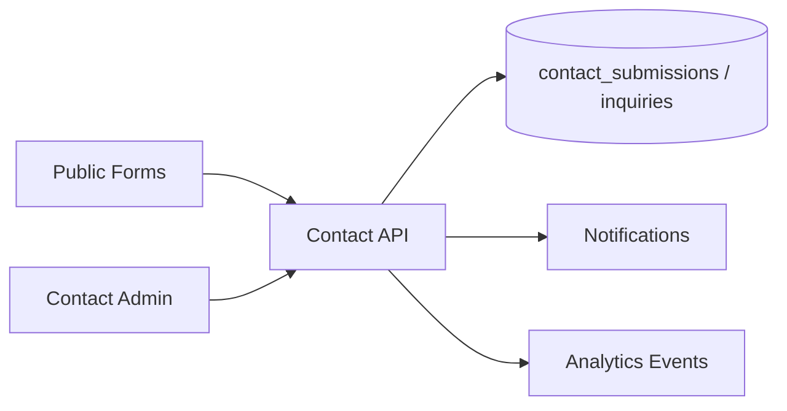

# Contact Manager Module

| Field | Value |
|-------|-------|
| Module ID | `MOD-CONTACT` |
| Version | 1.0 |
| Status | Specification |
| Owner | Lead Generation |
| Last Updated | 2026-06-29 |

## Purpose

The Contact Manager module captures, stores, and routes inbound lead submissions from public contact and inquiry forms—enabling founders to respond to enterprise prospects, partnership requests, and general inquiries without third-party form tools.

## Scope

| In Scope | Out of Scope |
|----------|--------------|
| Contact form and enterprise inquiry form submission | CRM sync (HubSpot, Salesforce) v1.2 |
| Admin inbox with read/unread status | Live chat widget |
| Email notification on new submission | Auto-responder drip campaigns |
| Spam honeypot and rate limiting | reCAPTCHA Enterprise (v1.1) |
| Export submissions (CSV) | Two-way email threading |

## Business Context

FounderOS sites convert visitors into qualified leads. Contact Manager is the primary inbound channel for enterprise buyers evaluating SaaS founders and agencies. Submissions feed [Notifications](Notifications.md) and [Analytics](Analytics.md) conversion tracking.

## Goals

1. Provide reliable, transactional storage of form submissions.
2. Deliver timely admin notifications for new leads.
3. Support distinct inquiry types (general contact vs. enterprise inquiry with budget).
4. Protect against spam and abuse without degrading UX.
5. Enable GDPR-compliant data export and deletion.

## Functional Requirements

| ID | Requirement | Priority |
|----|-------------|----------|
| CNT-FR-01 | Public `POST` contact form with name, email, message | Must |
| CNT-FR-02 | Public `POST` enterprise inquiry with company, role, budget | Must |
| CNT-FR-03 | Persist submissions with `is_read` flag | Must |
| CNT-FR-04 | Admin list with pagination and unread filter | Must |
| CNT-FR-05 | Admin mark read/unread and delete | Must |
| CNT-FR-06 | Honeypot field rejection (silent success) | Must |
| CNT-FR-07 | Rate limit per IP (10/hour) | Must |
| CNT-FR-08 | Trigger notification on new submission | Must |
| CNT-FR-09 | CSV export of submissions | Should |

## Non-functional Requirements

| ID | Requirement | Target |
|----|-------------|--------|
| CNT-NFR-01 | Form submission p95 | < 300 ms |
| CNT-NFR-02 | Zero data loss on submit | Transactional insert |
| CNT-NFR-03 | PII retention | 2 years (configurable) |
| CNT-NFR-04 | Max message length | 10,000 characters |

## User Stories

| ID | As a… | I want to… | So that… |
|----|-------|-------------|----------|
| CNT-US-01 | Visitor | Submit a contact message | The founder can reach me |
| CNT-US-02 | Enterprise buyer | Submit inquiry with budget range | Sales can qualify the lead |
| CNT-US-03 | Founder | See unread submissions in admin | I respond to hot leads quickly |
| CNT-US-04 | Admin | Export contacts for CRM import | I migrate leads to external tools |
| CNT-US-05 | Compliance officer | Delete a submission on request | We honor GDPR erasure |

## UX Requirements

- Public forms: clear labels, inline validation, success confirmation without redirect.
- Honeypot field hidden from assistive tech and users.
- Admin inbox: table with name, email, type, date, read badge; detail slide-over.
- Bulk mark-as-read and filter by inquiry type.
- Empty state: "No submissions yet" with link to public contact page.
- Mobile-friendly form layout with adequate touch targets.

## Technical Considerations

### Architecture

### Module Dependencies

| Module | Purpose |
|--------|---------|
| [Contact API](../08_API/Contact_API.md) | REST contract |
| [Notifications](Notifications.md) | Email alerts |
| [Analytics](Analytics.md) | Conversion events |
| [Contact Admin](../07_Admin/Content.md) | Inbox UI |

### Data Entities

| Entity | Table | Purpose |
|--------|-------|---------|
| ContactSubmission | `contact_submissions` | General contact messages |
| Inquiry | `inquiries` | Enterprise inquiry with budget |

See [Entities](../09_Database/Entities.md#contact_submissions).

## Security Considerations

- No authentication required for public submit; rate limiting enforced.
- Sanitize and escape all user input before storage and display.
- Never expose submission PII in public API responses.
- Admin endpoints require Bearer token and `contact:read` / `contact:write`.
- Audit log on delete operations (v1.1).
- Email addresses validated format-only; no email enumeration via API.

## Acceptance Criteria

- [ ] Contact and inquiry forms persist submissions with timestamps.
- [ ] Honeypot submissions return 200 but are not stored.
- [ ] Rate limit returns 429 after threshold.
- [ ] Admin inbox shows unread count badge.
- [ ] Notification sent within 60 seconds of submission.
- [ ] CSV export includes all visible columns.

## Future Enhancements

| Version | Enhancement |
|---------|-------------|
| v1.1 | reCAPTCHA v3 integration |
| v1.2 | HubSpot webhook on new inquiry |
| v1.5 | Idempotency key for duplicate submit prevention |
| v2.0 | In-app reply with SMTP relay |

## Open Questions

| ID | Question | Owner | Status |
|----|----------|-------|--------|
| OQ-CNT-01 | Single unified inbox vs. separate contact/inquiry views? | Product | Open |
| OQ-CNT-02 | Auto-assign inquiry priority by budget range? | Product | Open |
| OQ-CNT-03 | Store IP address for abuse tracking? | Legal | Open |

## Related Documents

- [Contact API](../08_API/Contact_API.md)
- [Notifications](Notifications.md)
- [Content Admin](../07_Admin/Content.md)
