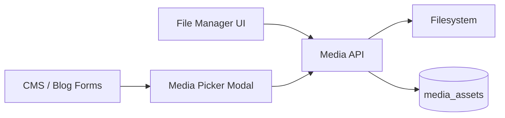

# File Manager Module

| Field | Value |
|-------|-------|
| Module ID | `MOD-FILE-MGR` |
| Version | 1.0 |
| Status | Specification |
| Owner | Creator Tools |
| Last Updated | 2026-06-29 |

## Purpose

The File Manager module provides the admin user interface for browsing, uploading, organizing, and deleting files in the media library—serving as the primary UX layer atop [Media Manager](Media_Manager.md) and the [Media API](../08_API/Media_API.md).

## Scope

| In Scope | Out of Scope |
|----------|--------------|
| Folder tree navigation | Desktop sync client |
| Drag-and-drop multi-file upload | Collaborative real-time editing |
| Grid and list view modes | Version history per file (v1.5) |
| Metadata editing (alt text, caption) | In-browser image editor (v1.2) |
| Bulk delete and move operations | CDN cache purge UI (v1.5) |
| Media picker modal for content editors | Video transcoding controls |

## Business Context

Content creators spend significant time managing assets. A polished file manager reduces friction when attaching images to blog posts, travel galleries, and product pages—directly impacting publishing velocity.

## Goals

1. Mirror filesystem folder structure in intuitive tree UI.
2. Support fast multi-file upload with progress indicators.
3. Enable content editors to pick media without leaving edit forms.
4. Surface reference warnings before destructive deletes.
5. Meet accessibility standards for keyboard navigation.

## Functional Requirements

| ID | Requirement | Priority |
|----|-------------|----------|
| FILE-FR-01 | Folder tree with expand/collapse | Must |
| FILE-FR-02 | Grid view with thumbnails for images | Must |
| FILE-FR-03 | List view with sortable columns | Must |
| FILE-FR-04 | Drag-and-drop upload to current folder | Must |
| FILE-FR-05 | Edit alt text and caption in detail panel | Must |
| FILE-FR-06 | Media picker modal for CMS/blog forms | Must |
| FILE-FR-07 | Delete with reference conflict warning | Must |
| FILE-FR-08 | Bulk select and delete | Should |
| FILE-FR-09 | Search/filter by filename and MIME type | Must |
| FILE-FR-10 | Copy public URL to clipboard | Must |

## Non-functional Requirements

| ID | Requirement | Target |
|----|-------------|--------|
| FILE-NFR-01 | Folder list load p95 | < 200 ms |
| FILE-NFR-02 | Thumbnail grid 100 items | < 1 s |
| FILE-NFR-03 | Upload progress per file | Real-time |
| FILE-NFR-04 | Max concurrent uploads | 5 |

## User Stories

| ID | As a… | I want to… | So that… |
|----|-------|-------------|----------|
| FILE-US-01 | Editor | Upload multiple photos at once | I build galleries faster |
| FILE-US-02 | Editor | Pick an image from a modal | I attach cover images easily |
| FILE-US-03 | Admin | Organize files in folders | The library stays manageable |
| FILE-US-04 | Admin | See if a file is in use before delete | I avoid broken images |
| FILE-US-05 | Accessibility user | Navigate file manager by keyboard | I can manage media independently |

## UX Requirements

- Layout: left folder tree, main grid/list, right detail panel on selection.
- Upload zone: dashed border drop target; click to browse files.
- Thumbnails: lazy-loaded; placeholder for non-image files (PDF, etc.).
- Picker modal: searchable grid; single or multi-select mode.
- Delete confirmation modal lists referencing content if conflict.
- Breadcrumb navigation for current folder path.
- Responsive: collapsible tree on tablet/mobile.

## Technical Considerations

### Architecture

### Module Dependencies

| Module | Purpose |
|--------|---------|
| [Media Manager](Media_Manager.md) | Backend storage logic |
| [Media API](../08_API/Media_API.md) | REST operations |
| [Media Admin](../07_Admin/Media.md) | Admin route hosting |
| [Gallery](Gallery.md) | Album composition from assets |

## Security Considerations

- All operations require `media:read` / `media:write` permissions.
- Upload MIME validation enforced server-side.
- No directory traversal via folder names.
- Public URLs copied are read-only — no signed upload URLs to client.
- Bulk delete requires confirmation with count.

## Acceptance Criteria

- [ ] Upload 10 images shows individual progress bars.
- [ ] Folder CRUD reflects in tree immediately.
- [ ] Picker modal returns selected asset URL to parent form.
- [ ] Delete blocked file shows referencing entities.
- [ ] Alt text edit persists and reflects in public img tags.
- [ ] Keyboard navigation covers tree, grid, and actions.

## Future Enhancements

| Version | Enhancement |
|---------|-------------|
| v1.2 | Basic crop/resize in browser |
| v1.5 | File version history |
| v1.5 | Storage quota indicator |
| v2.0 | AI auto-tagging |

## Open Questions

| ID | Question | Owner | Status |
|----|----------|-------|--------|
| OQ-FILE-01 | Unified File Manager vs. Media Manager naming in nav? | UX | Open |
| OQ-FILE-02 | Default folder structure (by year/month vs. content type)? | Product | Open |
| OQ-FILE-03 | Show file size quota in v1.0? | Product | Open |

## Related Documents

- [Media Manager](Media_Manager.md)
- [Media API](../08_API/Media_API.md)
- [Media Admin](../07_Admin/Media.md)
- [Gallery](Gallery.md)
