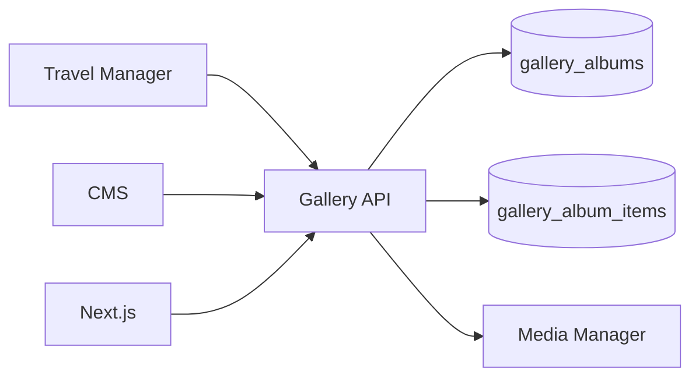

# Gallery Module

| Field | Value |
|-------|-------|
| Module ID | `MOD-GALLERY` |
| Version | 1.0 |
| Status | Specification |
| Owner | Creator Tools |
| Last Updated | 2026-06-29 |

## Purpose

The Gallery module organizes [Media Manager](Media_Manager.md) assets into albums and curated collections for public lightbox viewing—used by Travel, Portfolio, Blog, and standalone gallery pages.

## Scope

| In Scope | Out of Scope |
|----------|--------------|
| Album CRUD with ordered media items | Client proofing galleries with passwords (v1.2) |
| Public gallery pages and lightbox | Print shop integration |
| CMS embed block `gallery-grid` | RAW photo processing |
| Cover image per album | |

## Business Context

Visual storytelling differentiates founder and creator brands. Galleries provide structured photo presentation without duplicating file storage.

## Goals

1. Compose albums from existing media assets only.
2. Deliver performant lightbox UX on public pages.
3. Support drag-reorder of album items in admin.
4. Enable Travel and CMS modules to reference albums by ID.

## Functional Requirements

| ID | Requirement | Priority |
|----|-------------|----------|
| GAL-FR-01 | CRUD albums with title, slug, description | Must |
| GAL-FR-02 | Add/remove/reorder media items in album | Must |
| GAL-FR-03 | Set album cover (explicit or first item) | Must |
| GAL-FR-04 | Public album by slug | Must |
| GAL-FR-05 | `is_published` toggle | Must |
| GAL-FR-06 | Lightbox with keyboard navigation | Must |
| GAL-FR-07 | CMS block embedding | Should |

## Non-functional Requirements

| ID | Requirement | Target |
|----|-------------|--------|
| GAL-NFR-01 | Album with 50 images LCP | < 2.5 s |
| GAL-NFR-02 | Max items per album | 200 |
| GAL-NFR-03 | Lazy load off-screen thumbnails | Required |

## User Stories

| ID | As a… | I want to… | So that… |
|----|-------|-------------|----------|
| GAL-US-01 | Creator | Create photo albums | I showcase visual work |
| GAL-US-02 | Visitor | Browse photos in lightbox | I view images fullscreen |
| GAL-US-03 | Editor | Reorder album photos | I control narrative flow |
| GAL-US-04 | Travel creator | Link album to destination | Photos appear on travel page |

## UX Requirements

- Public: masonry or justified grid; click opens lightbox with prev/next, counter, caption.
- Admin: album list; album editor with media picker and drag reorder.
- Mobile: swipe gestures in lightbox.
- Keyboard: Esc close, arrow keys navigate.

## Technical Considerations

### Architecture



### Reusable Interfaces

```typescript
interface IGalleryAlbum {
  id: number;
  slug: string;
  title: string;
  description?: string;
  coverMediaId?: number;
  items: IGalleryItem[];
  isPublished: boolean;
  sortOrder: number;
}

interface IGalleryItem {
  id: number;
  mediaId: number;
  media: IMediaAsset;
  order: number;
  caption?: string;
}

interface IGalleryService {
  listAlbums(publishedOnly?: boolean): Promise<IGalleryAlbum[]>;
  getAlbum(slug: string): Promise<IGalleryAlbum>;
  createAlbum(data: AlbumInput): Promise<IGalleryAlbum>;
  addItem(albumId: number, mediaId: number): Promise<IGalleryItem>;
  reorderItems(albumId: number, itemIds: number[]): Promise<void>;
  removeItem(albumId: number, itemId: number): Promise<void>;
}
```

### Module Dependencies

| Module | Purpose |
|--------|---------|
| [Media Manager](Media_Manager.md) | Required — all items reference media |
| [Travel Manager](Travel_Manager.md) | Consumer |
| [CMS](CMS.md) | Embed blocks |
| [Authentication](Authentication.md) | Admin auth |
| [SEO](SEO.md) | Album page metadata |

### Data Entities

| Entity | Table | Fields |
|--------|-------|--------|
| `GalleryAlbum` | `gallery_albums` | `slug`, `title`, `description`, `cover_media_id`, `is_published` |
| `GalleryAlbumItem` | `gallery_album_items` | `album_id`, `media_id`, `order`, `caption` |

### API Endpoints

| Method | Path | Auth | Permission | API Doc |
|--------|------|------|------------|---------|
| GET | `/api/v1/galleries` | Public | — | [Gallery_API](../08_API/Gallery_API.md#list) |
| GET | `/api/v1/galleries/{slug}` | Public | — | [Gallery_API](../08_API/Gallery_API.md#get) |
| POST | `/api/v1/galleries` | Bearer | `gallery.write` | [Gallery_API](../08_API/Gallery_API.md#create) |
| PUT | `/api/v1/galleries/{id}` | Bearer | `gallery.write` | [Gallery_API](../08_API/Gallery_API.md#update) |
| POST | `/api/v1/galleries/{id}/items` | Bearer | `gallery.write` | [Gallery_API](../08_API/Gallery_API.md#add-item) |
| PATCH | `/api/v1/galleries/{id}/items/reorder` | Bearer | `gallery.write` | [Gallery_API](../08_API/Gallery_API.md#reorder) |
| DELETE | `/api/v1/galleries/{id}/items/{item_id}` | Bearer | `gallery.write` | [Gallery_API](../08_API/Gallery_API.md#remove-item) |
| DELETE | `/api/v1/galleries/{id}` | Bearer | `gallery.delete` | [Gallery_API](../08_API/Gallery_API.md#delete) |

### Permissions

| Permission | Roles |
|------------|-------|
| `gallery.read` | `editor`, `admin` |
| `gallery.write` | `editor`, `admin` |
| `gallery.delete` | `admin` |

### Admin UI Requirements

[Media Admin](../07_Admin/Media.md) → Galleries sub-section.

| Feature | Detail |
|---------|--------|
| Album list | Thumbnail, item count, publish status |
| Editor | Media multi-select, drag reorder, cover picker |

## Security Considerations

- Albums inherit media access rules; no direct file path exposure.
- Unpublished albums return 404 on public routes.
- CAPTCHA not required for public view (read-only).

## Acceptance Criteria

- [ ] Published album renders grid and functional lightbox.
- [ ] Reorder persists and reflects on public page after revalidation.
- [ ] Travel destination displays linked album.
- [ ] CMS gallery block renders selected album.
- [ ] Deleting media referenced in album shows warning in Media Manager.

## Future Enhancements

- Password-protected client galleries
- Download original (rights-managed)
- EXIF display (location, camera)
- Slideshow autoplay mode

## Open Questions

| # | Question | Status |
|---|----------|--------|
| OQ-GAL-01 | Standalone `/galleries/{slug}` route vs embed-only? | Both |
| OQ-GAL-02 | Video items in albums v1.0? | Images only v1.0 |

## Related Documents

- [Media Manager](Media_Manager.md)
- [Travel Manager](Travel_Manager.md)
- [Media Admin](../07_Admin/Media.md)
