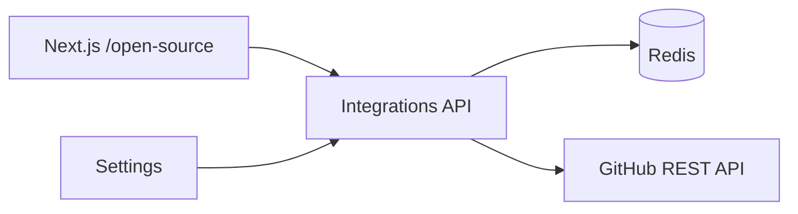

# GitHub Module

| Field | Value |
|-------|-------|
| Module ID | `MOD-GITHUB` |
| Version | 1.0 |
| Status | Specification |
| Owner | Integrations |
| Last Updated | 2026-06-29 |

## Purpose

The GitHub module surfaces open-source activity—public repositories, contribution stats, and language breakdown—for the founder's GitHub profile, powering the Open Source page and credibility signals across the platform.

## Scope

| In Scope | Out of Scope |
|----------|--------------|
| GitHub REST API public data fetch | Private repo access |
| Repository listing with stars, forks, language | GitHub Actions CI status |
| Aggregate stats (repo count, total stars) | Issue/PR management |
| Redis caching | OAuth GitHub App (v1.2) |
| Configurable username via Settings | |

## Business Context

Technical founders demonstrate execution through open source. Automated GitHub sync reduces manual portfolio updates and supports enterprise due diligence narratives.

## Goals

1. Display curated public repos sorted by relevance (stars, updated).
2. Cache GitHub API responses to respect rate limits (60/hr unauthenticated).
3. Provide stats summary for hero sections.
4. Degrade gracefully when GitHub is unreachable.

## Functional Requirements

| ID | Requirement | Priority |
|----|-------------|----------|
| GH-FR-01 | Configure `GITHUB_USERNAME` in Settings/env | Must |
| GH-FR-02 | `GET /integrations/github/repos` returns public repos | Must |
| GH-FR-03 | `GET /integrations/github/stats` returns aggregate metrics | Must |
| GH-FR-04 | Redis cache with 30 min TTL | Must |
| GH-FR-05 | Optional PAT for higher rate limits | Should |
| GH-FR-06 | CMS block `github-repos` | Should |
| GH-FR-07 | Filter pinned or featured repos (admin flag v1.1) | Could |

## Non-functional Requirements

| ID | Requirement | Target |
|----|-------------|--------|
| GH-NFR-01 | Cached p95 | < 50 ms |
| GH-NFR-02 | Cache TTL | 1800 s |
| GH-NFR-03 | Max repos returned | 30 |

## User Stories

| ID | As a… | I want to… | So that… |
|----|-------|-------------|----------|
| GH-US-01 | Founder | Show my public repos automatically | Visitors see open-source work |
| GH-US-02 | Enterprise buyer | View aggregate GitHub stats | I assess engineering activity |
| GH-US-03 | Admin | Set GitHub username in settings | No code deploy to update |
| GH-US-04 | Visitor | Click through to GitHub repo | I explore source code |

## UX Requirements

- Open Source page: stats bar (repos, stars, forks) + repo cards.
- Repo card: name, description, language chip, stars/forks icons.
- Link opens `github.com/{owner}/{repo}` in new tab.
- Loading skeleton; stale cache indicator in admin only.

## Technical Considerations

### Architecture



### Reusable Interfaces

```typescript
interface IGitHubRepo {
  id: number;
  name: string;
  fullName: string;
  description: string;
  htmlUrl: string;
  language: string;
  stargazersCount: number;
  forksCount: number;
  updatedAt: string;
  topics: string[];
}

interface IGitHubStats {
  publicRepoCount: number;
  totalStars: number;
  totalForks: number;
  topLanguages: Array<{ language: string; count: number }>;
}

interface IGitHubService {
  getRepos(): Promise<IGitHubRepo[]>;
  getStats(): Promise<IGitHubStats>;
  invalidateCache(): Promise<void>;
}
```

### Module Dependencies

| Module | Purpose |
|--------|---------|
| [Settings](Settings.md) | Username, optional PAT |
| [CMS](CMS.md) | Repo grid block |
| Redis | Cache layer |

Existing routes in `integrations.py`: `/github/repos`, `/github/stats`.

### Data Entities

Cache-only v1.0. Optional `github_featured_repos` table v1.1 for manual curation.

### API Endpoints

| Method | Path | Auth | Permission | API Doc |
|--------|------|------|------------|---------|
| GET | `/api/v1/integrations/github/repos` | Public | — | [GitHub_API](../08_API/GitHub_API.md) |
| GET | `/api/v1/integrations/github/stats` | Public | — | [GitHub_API](../08_API/GitHub_API.md) |
| POST | `/api/v1/integrations/github/cache/invalidate` | Bearer | `integrations.manage` | [GitHub_API](../08_API/GitHub_API.md) |

### Permissions

| Permission | Roles |
|------------|-------|
| `integrations.manage` | `admin` |

### Admin UI Requirements

[Settings Admin](../07_Admin/Settings.md) → Integrations.

| Setting | Description |
|---------|-------------|
| `github_username` | Public profile username |
| `github_token` | Optional PAT (encrypted) |
| Manual refresh button | Invalidates cache |

## Security Considerations

- PAT stored encrypted at rest; never sent to client.
- Only public repo endpoints used in v1.0.
- Sanitize repo descriptions before HTML render (escape).
- Handle GitHub 403 rate limit with cached stale data.

## Acceptance Criteria

- [ ] Repos endpoint returns sorted public repositories.
- [ ] Stats endpoint aggregates stars and forks correctly.
- [ ] Cache reduces duplicate GitHub API calls within TTL.
- [ ] Missing username returns empty data, not error.
- [ ] Open Source page renders repo cards with external links.

## Future Enhancements

- Featured repo pinning in admin
- Contribution graph heatmap embed
- Org-level profile support
- Webhook on new release

## Open Questions

| # | Question | Status |
|---|----------|--------|
| OQ-GH-01 | Sort repos by stars vs updated date? | Stars default |
| OQ-GH-02 | Include forked repos? | Exclude forks |

## Related Documents

- [YouTube](YouTube.md)
- [05_Pages Open_Source](../05_Pages/Open_Source.md)
- [Portfolio Manager](Portfolio_Manager.md)
