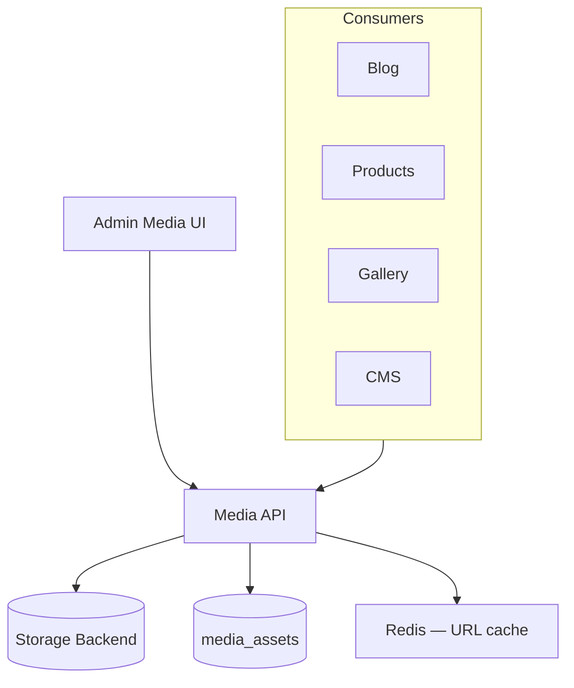

# Media Manager Module

| Field | Value |
|-------|-------|
| Module ID | `MOD-MEDIA` |
| Version | 1.0 |
| Status | Specification |
| Owner | Platform Engineering |
| Last Updated | 2026-06-29 |

## Purpose

The Media Manager module is the **central asset repository** for images, videos, documents, and other uploadable files. It provides upload, storage, metadata, transformations, and reference tracking consumed by Blog, Products, Portfolio, Gallery, CMS, and admin surfaces.

## Scope

| In Scope | Out of Scope |
|----------|--------------|
| File upload and storage abstraction | Video transcoding pipeline (v1.2) |
| Image metadata (alt text, caption, dimensions) | DAM enterprise workflows |
| Folder/collection organization | CDN provisioning (see Deployment) |
| Public and signed URL generation | AI auto-tagging (v2.0) |
| Usage reference tracking | |

## Business Context

Every content module needs consistent media handling. Centralizing assets prevents orphaned files, enables storage quotas per tenant, and supports white-label branding (logos, favicons) via [Settings](Settings.md).

## Goals

1. Single upload API with pluggable storage backend (local/S3).
2. Enforce alt text for accessibility on public-facing images.
3. Track which entities reference each media asset.
4. Provide admin media library with search and filters.

## Functional Requirements

| ID | Requirement | Priority |
|----|-------------|----------|
| MEDIA-FR-01 | Upload files via multipart API | Must |
| MEDIA-FR-02 | Store metadata: filename, mime, size, width, height | Must |
| MEDIA-FR-03 | Alt text and caption fields | Must |
| MEDIA-FR-04 | Folder hierarchy (single level v1.0) | Should |
| MEDIA-FR-05 | List, search, filter by mime type | Must |
| MEDIA-FR-06 | Delete with reference check (warn if in use) | Must |
| MEDIA-FR-07 | Generate responsive image URLs (srcset variants) | Should |
| MEDIA-FR-08 | Max file size configurable via Settings | Must |

## Non-functional Requirements

| ID | Requirement | Target |
|----|-------------|--------|
| MEDIA-NFR-01 | Upload 5 MB image p95 | < 3 s |
| MEDIA-NFR-02 | Default max file size | 10 MB (images), 50 MB (docs) |
| MEDIA-NFR-03 | Storage backend swap | Interface-driven |
| MEDIA-NFR-04 | Virus scan hook | ClamAV optional v1.1 |

## User Stories

| ID | As a… | I want to… | So that… |
|----|-------|-------------|----------|
| MEDIA-US-01 | Editor | Upload images to a media library | I reuse assets across pages |
| MEDIA-US-02 | Editor | Search media by filename | I find assets quickly |
| MEDIA-US-03 | Accessibility reviewer | Require alt text on images | Site meets WCAG |
| MEDIA-US-04 | Admin | See where an asset is used | I avoid breaking published pages |
| MEDIA-US-05 | Developer | Swap S3 for local storage | Deployments fit environment |

## UX Requirements

- Admin media library: grid/list toggle, mime filter, search, upload dropzone.
- Media detail drawer: preview, metadata edit, usage list, copy URL.
- Picker modal embeddable in Blog/Product/Portfolio editors.
- Upload progress indicator; error toast on size/type rejection.
- Empty folder state with upload CTA.

## Technical Considerations

### Architecture



### Reusable Interfaces

```typescript
interface IMediaAsset {
  id: number;
  filename: string;
  originalFilename: string;
  mimeType: string;
  sizeBytes: number;
  width?: number;
  height?: number;
  altText?: string;
  caption?: string;
  folderId?: number;
  url: string;
  thumbnailUrl?: string;
  createdAt: string;
}

interface IMediaStorageBackend {
  upload(file: Buffer, key: string, mime: string): Promise<string>;
  delete(key: string): Promise<void>;
  getPublicUrl(key: string): string;
  getSignedUrl(key: string, expiresIn: number): Promise<string>;
}

interface IMediaService {
  upload(file: File, metadata?: MediaMetadata): Promise<IMediaAsset>;
  list(params?: MediaListParams): Promise<Paginated<IMediaAsset>>;
  get(id: number): Promise<IMediaAsset>;
  update(id: number, metadata: Partial<MediaMetadata>): Promise<IMediaAsset>;
  delete(id: number, force?: boolean): Promise<void>;
  getReferences(id: number): Promise<MediaReference[]>;
}
```

### Module Dependencies

| Module | Direction | Purpose |
|--------|-----------|---------|
| [Authentication](Authentication.md) | Inbound | Upload auth |
| [Settings](Settings.md) | Inbound | Size limits, storage config |
| [File Manager](File_Manager.md) | Sibling | Non-image documents overlap |
| [Gallery](Gallery.md) | Consumer | Album assets |
| All content modules | Consumers | Embeds |

### Data Entities

| Entity | Table | Key Fields |
|--------|-------|------------|
| `MediaAsset` | `media_assets` | `storage_key`, `filename`, `mime_type`, `size_bytes`, `width`, `height`, `alt_text`, `caption`, `folder_id` |
| `MediaFolder` | `media_folders` | `name`, `parent_id` (nullable v1.0) |
| `MediaReference` | `media_references` | `media_id`, `entity_type`, `entity_id`, `field` |

### API Endpoints

| Method | Path | Auth | Permission | API Doc |
|--------|------|------|------------|---------|
| GET | `/api/v1/media` | Bearer | `media.read` | [Media_API](../08_API/Media_API.md#list) |
| GET | `/api/v1/media/{id}` | Bearer/Public | `media.read` | [Media_API](../08_API/Media_API.md#get) |
| POST | `/api/v1/media/upload` | Bearer | `media.write` | [Media_API](../08_API/Media_API.md#upload) |
| PUT | `/api/v1/media/{id}` | Bearer | `media.write` | [Media_API](../08_API/Media_API.md#update) |
| DELETE | `/api/v1/media/{id}` | Bearer | `media.delete` | [Media_API](../08_API/Media_API.md#delete) |
| GET | `/api/v1/media/{id}/references` | Bearer | `media.read` | [Media_API](../08_API/Media_API.md#references) |

### Permissions

| Permission | Roles |
|------------|-------|
| `media.read` | `editor`, `admin` |
| `media.write` | `editor`, `admin` |
| `media.delete` | `admin` |

### Admin UI Requirements

See [Media Admin](../07_Admin/Media.md).

| Screen | Route | Features |
|--------|-------|----------|
| Library | `/admin/media` | Grid, upload, search |
| Detail | `/admin/media/{id}` | Edit metadata, view references |
| Picker | Modal component | Used by content editors |

## Security Considerations

- Validate MIME type via magic bytes, not extension only.
- Block executable MIME types (`.exe`, `application/x-msdownload`).
- Signed URLs for private assets; public CDN for published content.
- Rate-limit uploads per user (20/hour default).
- See [11_Security File Upload](../11_Security/File_Upload.md).

## Acceptance Criteria

- [ ] Upload stores file and returns asset record with URL.
- [ ] Oversized files rejected with 413 and clear message.
- [ ] Delete blocked when references exist (unless `force=true` by admin).
- [ ] Alt text editable and enforced on publish flows that use images.
- [ ] Media picker works in Blog and Product editors.
- [ ] Storage backend configurable via environment.

## Future Enhancements

- Image optimization pipeline (WebP/AVIF variants)
- Video upload with poster frames
- Bulk upload and ZIP import
- AI-generated alt text suggestions
- Per-tenant storage quotas

## Open Questions

| # | Question | Status |
|---|----------|--------|
| OQ-MEDIA-01 | Local filesystem vs S3 as v1.0 default? | Local dev, S3 prod |
| OQ-MEDIA-02 | Merge with File Manager or keep separate? | Separate modules, shared storage interface |

## Related Documents

- [Media Admin](../07_Admin/Media.md)
- [File Manager](File_Manager.md)
- [Gallery](Gallery.md)
- [13_Deployment Storage](../13_Deployment/Storage.md)
