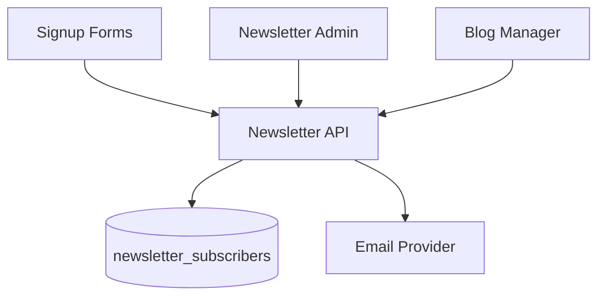

# Newsletter Module

| Field | Value |
|-------|-------|
| Module ID | `MOD-NEWSLETTER` |
| Version | 1.0 |
| Status | Specification |
| Owner | Growth |
| Last Updated | 2026-06-29 |

## Purpose

The Newsletter module manages email list subscriptions, double opt-in confirmation, and subscriber administration—enabling founders to build an owned audience independent of social platforms and optionally trigger campaigns from [Blog Manager](Blog_Manager.md) content.

## Scope

| In Scope | Out of Scope |
|----------|--------------|
| Public subscribe/unsubscribe endpoints | Full email campaign builder (v1.2) |
| Double opt-in with confirmation token | A/B subject line testing |
| Subscriber list in admin | Drip automation sequences |
| Integration with email provider (Resend/SendGrid) | Paid newsletter paywall |
| GDPR consent timestamp storage | RSS-to-email auto-send (v1.1) |

## Business Context

Owned email lists are a durable growth asset for founders. Newsletter subscriptions convert blog readers and product page visitors into a direct communication channel, supporting product launches and fundraising updates.

## Goals

1. Capture subscriber emails with explicit consent.
2. Enforce double opt-in for compliance and list quality.
3. Provide admin visibility into subscriber growth and status.
4. Support one-click unsubscribe without login.
5. Integrate with [Settings](Settings.md) for provider credentials.

## Functional Requirements

| ID | Requirement | Priority |
|----|-------------|----------|
| NWL-FR-01 | Public subscribe with email + consent checkbox | Must |
| NWL-FR-02 | Send confirmation email with token link | Must |
| NWL-FR-03 | Confirm subscription via token URL | Must |
| NWL-FR-04 | Public unsubscribe via signed token | Must |
| NWL-FR-05 | Admin list subscribers with status filter | Must |
| NWL-FR-06 | Admin export subscribers CSV | Should |
| NWL-FR-07 | Block duplicate active subscriptions | Must |
| NWL-FR-08 | CMS `newsletter-signup` block | Should |

## Non-functional Requirements

| ID | Requirement | Target |
|----|-------------|--------|
| NWL-NFR-01 | Subscribe p95 | < 400 ms |
| NWL-NFR-02 | Confirmation token expiry | 72 hours |
| NWL-NFR-03 | Max subscribers v1.0 | 50,000 |
| NWL-NFR-04 | Email delivery via provider | < 30 s |

## User Stories

| ID | As a… | I want to… | So that… |
|----|-------|-------------|----------|
| NWL-US-01 | Reader | Subscribe to the newsletter | I get updates on new content |
| NWL-US-02 | Subscriber | Confirm via email link | My subscription is verified |
| NWL-US-03 | Subscriber | Unsubscribe easily | I control my inbox |
| NWL-US-04 | Founder | View subscriber count in admin | I track audience growth |
| NWL-US-05 | Compliance officer | See consent timestamps | We prove GDPR compliance |

## UX Requirements

- Signup form: email field, consent checkbox with privacy policy link, submit button.
- Success state: "Check your email to confirm" — not "You're subscribed" until confirmed.
- Confirmation landing page: clear success/failure message.
- Unsubscribe page: single action, no login required, confirmation message.
- Admin: subscriber table with email, status (pending/confirmed/unsubscribed), subscribed_at.
- Footer signup widget on all public pages (configurable).

## Technical Considerations

### Architecture

### Module Dependencies

| Module | Purpose |
|--------|---------|
| [Settings](Settings.md) | Provider API keys, from-address |
| [Notifications](Notifications.md) | Transactional email delivery |
| [CMS](CMS.md) | Signup block embedding |
| [Analytics](Analytics.md) | Subscription conversion events |

### Data Entities

| Entity | Table | Purpose |
|--------|-------|---------|
| NewsletterSubscriber | `newsletter_subscribers` | Email, status, consent metadata |

## Security Considerations

- Confirmation and unsubscribe tokens: cryptographically random, single-use, time-limited.
- Rate limit subscribe endpoint: 5 requests/hour/IP.
- Never expose full subscriber list via public API.
- Admin access requires `newsletter:read` / `newsletter:write`.
- Store only email and consent metadata — no unnecessary PII.
- Honeypot field on public signup forms.

## Acceptance Criteria

- [ ] Subscribe creates pending record and sends confirmation email.
- [ ] Confirm token activates subscriber status.
- [ ] Duplicate email returns friendly message without error leak.
- [ ] Unsubscribe token invalidates subscription.
- [ ] Admin list paginates and filters by status.
- [ ] Consent timestamp recorded on confirmation.

## Future Enhancements

| Version | Enhancement |
|---------|-------------|
| v1.1 | Auto-notify subscribers on blog publish |
| v1.2 | Campaign composer with templates |
| v1.5 | Segmentation by tag interest |
| v2.0 | Beehiiv/ConvertKit migration import |

## Open Questions

| ID | Question | Owner | Status |
|----|----------|-------|--------|
| OQ-NWL-01 | Resend vs SendGrid as default provider? | DevOps | Open |
| OQ-NWL-02 | Require double opt-in in all regions? | Legal | Open |
| OQ-NWL-03 | Store subscriber source (page URL)? | Product | Open |

## Related Documents

- [Blog Manager](Blog_Manager.md)
- [Settings](Settings.md)
- [Content Admin](../07_Admin/Content.md)
