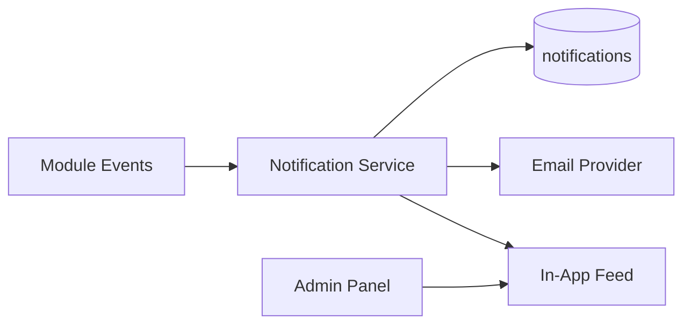

# Notifications Module

| Field | Value |
|-------|-------|
| Module ID | `MOD-NOTIFICATIONS` |
| Version | 1.0 |
| Status | Specification |
| Owner | Platform Core |
| Last Updated | 2026-06-29 |

## Purpose

The Notifications module delivers transactional alerts—email and in-app—to admin users when significant events occur (new contact submission, system errors, integration failures), ensuring founders respond promptly to business-critical activity.

## Scope

| In Scope | Out of Scope |
|----------|--------------|
| Email notification dispatch via provider | Push notifications (mobile) |
| In-app notification bell in admin panel | SMS alerts |
| Notification preferences per admin user | Marketing broadcast emails |
| Event-driven triggers from other modules | Slack/Discord webhooks (v1.1) |
| Delivery status logging | Rich HTML email templates (v1.2) |

## Business Context

Inbound leads and system issues require immediate attention. A unified notification layer decouples event producers ([Contact Manager](Contact_Manager.md), [Monitoring](../07_Admin/Monitoring.md)) from delivery channels, enabling consistent alerting without duplicated email logic.

## Goals

1. Send email to configured recipients on new contact/inquiry.
2. Display in-app unread notification count in admin header.
3. Allow admins to configure which events they receive.
4. Log delivery attempts for troubleshooting.
5. Fail gracefully when email provider is unavailable.

## Functional Requirements

| ID | Requirement | Priority |
|----|-------------|----------|
| NOTIF-FR-01 | Email on new contact submission | Must |
| NOTIF-FR-02 | Email on new enterprise inquiry | Must |
| NOTIF-FR-03 | In-app notification list for admin users | Must |
| NOTIF-FR-04 | Mark notification read/unread | Must |
| NOTIF-FR-05 | Per-user notification preferences | Should |
| NOTIF-FR-06 | Configurable recipient email(s) in Settings | Must |
| NOTIF-FR-07 | Retry failed email delivery (3 attempts) | Should |
| NOTIF-FR-08 | Notification types enum registry | Must |

## Non-functional Requirements

| ID | Requirement | Target |
|----|-------------|--------|
| NOTIF-NFR-01 | Email dispatch latency | < 60 s from event |
| NOTIF-NFR-02 | In-app list p95 | < 100 ms |
| NOTIF-NFR-03 | Notification retention | 90 days |
| NOTIF-NFR-04 | Max recipients per event | 10 |

## User Stories

| ID | As a… | I want to… | So that… |
|----|-------|-------------|----------|
| NOTIF-US-01 | Founder | Get emailed on new inquiry | I respond while lead is hot |
| NOTIF-US-02 | Admin | See notification badge in admin | I notice unread alerts |
| NOTIF-US-03 | Admin | Mark notifications as read | My inbox stays organized |
| NOTIF-US-04 | Admin | Disable email for low-priority events | I reduce noise |
| NOTIF-US-05 | DevOps | See delivery failure in logs | I debug email issues |

## UX Requirements

- Admin header: bell icon with unread count badge.
- Dropdown: recent notifications with type icon, message, relative time.
- "Mark all read" action.
- Settings page: toggle per event type (email on/off).
- Email: plain-text + minimal HTML; link to admin inbox item.
- Toast for real-time in-app notification (v1.1 WebSocket).

## Technical Considerations

### Architecture

### Module Dependencies

| Module | Purpose |
|--------|---------|
| [Contact Manager](Contact_Manager.md) | Lead event triggers |
| [Settings](Settings.md) | Recipient config, email provider |
| [Logs Admin](../07_Admin/Logs.md) | Delivery failure logs |
| [Monitoring Admin](../07_Admin/Monitoring.md) | System alert triggers |

### Notification Types

| Type | Channel | Trigger |
|------|---------|---------|
| `contact.new` | Email + In-app | New contact submission |
| `inquiry.new` | Email + In-app | New enterprise inquiry |
| `integration.error` | Email | GitHub/YouTube sync failure |
| `system.health` | Email | Health check failure |

### Data Entities

| Entity | Table | Purpose |
|--------|-------|---------|
| Notification | `notifications` | In-app notification records |
| NotificationPreference | `notification_preferences` | Per-user toggles |

## Security Considerations

- Notifications contain minimal PII — link to admin for details.
- Email recipients validated against admin user list.
- No notification content exposed via public API.
- Rate limit event triggers to prevent email bombing.
- Secure unsubscribe not applicable (transactional only).

## Acceptance Criteria

- [ ] New contact triggers email within 60 seconds.
- [ ] In-app notification appears for logged-in admin.
- [ ] Mark read updates badge count.
- [ ] Failed email logged with provider error.
- [ ] Preferences suppress email when disabled.
- [ ] Notifications older than 90 days purged.

## Future Enhancements

| Version | Enhancement |
|---------|-------------|
| v1.1 | Slack webhook integration |
| v1.2 | Rich HTML email templates |
| v1.5 | WebSocket real-time push |
| v2.0 | Mobile push via PWA |

## Open Questions

| ID | Question | Owner | Status |
|----|----------|-------|--------|
| OQ-NOTIF-01 | Single shared inbox email vs. per-admin routing? | Product | Open |
| OQ-NOTIF-02 | Digest mode (daily summary) vs. instant? | Product | Open |
| OQ-NOTIF-03 | Store email body in DB for audit? | Compliance | Open |

## Related Documents

- [Contact Manager](Contact_Manager.md)
- [Settings](Settings.md)
- [Logs Admin](../07_Admin/Logs.md)
