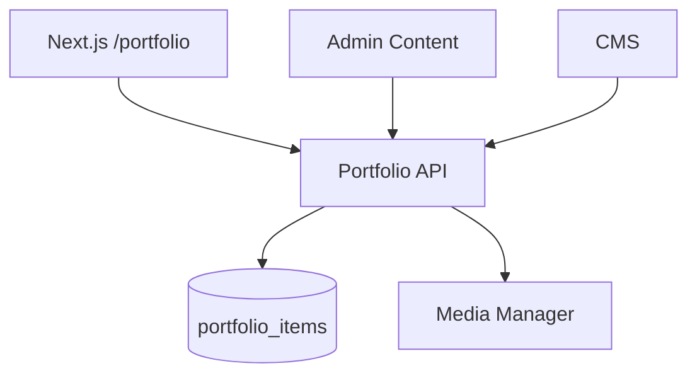

# Portfolio Manager Module

| Field | Value |
|-------|-------|
| Module ID | `MOD-PORTFOLIO` |
| Version | 1.0 |
| Status | Specification |
| Owner | Content Platform |
| Last Updated | 2026-06-29 |

## Purpose

The Portfolio Manager module catalogs professional work—projects, case highlights, and technical builds—with categorization, technology tags, imagery, and external links. It powers the public portfolio page and founder credibility narratives.

## Scope

| In Scope | Out of Scope |
|----------|--------------|
| Portfolio item CRUD | Client project billing/time tracking |
| Category and technology tagging | Full case study narrative (see Case Studies in CMS) |
| Sort ordering and publish toggle | GitHub auto-sync of repos as portfolio items |
| Image and project URL linking | |

## Business Context

Founders, consultants, and agencies use portfolio sections to demonstrate execution capability. Portfolio items complement [Product Manager](Product_Manager.md) (commercial products) and case studies (deep narratives).

## Goals

1. Provide a lightweight project catalog manageable by non-developers.
2. Support filtering by category and technology on the public page.
3. Integrate with [Media Manager](Media_Manager.md) for project thumbnails.
4. Enable CMS embedding via portfolio grid blocks.

## Functional Requirements

| ID | Requirement | Priority |
|----|-------------|----------|
| PORT-FR-01 | CRUD portfolio items with slug, title, category, description | Must |
| PORT-FR-02 | Store technologies as comma-separated or JSON array | Must |
| PORT-FR-03 | Optional `image_url` and `project_url` | Must |
| PORT-FR-04 | `is_published` and `sort_order` support | Must |
| PORT-FR-05 | Public list returns published items only | Must |
| PORT-FR-06 | Filter by category query param | Should |
| PORT-FR-07 | CMS block type `portfolio-grid` | Should |

## Non-functional Requirements

| ID | Requirement | Target |
|----|-------------|--------|
| PORT-NFR-01 | List API p95 | < 80 ms |
| PORT-NFR-02 | Max items per tenant | 200 |
| PORT-NFR-03 | Image lazy-load on public page | LCP-friendly |

## User Stories

| ID | As a… | I want to… | So that… |
|----|-------|-------------|----------|
| PORT-US-01 | Founder | Add portfolio projects with tech stack | Visitors see my work breadth |
| PORT-US-02 | Visitor | Filter by category | I find relevant examples |
| PORT-US-03 | Editor | Reorder portfolio items | I highlight best work first |
| PORT-US-04 | Visitor | Click through to live project | I evaluate quality directly |

## UX Requirements

- Public: masonry or card grid with hover overlay showing technologies.
- Category filter chips above grid.
- Admin: table with thumbnail preview, drag reorder, quick publish toggle.
- Empty state guidance when no items exist.

## Technical Considerations

### Architecture



### Reusable Interfaces

```typescript
interface IPortfolioItem {
  id: number;
  slug: string;
  title: string;
  category: string;
  description: string;
  technologies: string[];
  imageUrl?: string;
  projectUrl?: string;
  isPublished: boolean;
  sortOrder: number;
  createdAt: string;
}

interface IPortfolioService {
  list(filters?: { category?: string; publishedOnly?: boolean }): Promise<IPortfolioItem[]>;
  getBySlug(slug: string): Promise<IPortfolioItem>;
  create(data: PortfolioCreateInput): Promise<IPortfolioItem>;
  update(id: number, data: PortfolioUpdateInput): Promise<IPortfolioItem>;
  delete(id: number): Promise<void>;
  reorder(ids: number[]): Promise<void>;
}
```

### Module Dependencies

| Module | Purpose |
|--------|---------|
| [Authentication](Authentication.md) | Admin auth |
| [Media Manager](Media_Manager.md) | Thumbnails |
| [CMS](CMS.md) | Portfolio grid blocks |
| [Search](Search.md) | Index published items |
| [SEO](SEO.md) | Portfolio page metadata |

### Data Entities

| Entity | Table | Fields |
|--------|-------|--------|
| `PortfolioItem` | `portfolio_items` | `slug`, `title`, `category`, `description`, `technologies`, `image_url`, `project_url`, `is_published`, `sort_order` |

### API Endpoints

| Method | Path | Auth | Permission | API Doc |
|--------|------|------|------------|---------|
| GET | `/api/v1/portfolio` | Public | — | [Portfolio_API](../08_API/Portfolio_API.md#list) |
| GET | `/api/v1/portfolio/{slug}` | Public | — | [Portfolio_API](../08_API/Portfolio_API.md#get) |
| POST | `/api/v1/portfolio` | Bearer | `portfolio.write` | [Portfolio_API](../08_API/Portfolio_API.md#create) |
| PUT | `/api/v1/portfolio/{item_id}` | Bearer | `portfolio.write` | [Portfolio_API](../08_API/Portfolio_API.md#update) |
| DELETE | `/api/v1/portfolio/{item_id}` | Bearer | `portfolio.delete` | [Portfolio_API](../08_API/Portfolio_API.md#delete) |
| PATCH | `/api/v1/portfolio/reorder` | Bearer | `portfolio.write` | [Portfolio_API](../08_API/Portfolio_API.md#reorder) |

### Permissions

| Permission | Roles |
|------------|-------|
| `portfolio.read` | `editor`, `admin` |
| `portfolio.write` | `editor`, `admin` |
| `portfolio.delete` | `admin` |

### Admin UI Requirements

[Content Admin](../07_Admin/Content.md) → Portfolio tab.

| Feature | Detail |
|---------|--------|
| List view | Category filter, search, sort drag |
| Form | Media picker for image, URL validators |
| Bulk actions | Publish/unpublish selected |

## Security Considerations

- Validate `project_url` scheme (https only in production).
- Sanitize description HTML if rich text enabled.
- Rate-limit public list endpoint if abused.

## Acceptance Criteria

- [ ] Published items appear on `/portfolio` in sort order.
- [ ] Unpublished items hidden from public API.
- [ ] Category filter returns correct subset.
- [ ] Admin reorder persists `sort_order`.
- [ ] Technologies render as tags on public cards.

## Future Enhancements

- Portfolio item detail pages with extended case narrative
- Import from [GitHub](GitHub.md) repositories
- Client logo and testimonial linkage
- Featured item spotlight on homepage

## Open Questions

| # | Question | Status |
|---|----------|--------|
| OQ-PORT-01 | Dedicated detail pages vs modal-only? | Detail pages v1.1 |
| OQ-PORT-02 | Normalize technologies to taxonomy table? | Deferred |

## Related Documents

- [05_Pages Portfolio](../05_Pages/Portfolio.md)
- [Media Manager](Media_Manager.md)
- [Content Admin](../07_Admin/Content.md)
