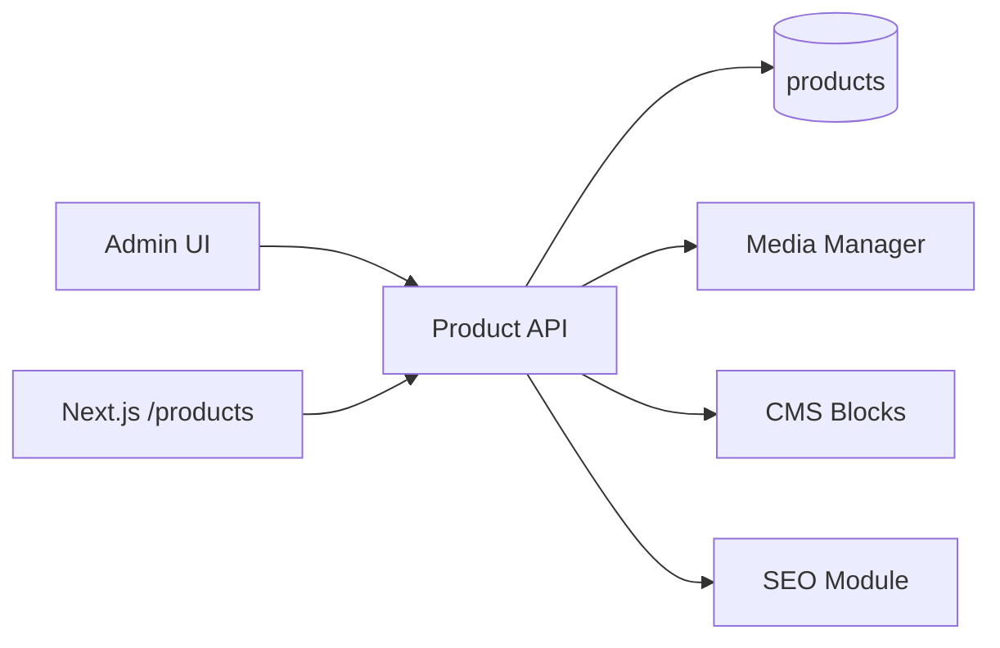

# Product Manager Module

| Field | Value |
|-------|-------|
| Module ID | `MOD-PRODUCT` |
| Version | 1.0 |
| Status | Specification |
| Owner | Product Engineering |
| Last Updated | 2026-06-29 |

## Purpose

The Product Manager module enables founders to showcase SaaS products, AI platforms, and licensable software with rich detail pages—including features, architecture diagrams, screenshots, domain fit, and flagship designation—for enterprise buyers and licensing prospects.

## Scope

| In Scope | Out of Scope |
|----------|--------------|
| Product CRUD and publishing | Payment/checkout integration |
| Flagship product designation | Subscription billing (Paddle/Stripe) |
| Feature lists, architecture JSON, screenshots | Product analytics dashboards (see [Analytics](Analytics.md)) |
| Product listing and detail public pages | License key generation |
| Sort ordering and slug management | |

## Business Context

FounderOS targets founders selling or licensing enterprise software. The product showcase is a primary conversion surface for acquisition, licensing, and partnership inquiries linked to [Contact Manager](Contact_Manager.md).

## Goals

1. Present products as first-class commercial assets with structured metadata.
2. Support one flagship product highlighted on home and products index.
3. Enable non-technical admins to update product copy and media.
4. Integrate with CMS blocks for flexible landing layouts.

## Functional Requirements

| ID | Requirement | Priority |
|----|-------------|----------|
| PROD-FR-01 | CRUD for products with slug, name, tagline, description | Must |
| PROD-FR-02 | Store features, domains, architecture, screenshots as structured JSON | Must |
| PROD-FR-03 | Support `is_flagship` — at most one flagship per tenant | Must |
| PROD-FR-04 | Support `is_published` toggle | Must |
| PROD-FR-05 | Public list sorted by `sort_order` | Must |
| PROD-FR-06 | Public detail by slug | Must |
| PROD-FR-07 | Link screenshots to [Media Manager](Media_Manager.md) assets | Should |
| PROD-FR-08 | Register CMS block type `product-showcase` | Should |

## Non-functional Requirements

| ID | Requirement | Target |
|----|-------------|--------|
| PROD-NFR-01 | Product list API p95 | < 80 ms |
| PROD-NFR-02 | Detail page SSR TTFB | < 300 ms |
| PROD-NFR-03 | Max products per tenant (v1.0) | 50 |
| PROD-NFR-04 | JSON field validation | Schema-validated on write |

## User Stories

| ID | As a… | I want to… | So that… |
|----|-------|-------------|----------|
| PROD-US-01 | Founder | Add a new SaaS product with features | Prospects understand my offering |
| PROD-US-02 | Founder | Mark one product as flagship | It appears prominently on homepage |
| PROD-US-03 | Enterprise buyer | View architecture and screenshots | I evaluate technical fit |
| PROD-US-04 | Content editor | Reorder products | I control showcase priority |
| PROD-US-05 | Admin | Unpublish a product | Retired products are hidden |

## UX Requirements

### Public

- Products index: card grid with tagline, flagship badge, CTA to detail.
- Product detail: hero, feature grid, architecture layer diagram, screenshot carousel, domains chips, inquiry CTA.
- Responsive layouts; architecture collapses to accordion on mobile.

### Admin

- Data table with drag-sort, publish toggle, flagship radio (single select).
- Tabbed editor: General, Features, Architecture, Screenshots, SEO.
- Live slug preview URL.
- Validation warnings for missing screenshots or empty features.

## Technical Considerations

### Architecture



### Reusable Interfaces

```typescript
interface IProductFeature {
  title: string;
  description: string;
  icon: string;
}

interface IProductArchitecture {
  layers: Array<{
    name: string;
    components: string[];
  }>;
}

interface IProduct {
  id: number;
  slug: string;
  name: string;
  tagline: string;
  description: string;
  features: IProductFeature[];
  domains: string[];
  architecture: IProductArchitecture;
  screenshots: string[]; // URLs or media IDs
  isFlagship: boolean;
  isPublished: boolean;
  sortOrder: number;
  seo?: ISEOMetadata;
  createdAt: string;
  updatedAt: string;
}

interface IProductService {
  list(publishedOnly?: boolean): Promise<IProduct[]>;
  getBySlug(slug: string): Promise<IProduct>;
  create(data: ProductCreateInput): Promise<IProduct>;
  update(id: number, data: ProductUpdateInput): Promise<IProduct>;
  delete(id: number): Promise<void>;
  setFlagship(id: number): Promise<void>;
}
```

### Module Dependencies

| Module | Direction | Purpose |
|--------|-----------|---------|
| [Authentication](Authentication.md) | Inbound | Admin writes |
| [Media Manager](Media_Manager.md) | Outbound | Screenshot assets |
| [CMS](CMS.md) | Outbound | Product showcase blocks |
| [SEO](SEO.md) | Outbound | Per-product metadata |
| [Contact Manager](Contact_Manager.md) | Outbound | Inquiry CTAs |
| [Analytics](Analytics.md) | Outbound | Product page views |

### Data Entities

| Entity | Table | Key Fields |
|--------|-------|------------|
| `Product` | `products` | `slug`, `name`, `tagline`, `description`, `features` (JSON), `domains` (JSON), `architecture` (JSON), `screenshots` (JSON), `is_flagship`, `is_published`, `sort_order` |

Aligns with existing implementation in `backend/app/models/__init__.py`.

### API Endpoints

| Method | Path | Auth | Permission | API Doc |
|--------|------|------|------------|---------|
| GET | `/api/v1/products` | Public | — | [Products_API](../08_API/Products_API.md#list) |
| GET | `/api/v1/products/{slug}` | Public | — | [Products_API](../08_API/Products_API.md#get) |
| POST | `/api/v1/products` | Bearer | `products.write` | [Products_API](../08_API/Products_API.md#create) |
| PUT | `/api/v1/products/{id}` | Bearer | `products.write` | [Products_API](../08_API/Products_API.md#update) |
| DELETE | `/api/v1/products/{id}` | Bearer | `products.delete` | [Products_API](../08_API/Products_API.md#delete) |
| PATCH | `/api/v1/products/{id}/flagship` | Bearer | `products.write` | [Products_API](../08_API/Products_API.md#set-flagship) |

### Permissions

| Permission | Description | Roles |
|------------|-------------|-------|
| `products.read` | View products in admin | `editor`, `admin` |
| `products.write` | Create/update products | `editor`, `admin` |
| `products.delete` | Delete products | `admin` |
| `products.publish` | Toggle publish state | `admin`, `publisher` |

### Admin UI Requirements

Managed via [Content Admin](../07_Admin/Content.md) → Products tab.

| Screen | Elements |
|--------|----------|
| List | Table, sort drag, publish toggle, flagship indicator |
| Editor | Tabbed form, JSON schema validation for architecture |
| Delete | Confirm modal; block if sole flagship without replacement |

## Security Considerations

- Public endpoints return only `is_published=true` products.
- Validate JSON payloads against Pydantic schemas; reject oversized arrays (>20 features, >10 screenshots).
- Slug uniqueness enforced at DB level.
- Admin mutations audited in [Logs](../07_Admin/Logs.md).

## Acceptance Criteria

- [ ] Public `/products` lists published products in sort order.
- [ ] Flagship product appears first with badge on index.
- [ ] Only one product can be flagship; setting new clears previous.
- [ ] Product detail renders features, architecture, screenshots.
- [ ] Unpublished products return 404 on public slug route.
- [ ] Admin CRUD requires `products.write` permission.

## Future Enhancements

- Product versioning and changelog
- Pricing tiers and comparison tables
- Demo video embed via [YouTube](YouTube.md)
- Integration with acquisition portal workflows

## Open Questions

| # | Question | Status |
|---|----------|--------|
| OQ-PROD-01 | Screenshots as URLs only vs media library IDs? | Hybrid v1.0 |
| OQ-PROD-02 | Case study linkage per product? | v1.1 |
| OQ-PROD-03 | Product categories/taxonomy? | Deferred |

## Related Documents

- [05_Pages Products](../05_Pages/Products.md)
- [Contact Manager](Contact_Manager.md)
- [CMS](CMS.md)
- [Content Admin](../07_Admin/Content.md)
