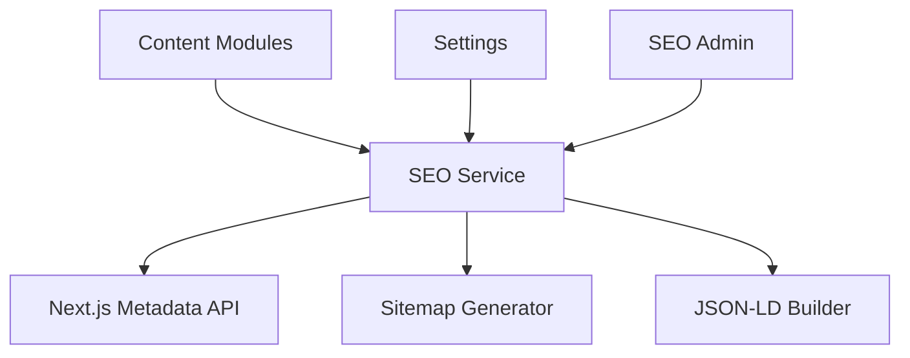

# SEO Module

| Field | Value |
|-------|-------|
| Module ID | `MOD-SEO` |
| Version | 1.0 |
| Status | Specification |
| Owner | Growth Platform |
| Last Updated | 2026-06-29 |

## Purpose

The SEO module centralizes search-engine optimization capabilities—per-page metadata, Open Graph and Twitter cards, structured data (JSON-LD), sitemap generation, robots.txt, and canonical URL management—across all public content types in FounderOS.

## Scope

| In Scope | Out of Scope |
|----------|--------------|
| Global and per-entity meta title/description | Paid search / SEM campaign management |
| Open Graph and Twitter Card tags | Keyword rank tracking (v1.2) |
| JSON-LD structured data for key page types | Multi-language hreflang (v2.0) |
| Dynamic sitemap.xml and robots.txt | SEO audit crawler (v1.5) |
| Canonical URL overrides | Backlink monitoring |
| Integration with content modules | AI content optimization (v2.0) |

## Business Context

Organic search is a primary acquisition channel for founder portfolios and SaaS product pages. Consistent SEO infrastructure ensures every published page is indexable, shareable on social platforms, and eligible for rich results.

## Goals

1. Auto-generate sensible defaults from content fields (title, excerpt).
2. Allow per-entity SEO overrides without code changes.
3. Produce valid sitemap including all published slugs.
4. Emit correct structured data for Organization, Article, Product.
5. Prevent duplicate content via canonical URLs.

## Functional Requirements

| ID | Requirement | Priority |
|----|-------------|----------|
| SEO-FR-01 | Global site meta defaults in Settings | Must |
| SEO-FR-02 | Per-entity `meta_title`, `meta_description` override fields | Must |
| SEO-FR-03 | Open Graph tags on all public pages | Must |
| SEO-FR-04 | Twitter Card tags on all public pages | Must |
| SEO-FR-05 | `GET /sitemap.xml` with all published URLs | Must |
| SEO-FR-06 | `GET /robots.txt` configurable disallow rules | Must |
| SEO-FR-07 | JSON-LD for blog posts (Article) | Must |
| SEO-FR-08 | JSON-LD for products (SoftwareApplication) | Should |
| SEO-FR-09 | Canonical URL per page with override support | Must |
| SEO-FR-10 | `noindex` flag per entity | Should |

## Non-functional Requirements

| ID | Requirement | Target |
|----|-------------|--------|
| SEO-NFR-01 | Sitemap generation p95 | < 200 ms |
| SEO-NFR-02 | Sitemap max URLs | 50,000 |
| SEO-NFR-03 | Meta tag payload size | < 2 KB per page |
| SEO-NFR-04 | Sitemap cache TTL | 1 hour |

## User Stories

| ID | As a… | I want to… | So that… |
|----|-------|-------------|----------|
| SEO-US-01 | Founder | Set custom meta for a product page | It ranks for target keywords |
| SEO-US-02 | Content editor | Preview social share card | Links look professional on LinkedIn |
| SEO-US-03 | SEO manager | Regenerate sitemap after publish | New pages get indexed |
| SEO-US-04 | Developer | Use structured data without manual JSON | Rich results appear in Google |
| SEO-US-05 | Admin | Block a draft from indexing | Unpublished content stays hidden |

## UX Requirements

- Admin SEO panel: meta title (60 char hint), meta description (160 char hint), OG image picker.
- Live preview of Google snippet and social card.
- Global defaults in Settings with inheritance indicator on entity forms.
- Sitemap last-modified reflects `updated_at` of entities.
- Robots.txt editor with validation warnings for blocking critical paths.

## Technical Considerations

### Architecture

### Module Dependencies

| Module | Purpose |
|--------|---------|
| [Blog Manager](Blog_Manager.md) | Article schema, post metadata |
| [Product Manager](Product_Manager.md) | Product schema |
| [Settings](Settings.md) | Global defaults, robots rules |
| [Search](Search.md) | Index alignment with sitemap |
| [SEO Admin](../07_Admin/SEO.md) | Override management UI |

Detailed tag specifications: [10_SEO](../10_SEO/).

### Data Entities

SEO fields stored on content tables (`meta_title`, `meta_description`, `og_image`, `canonical_url`, `noindex`) plus `site_settings` for globals.

## Security Considerations

- Sanitize meta fields to prevent XSS in `<title>` and meta content attributes.
- Robots.txt changes require `seo:write` permission.
- Sitemap exposes only `is_published=true` entities.
- No sensitive admin URLs in sitemap.
- Validate OG image URLs are same-origin or allowlisted CDN.

## Acceptance Criteria

- [ ] Every public page renders unique `<title>` and meta description.
- [ ] OG and Twitter tags present with image, title, description.
- [ ] Sitemap includes all published content types.
- [ ] Blog posts emit valid Article JSON-LD (Google Rich Results Test).
- [ ] `noindex` pages excluded from sitemap.
- [ ] Canonical tag matches preferred URL.

## Future Enhancements

| Version | Enhancement |
|---------|-------------|
| v1.1 | BreadcrumbList JSON-LD |
| v1.2 | Search Console API integration |
| v1.5 | Automated SEO score per page |
| v2.0 | hreflang for multi-locale |

## Open Questions

| ID | Question | Owner | Status |
|----|----------|-------|--------|
| OQ-SEO-01 | ISR vs on-demand sitemap regeneration? | Backend | Open |
| OQ-SEO-02 | Separate `seo_metadata` table vs. columns on entities? | Backend | Open |
| OQ-SEO-03 | Default OG image fallback strategy? | Design | Open |

## Related Documents

- [10_SEO Technical](../10_SEO/Technical_SEO.md)
- [SEO Admin](../07_Admin/SEO.md)
- [Search](Search.md)
