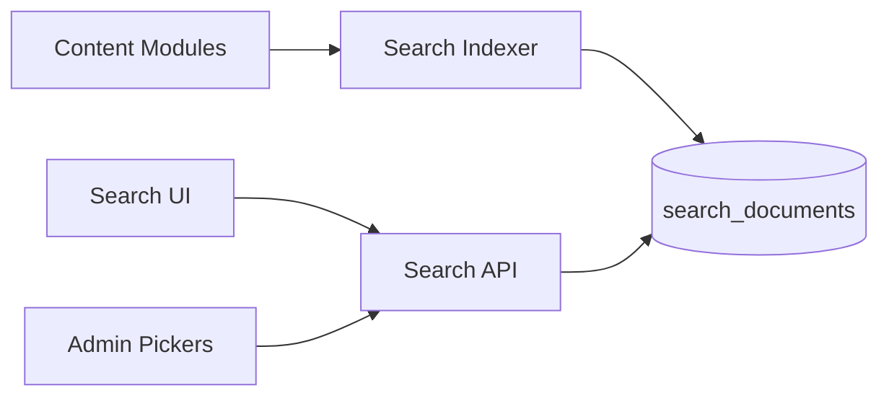

# Search Module

| Field | Value |
|-------|-------|
| Module ID | `MOD-SEARCH` |
| Version | 1.0 |
| Status | Specification |
| Owner | Content Platform |
| Last Updated | 2026-06-29 |

## Purpose

The Search module provides unified full-text search across published content—blog posts, products, portfolio items, travel entries, and static pages—delivering fast, relevance-ranked results on the public site and within the admin content picker.

## Scope

| In Scope | Out of Scope |
|----------|--------------|
| Public search API and UI (`/search`) | Elasticsearch cluster (v2.0) |
| PostgreSQL full-text search (v1.0 target) | Semantic / vector search (v2.0) |
| Index on publish/unpublish events | Federated external search (GitHub, YouTube) |
| Admin content search in pickers | Search analytics dashboard (v1.1) |
| Query highlighting in results | Typo tolerance / fuzzy match (v1.5) |

## Business Context

As founder sites grow content libraries, navigation alone is insufficient. Search improves visitor discovery of relevant case studies, blog posts, and products—especially for enterprise buyers researching capabilities.

## Goals

1. Index all published content types in a unified search index.
2. Return results ranked by relevance and recency.
3. Re-index within 60 seconds of content publish/update.
4. Support type filtering (blog, product, portfolio, travel).
5. Provide accessible search UI with keyboard navigation.

## Functional Requirements

| ID | Requirement | Priority |
|----|-------------|----------|
| SRCH-FR-01 | `GET /search?q=` public endpoint | Must |
| SRCH-FR-02 | Index blog posts, products, portfolio, travel | Must |
| SRCH-FR-03 | Filter by `content_type` | Must |
| SRCH-FR-04 | Exclude unpublished content from index | Must |
| SRCH-FR-05 | Re-index on content CRUD hooks | Must |
| SRCH-FR-06 | Public search page with results list | Must |
| SRCH-FR-07 | Result snippet with query term highlight | Should |
| SRCH-FR-08 | Admin typeahead for content picker | Should |
| SRCH-FR-09 | Empty query returns 400 | Must |

## Non-functional Requirements

| ID | Requirement | Target |
|----|-------------|--------|
| SRCH-NFR-01 | Search p95 latency | < 150 ms |
| SRCH-NFR-02 | Max results per query | 50 |
| SRCH-NFR-03 | Index rebuild full site | < 5 min |
| SRCH-NFR-04 | Min query length | 2 characters |

## User Stories

| ID | As a… | I want to… | So that… |
|----|-------|-------------|----------|
| SRCH-US-01 | Visitor | Search for a topic across the site | I find relevant content quickly |
| SRCH-US-02 | Enterprise buyer | Filter search to products only | I evaluate SaaS offerings |
| SRCH-US-03 | Editor | Search content in admin picker | I link related posts |
| SRCH-US-04 | Founder | See search work after publishing | New content is discoverable |
| SRCH-US-05 | Visitor | Use keyboard to navigate results | Search is accessible |

## UX Requirements

- Public: search input in header; dedicated `/search` results page.
- Results: title, type badge, snippet, URL; paginated if > 20 results.
- Type filter chips: All, Blog, Products, Portfolio, Travel.
- Loading state and "No results" with suggested popular pages.
- Admin typeahead: debounced 300 ms, max 10 suggestions.
- ARIA live region announces result count.

## Technical Considerations

### Architecture

### Module Dependencies

| Module | Purpose |
|--------|---------|
| [Blog Manager](Blog_Manager.md) | Blog index documents |
| [Product Manager](Product_Manager.md) | Product index documents |
| [Portfolio Manager](Portfolio_Manager.md) | Portfolio index documents |
| [Travel Manager](Travel_Manager.md) | Travel index documents |
| [SEO](SEO.md) | Sitemap alignment |

### Data Entities

| Entity | Table | Purpose |
|--------|-------|---------|
| SearchDocument | `search_documents` | Denormalized searchable rows |

Fields: `content_type`, `content_id`, `title`, `body_text`, `url`, `published_at`, `search_vector`.

## Security Considerations

- Public search returns only published content.
- Rate limit: 60 queries/minute/IP.
- Sanitize query input; parameterized full-text queries only.
- No exposure of draft titles or unpublished slugs.
- Admin search respects user content permissions (v1.1).

## Acceptance Criteria

- [ ] Search returns relevant blog post for title keyword.
- [ ] Unpublished content never appears in results.
- [ ] Type filter restricts results correctly.
- [ ] Re-index completes within 60 s of publish.
- [ ] Queries under 2 characters return 400.
- [ ] Public search page passes accessibility audit.

## Future Enhancements

| Version | Enhancement |
|---------|-------------|
| v1.1 | Search analytics (top queries) |
| v1.5 | Fuzzy matching and synonyms |
| v2.0 | Elasticsearch or Meilisearch backend |
| v2.0 | Semantic search with embeddings |

## Open Questions

| ID | Question | Owner | Status |
|----|----------|-------|--------|
| OQ-SRCH-01 | PostgreSQL tsvector vs. dedicated search engine for v1.0? | Backend | Open |
| OQ-SRCH-02 | Index media alt text and captions? | Product | Open |
| OQ-SRCH-03 | Weight title higher than body? | Product | Open |

## Related Documents

- [SEO](SEO.md)
- [Content Admin](../07_Admin/Content.md)
