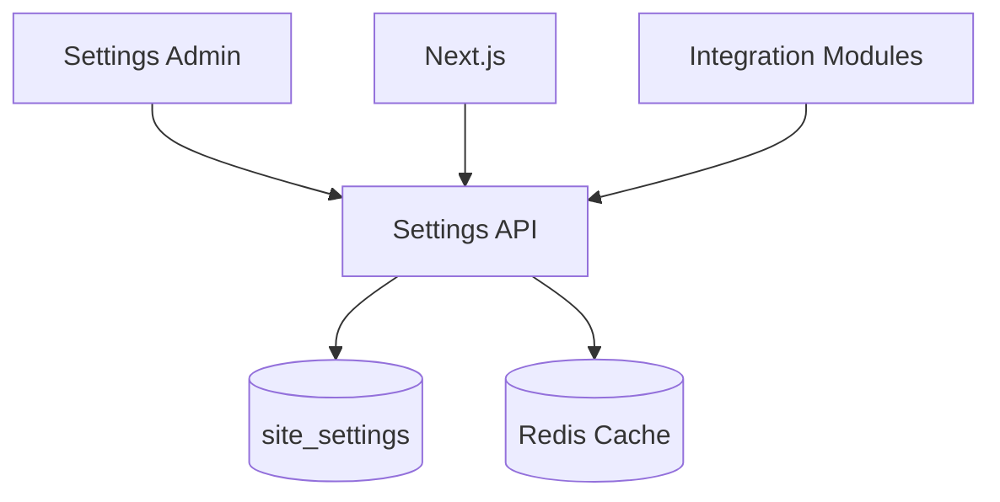

# Settings Module

| Field | Value |
|-------|-------|
| Module ID | `MOD-SETTINGS` |
| Version | 1.0 |
| Status | Specification |
| Owner | Platform Core |
| Last Updated | 2026-06-29 |

## Purpose

The Settings module provides a centralized key-value configuration store for site-wide options—branding, integrations, feature flags, email provider credentials, and SEO defaults—enabling white-label customization without code deployments.

## Scope

| In Scope | Out of Scope |
|----------|--------------|
| Key-value `site_settings` persistence | Multi-tenant settings isolation (v2.0) |
| Typed setting definitions with validation | Environment variable override UI |
| Public-safe settings endpoint | Secrets in client-accessible responses |
| Admin settings UI grouped by category | Settings version history (v1.5) |
| Encrypted storage for sensitive values | Feature flag A/B experiments |

## Business Context

FounderOS must be configurable per deployment—site name, logo, social links, API keys, and integration usernames—without forked codebases. Settings is the backbone for [YouTube](YouTube.md), [GitHub](GitHub.md), [Newsletter](Newsletter.md), and [SEO](SEO.md) modules.

## Goals

1. Persist all site configuration in PostgreSQL `site_settings`.
2. Validate setting types and constraints on write.
3. Expose public-safe subset to frontend for branding.
4. Encrypt secrets at rest (API keys, tokens).
5. Support env var overrides for deployment secrets.

## Functional Requirements

| ID | Requirement | Priority |
|----|-------------|----------|
| SET-FR-01 | CRUD settings via admin API | Must |
| SET-FR-02 | `GET /settings/public` returns non-secret keys only | Must |
| SET-FR-03 | Setting groups: General, Branding, Integrations, SEO, Email | Must |
| SET-FR-04 | Type validation: string, integer, boolean, json, secret | Must |
| SET-FR-05 | Secret values masked in admin UI | Must |
| SET-FR-06 | Env var override for secrets (e.g., `YOUTUBE_API_KEY`) | Must |
| SET-FR-07 | Cache public settings with 5 min TTL | Should |
| SET-FR-08 | Audit log on secret changes (v1.1) | Could |

## Non-functional Requirements

| ID | Requirement | Target |
|----|-------------|--------|
| SET-NFR-01 | Public settings p95 | < 30 ms (cached) |
| SET-NFR-02 | Max settings count | 200 keys |
| SET-NFR-03 | Max value size | 64 KB |
| SET-NFR-04 | Secret encryption | AES-256 at rest |

## User Stories

| ID | As a… | I want to… | So that… |
|----|-------|-------------|----------|
| SET-US-01 | Founder | Change site name and tagline | Branding updates without deploy |
| SET-US-02 | Admin | Configure YouTube channel ID | Videos sync automatically |
| SET-US-03 | Developer | Override secrets via env vars | Production secrets stay secure |
| SET-US-04 | Frontend | Fetch public branding settings | Header/footer render correctly |
| SET-US-05 | Super Admin | Restrict settings access by role | Editors cannot change API keys |

## UX Requirements

- Admin settings: left nav with category groups; form per group.
- Secret fields: password input with reveal toggle; never show full value after save.
- Unsaved changes warning on navigation.
- Validation errors inline per field.
- "Reset to default" for optional settings.
- Public settings consumed at build/ISR time where possible.

## Technical Considerations

### Architecture

### Module Dependencies

| Module | Purpose |
|--------|---------|
| [Settings API](../08_API/Settings_API.md) | REST contract |
| [Settings Admin](../07_Admin/Settings.md) | Admin UI |
| [Authentication](Authentication.md) | `settings:write` permission |
| All integration modules | Read configuration |

### Setting Categories

| Category | Examples |
|----------|----------|
| General | `site_name`, `site_tagline`, `contact_email` |
| Branding | `logo_url`, `favicon_url`, `primary_color` |
| Integrations | `github_username`, `youtube_channel_id` |
| SEO | `default_meta_title`, `robots_disallow` |
| Email | `email_from_address`, `email_provider` |

### Data Entities

| Entity | Table | Purpose |
|--------|-------|---------|
| SiteSetting | `site_settings` | Key-value configuration |

## Security Considerations

- `settings:write` restricted to `admin` and `super_admin` roles.
- Secrets never returned in `GET /settings/public`.
- Encrypt `is_secret=true` values before DB insert.
- Env var overrides take precedence over DB for secrets.
- Rate limit settings mutations: 30/hour/user.
- Validate JSON settings against schema before save.

## Acceptance Criteria

- [ ] Public endpoint returns only non-secret keys.
- [ ] Secret write stores encrypted value; read masks value.
- [ ] Type validation rejects invalid boolean/integer.
- [ ] Integration modules read settings after cache invalidation.
- [ ] Admin UI groups settings by category.
- [ ] Env override documented for all secret keys.

## Future Enhancements

| Version | Enhancement |
|---------|-------------|
| v1.1 | Settings change audit log |
| v1.5 | Settings export/import JSON |
| v2.0 | Per-tenant settings namespace |
| v2.0 | Settings UI feature flags |

## Open Questions

| ID | Question | Owner | Status |
|----|----------|-------|--------|
| OQ-SET-01 | Single `site_settings` table vs. typed tables per domain? | Backend | Open |
| OQ-SET-02 | Hot-reload settings without cache TTL? | Backend | Open |
| OQ-SET-03 | Which settings are build-time vs runtime? | Frontend | Open |

## Related Documents

- [Settings API](../08_API/Settings_API.md)
- [Settings Admin](../07_Admin/Settings.md)
- [Entities](../09_Database/Entities.md#site_settings)
