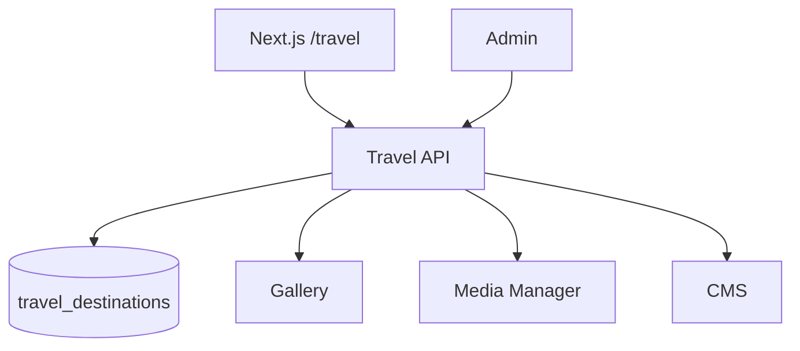

# Travel Manager Module

| Field | Value |
|-------|-------|
| Module ID | `MOD-TRAVEL` |
| Version | 1.0 |
| Status | Specification |
| Owner | Creator Tools |
| Last Updated | 2026-06-29 |

## Purpose

The Travel Manager module supports creators and founder-travelers in publishing destinations, itineraries, travel logs, and geo-tagged content—extending FounderOS beyond pure SaaS branding into lifestyle and creator monetization verticals.

## Scope

| In Scope | Out of Scope |
|----------|--------------|
| Travel destination and trip CRUD | Booking engine integration |
| Geo coordinates and map display | Flight/hotel API partnerships |
| Photo galleries per destination | Real-time GPS tracking |
| Publish workflow | Visa/immigration tools |
| Integration with [Gallery](Gallery.md) and [Media Manager](Media_Manager.md) | |

## Business Context

Secondary market includes travel bloggers and creators who want a unified founder + creator identity site. Travel content drives engagement, affiliate opportunities (future), and personal brand differentiation.

## Goals

1. Model destinations with rich media and narrative content.
2. Display interactive maps on public travel page.
3. Reuse gallery and media infrastructure—no duplicate asset stores.
4. Support CMS embedding of featured destinations.

## Functional Requirements

| ID | Requirement | Priority |
|----|-------------|----------|
| TRAV-FR-01 | CRUD destinations with name, slug, country, description | Must |
| TRAV-FR-02 | Optional latitude/longitude for map pins | Must |
| TRAV-FR-03 | Link gallery album per destination | Should |
| TRAV-FR-04 | Trip log entries with date range | Should |
| TRAV-FR-05 | Public travel index and detail pages | Must |
| TRAV-FR-06 | `is_published` and `sort_order` | Must |
| TRAV-FR-07 | CMS block `travel-featured` | Should |

## Non-functional Requirements

| ID | Requirement | Target |
|----|-------------|--------|
| TRAV-NFR-01 | Map tile load | Lazy on scroll |
| TRAV-NFR-02 | Max destinations | 500 |
| TRAV-NFR-03 | Geo search radius query | < 200 ms |

## User Stories

| ID | As a… | I want to… | So that… |
|----|-------|-------------|----------|
| TRAV-US-01 | Creator | Add destinations with photos | Followers explore my travels |
| TRAV-US-02 | Visitor | View destinations on a world map | I discover content geographically |
| TRAV-US-03 | Creator | Write trip logs with dates | I document journeys chronologically |
| TRAV-US-04 | Editor | Feature a destination on homepage | I highlight current location |

## UX Requirements

- Public `/travel`: map hero + destination cards below.
- Detail page: hero image, narrative, photo gallery, map pin, trip timeline.
- Admin: destination form with map pin picker (click to set lat/lng).
- Gallery album selector dropdown.
- Mobile: map collapses to list-first with map toggle.

## Technical Considerations

### Architecture



### Reusable Interfaces

```typescript
interface ITravelDestination {
  id: number;
  slug: string;
  name: string;
  country: string;
  description: string;
  latitude?: number;
  longitude?: number;
  coverImageUrl?: string;
  galleryAlbumId?: number;
  tripStartDate?: string;
  tripEndDate?: string;
  isPublished: boolean;
  sortOrder: number;
}

interface ITravelTripLog {
  id: number;
  destinationId: number;
  title: string;
  content: string;
  logDate: string;
}

interface ITravelService {
  listDestinations(publishedOnly?: boolean): Promise<ITravelDestination[]>;
  getDestination(slug: string): Promise<ITravelDestination>;
  createDestination(data: DestinationInput): Promise<ITravelDestination>;
  updateDestination(id: number, data: DestinationInput): Promise<ITravelDestination>;
  listTripLogs(destinationId: number): Promise<ITravelTripLog[]>;
}
```

### Module Dependencies

| Module | Purpose |
|--------|---------|
| [Gallery](Gallery.md) | Destination photo albums |
| [Media Manager](Media_Manager.md) | Cover and inline images |
| [CMS](CMS.md) | Featured destination blocks |
| [SEO](SEO.md) | Destination page metadata |
| [Authentication](Authentication.md) | Admin auth |

### Data Entities

| Entity | Table | Key Fields |
|--------|-------|------------|
| `TravelDestination` | `travel_destinations` | `slug`, `name`, `country`, `description`, `lat`, `lng`, `gallery_album_id`, `is_published` |
| `TravelTripLog` | `travel_trip_logs` | `destination_id`, `title`, `content`, `log_date` |

### API Endpoints

| Method | Path | Auth | Permission | API Doc |
|--------|------|------|------------|---------|
| GET | `/api/v1/travel/destinations` | Public | — | [Travel_API](../08_API/Travel_API.md#list) |
| GET | `/api/v1/travel/destinations/{slug}` | Public | — | [Travel_API](../08_API/Travel_API.md#get) |
| POST | `/api/v1/travel/destinations` | Bearer | `travel.write` | [Travel_API](../08_API/Travel_API.md#create) |
| PUT | `/api/v1/travel/destinations/{id}` | Bearer | `travel.write` | [Travel_API](../08_API/Travel_API.md#update) |
| DELETE | `/api/v1/travel/destinations/{id}` | Bearer | `travel.delete` | [Travel_API](../08_API/Travel_API.md#delete) |
| GET | `/api/v1/travel/destinations/{id}/logs` | Public | — | [Travel_API](../08_API/Travel_API.md#logs) |
| POST | `/api/v1/travel/destinations/{id}/logs` | Bearer | `travel.write` | [Travel_API](../08_API/Travel_API.md#create-log) |

### Permissions

| Permission | Roles |
|------------|-------|
| `travel.read` | `editor`, `admin` |
| `travel.write` | `editor`, `admin` |
| `travel.delete` | `admin` |

### Admin UI Requirements

[Content Admin](../07_Admin/Content.md) → Travel tab.

| Feature | Detail |
|---------|--------|
| Map picker | Leaflet/Mapbox embed for lat/lng |
| Gallery link | Select from [Gallery](Gallery.md) albums |
| Trip logs | Sub-panel on destination detail |

## Security Considerations

- Validate lat/lng ranges (-90/90, -180/180).
- Do not expose precise home addresses—document privacy guidance for admins.
- Sanitize trip log HTML content.

## Acceptance Criteria

- [ ] Published destinations appear on `/travel` with map pins.
- [ ] Destination detail shows linked gallery when configured.
- [ ] Unpublished destinations hidden from public API.
- [ ] Trip logs sort chronologically on detail page.
- [ ] CMS featured block renders selected destination.

## Future Enhancements

- Affiliate link management per destination
- Import GPX tracks
- Multi-leg itinerary builder
- Integration with Instagram location tags

## Open Questions

| # | Question | Status |
|---|----------|--------|
| OQ-TRAV-01 | Mapbox vs OpenStreetMap/Leaflet default? | Mapbox with OSM fallback |
| OQ-TRAV-02 | Separate travel blog vs trip logs? | Trip logs v1.0 |

## Related Documents

- [05_Pages Travel](../05_Pages/Travel.md)
- [Gallery](Gallery.md)
- [Media Manager](Media_Manager.md)
