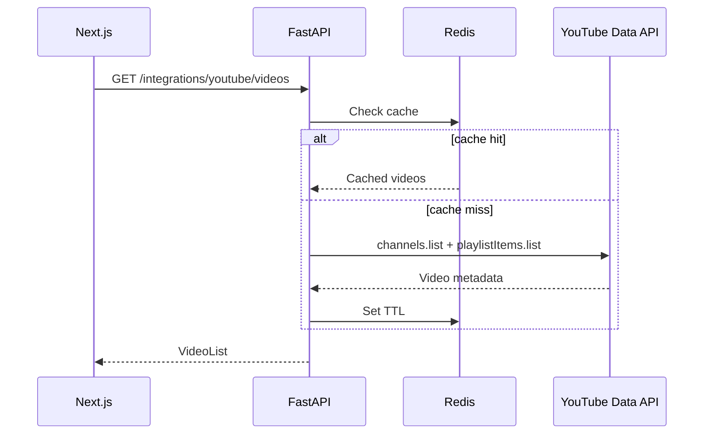

# YouTube Module

| Field | Value |
|-------|-------|
| Module ID | `MOD-YOUTUBE` |
| Version | 1.0 |
| Status | Specification |
| Owner | Integrations |
| Last Updated | 2026-06-29 |

## Purpose

The YouTube module integrates a founder's or company's YouTube channel into FounderOS—surfacing latest videos, channel stats, and embeddable players on public pages and CMS blocks without manual video duplication.

## Scope

| In Scope | Out of Scope |
|----------|--------------|
| YouTube Data API v3 read integration | Video upload to YouTube |
| Channel video listing and caching | YouTube Analytics API (v1.2) |
| Video embed components | Comment sync |
| CMS `youtube-grid` block | Live stream scheduling |
| Configurable channel ID via Settings | |

## Business Context

Video content builds trust for SaaS founders and creators. Auto-synced YouTube feeds keep the site fresh and support the open-source / technology narrative pages.

## Goals

1. Fetch and cache channel videos with Redis TTL.
2. Render responsive embeds with privacy-enhanced mode.
3. Graceful degradation when API quota exceeded or key missing.
4. Minimize API calls via aggressive caching.

## Functional Requirements

| ID | Requirement | Priority |
|----|-------------|----------|
| YT-FR-01 | Configure YouTube API key and channel ID in Settings | Must |
| YT-FR-02 | `GET /integrations/youtube/videos` returns latest N videos | Must |
| YT-FR-03 | Cache responses in Redis (TTL 1 hour default) | Must |
| YT-FR-04 | Public embed component with title, thumbnail, duration | Must |
| YT-FR-05 | CMS block for featured videos grid | Should |
| YT-FR-06 | Fallback static list when API unavailable | Should |

## Non-functional Requirements

| ID | Requirement | Target |
|----|-------------|--------|
| YT-NFR-01 | Cached endpoint p95 | < 50 ms |
| YT-NFR-02 | Uncached fetch p95 | < 2 s |
| YT-NFR-03 | Default cache TTL | 3600 s |
| YT-NFR-04 | Max videos per request | 12 |

## User Stories

| ID | As a… | I want to… | So that… |
|----|-------|-------------|----------|
| YT-US-01 | Founder | Show latest YouTube videos on my site | Visitors see recent content |
| YT-US-02 | Visitor | Play videos without leaving the site | I engage with embedded player |
| YT-US-03 | Admin | Configure channel in settings | Integration works without code |
| YT-US-04 | Developer | Rely on cache when API quota low | Site stays performant |

## UX Requirements

- Video grid: thumbnail, title, published date, play overlay.
- Embed: 16:9 responsive iframe, lazy load on scroll.
- Loading skeleton while fetching.
- Empty state: "No videos configured" with admin link (authenticated only).
- Privacy: `youtube-nocookie.com` embed domain.

## Technical Considerations

### Architecture



### Reusable Interfaces

```typescript
interface IYouTubeVideo {
  id: string;
  title: string;
  description: string;
  thumbnailUrl: string;
  publishedAt: string;
  duration?: string;
  viewCount?: number;
}

interface IYouTubeService {
  getLatestVideos(limit?: number): Promise<IYouTubeVideo[]>;
  getVideoEmbedUrl(videoId: string): string;
  invalidateCache(): Promise<void>;
}
```

```python
class IYouTubeClient(Protocol):
    async def fetch_channel_videos(self, channel_id: str, limit: int) -> list[YouTubeVideoDTO]: ...
```

### Module Dependencies

| Module | Purpose |
|--------|---------|
| [Settings](Settings.md) | API key, channel ID |
| [CMS](CMS.md) | YouTube grid block |
| [Authentication](Authentication.md) | Cache invalidation admin action |
| Redis | Response cache |

Existing route: `GET /api/v1/integrations/youtube/videos` in `backend/app/api/routes/integrations.py`.

### Data Entities

No persistent DB entities in v1.0 — cache-only. Optional v1.1:

| Entity | Table | Purpose |
|--------|-------|---------|
| `YouTubeCacheMeta` | `integration_cache_meta` | Last sync, error state |

### API Endpoints

| Method | Path | Auth | Permission | API Doc |
|--------|------|------|------------|---------|
| GET | `/api/v1/integrations/youtube/videos` | Public | — | [YouTube_API](../08_API/YouTube_API.md) |
| POST | `/api/v1/integrations/youtube/cache/invalidate` | Bearer | `integrations.manage` | [YouTube_API](../08_API/YouTube_API.md) |

### Permissions

| Permission | Roles |
|------------|-------|
| `integrations.read` | Public (videos endpoint) |
| `integrations.manage` | `admin` |

### Admin UI Requirements

[Settings Admin](../07_Admin/Settings.md) → Integrations tab.

| Field | Type | Notes |
|-------|------|-------|
| `youtube_api_key` | Secret | Env override supported |
| `youtube_channel_id` | String | Required for sync |
| `youtube_video_limit` | Number | Default 6 |

## Security Considerations

- Store API key in environment/secrets manager, not client bundle.
- Never expose API key to browser.
- Validate channel ID format server-side.
- Rate-limit public endpoint (60 req/min/IP).
- CSP allow `youtube-nocookie.com` frame-src.

## Acceptance Criteria

- [ ] Videos endpoint returns metadata when API key and channel configured.
- [ ] Second request served from Redis cache within TTL.
- [ ] Embed component renders playable video.
- [ ] Missing config returns empty array with 200 (not 500).
- [ ] Admin cache invalidation forces refresh.

## Future Enhancements

- YouTube Analytics integration
- Playlist-specific feeds
- Webhook for new upload notifications
- Featured video pinning override

## Open Questions

| # | Question | Status |
|---|----------|--------|
| OQ-YT-01 | Server-side only vs Next.js ISR fetch? | Server API + ISR |
| OQ-YT-02 | Store video metadata in DB for offline mode? | v1.1 |

## Related Documents

- [GitHub](GitHub.md)
- [Settings](Settings.md)
- [05_Pages Technology](../05_Pages/Media.md)
