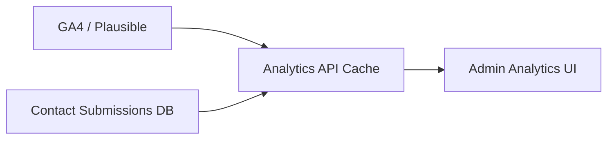

# Admin — Analytics

| Field | Value |
|-------|-------|
| **Document ID** | ADMIN-AN-001 |
| **Route** | `/admin/analytics` |
| **Product** | Founder Portfolio Platform (FounderOS v1.0) |
| **Status** | Approved |
| **Last Updated** | 2026-06-29 |
| **Related** | [Analytics Module](../06_Modules/Analytics.md) · [Analytics API](../08_API/Analytics_API.md) · [Monitoring (Admin)](./Monitoring.md) · [Cookie](../05_Pages/Cookie.md) |

---

## Purpose

Define the Admin Analytics dashboard — traffic, engagement, conversions, and content performance metrics for founders and tenant operators.

---

## Scope

| In Scope | Out of Scope |
|----------|--------------|
| Dashboard charts and KPI cards | Custom BI warehouse |
| Integration with GA4 or Plausible API | Real-time second-by-second analytics |
| Contact form conversion metrics | Revenue attribution |

---

## Business Context

Founders need to know which products and blog posts drive enterprise inquiries. Analytics must respect cookie consent — only aggregate data in admin from consented sessions or server-side events.

---

## Goals

1. Top pages, referrers, and devices visible at a glance.
2. Contact form submissions correlated with traffic (server-side).
3. Date range selector with comparison period.
4. Data loads in &lt; 3s for 90-day range.

---

## Functional Requirements

| ID | Requirement | Priority |
|----|-------------|----------|
| FR-AAN-001 | KPI cards: visitors, pageviews, bounce rate, form submits | P0 |
| FR-AAN-002 | Line chart: traffic over selected range | P0 |
| FR-AAN-003 | Tables: top pages, top referrers | P0 |
| FR-AAN-004 | Date range: 7d, 30d, 90d, custom | P0 |
| FR-AAN-005 | Data from Analytics API (aggregated) | P0 |
| FR-AAN-006 | Empty state if analytics not configured | P0 |
| FR-AAN-007 | Role: `admin`, `editor` read-only | P1 |

---

## Non-functional Requirements

| ID | Requirement | Target |
|----|-------------|--------|
| NFR-AAN-001 | Dashboard load | &lt; 3s |
| NFR-AAN-002 | Chart library bundle | lazy load Recharts |

---

## User Stories

| ID | As a… | I want… | So that… |
|----|-------|---------|----------|
| US-AAN-001 | Founder | see traffic trends | I know what's working |
| US-AAN-002 | Marketer | top referrers | I invest in right channels |
| US-AAN-003 | Admin | form conversion count | I measure enterprise funnel |
| US-AAN-004 | Privacy officer | consent-aware data | we stay compliant |

---

## UX Requirements

- **Layout**: KPI row → main chart → two-column tables.
- **Charts**: Use semantic colors; accessible patterns (not color-only).
- **Responsive**: Stack cards on mobile; horizontal scroll chart optional.
- **Loading**: Skeleton cards per [Loading States](../03_Design_System/Loading_States.md).

---

## Technical Considerations

- Redis cache analytics API responses 15 min TTL.
- Server-side events: `contact_submitted` always counted (no cookie).
- Recharts via dynamic import.
- See [Analytics API](../08_API/Analytics_API.md).

---

## Security Considerations

- Analytics API admin-authenticated only.
- No raw IP export in UI.
- Third-party API keys in Settings secrets.

---

## Acceptance Criteria

- [ ] KPI list and charts documented
- [ ] Date range behavior specified
- [ ] Data sources (GA + server events) identified
- [ ] RBAC and empty state defined
- [ ] Cookie consent cross-link included

---

## Future Enhancements

- Funnel visualization (Home → Enterprise → Contact)
- Email report scheduling
- Per-product page analytics

---

## Open Questions

| # | Question | Owner |
|---|----------|-------|
| OQ-1 | GA4 vs Plausible default? | Product |
| OQ-2 | Show realtime active users? | UX |
| OQ-3 | Export analytics PDF? | Product |
