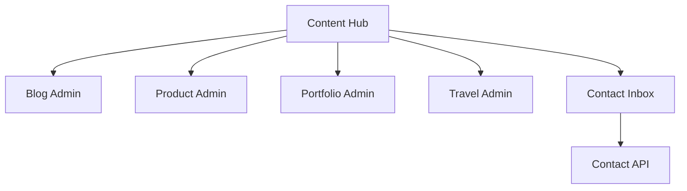

# Admin Content

| Field | Value |
|-------|-------|
| Admin Section ID | `ADM-CONTENT` |
| Version | 1.0 |
| Status | Specification |
| Owner | Admin Platform |
| Last Updated | 2026-06-29 |

## Purpose

The Admin Content section provides unified navigation and management for all content types—blog posts, products, portfolio items, case studies, testimonials, travel entries, and contact inbox—within a single admin hub.

## Scope

| In Scope | Out of Scope |
|----------|--------------|
| Sidebar navigation to content modules | WYSIWYG page builder (see CMS) |
| Contact/inquiry inbox management | Comment moderation |
| Cross-content search (admin) | Workflow approval chains (v1.2) |
| Bulk publish/unpublish (v1.1) | Content scheduling calendar view |
| Content status overview counts | AI content generation |

## Business Context

Editors spend most admin time in content tools. A unified Content hub reduces navigation friction and provides a single inbox for inbound leads alongside editorial workflows.

## Goals

1. Centralize links to all content module admin pages.
2. Provide contact/inquiry inbox with read/unread workflow.
3. Show content counts by type and publish status.
4. Enable quick filter/search across content types (v1.1).
5. Respect role permissions per content type.

## Functional Requirements

| ID | Requirement | Priority |
|----|-------------|----------|
| CNT-FR-01 | Content hub landing with module cards | Must |
| CNT-FR-02 | Contact inbox: list, detail, mark read | Must |
| CNT-FR-03 | Inquiry inbox: list, detail, mark read | Must |
| CNT-FR-04 | Unread badge on inbox nav item | Must |
| CNT-FR-05 | Links to Blog, Products, Portfolio, Travel admins | Must |
| CNT-FR-06 | Draft vs. published counts per type | Should |
| CNT-FR-07 | Delete submission with confirmation | Must |

## Non-functional Requirements

| ID | Requirement | Target |
|----|-------------|--------|
| CNT-NFR-01 | Inbox list p95 | < 150 ms |
| CNT-NFR-02 | Inbox pagination | 25 per page |

## User Stories

| ID | As a… | I want to… | So that… |
|----|-------|-------------|----------|
| CNT-US-01 | Editor | Navigate to blog admin from one place | I find tools quickly |
| CNT-US-02 | Founder | Manage contact inbox | I respond to leads |
| CNT-US-03 | Admin | See draft counts | I know unpublished work |
| CNT-US-04 | Editor | Not access inquiry budget details without permission | Sensitive data protected |

## UX Requirements

- Hub layout: grid of content type cards with icon, title, count, link.
- Inbox: split view — list left, detail right on desktop.
- Inquiry detail shows company, role, budget range prominently.
- Filter: All, Unread, Read; sort by date desc.
- Mobile: list → detail navigation stack.
- Keyboard: j/k navigate inbox items.

## Technical Considerations

### Architecture

### Module Routes

| Content Type | Admin Route | Permission |
|--------------|-------------|------------|
| Blog | `/admin/content/blog` | `content:read` |
| Products | `/admin/content/products` | `content:read` |
| Portfolio | `/admin/content/portfolio` | `content:read` |
| Travel | `/admin/content/travel` | `content:read` |
| Contact Inbox | `/admin/content/inbox` | `contact:read` |

## Security Considerations

- Inbox PII visible only to `contact:read` permission.
- Delete requires `contact:write`.
- No public exposure of submission content.
- Export CSV requires `contact:read` (v1.1).

## Acceptance Criteria

- [ ] Content hub displays all module links.
- [ ] Inbox unread count matches dashboard widget.
- [ ] Mark read updates status and badge.
- [ ] Editor can access blog admin but not settings.
- [ ] Inquiry detail renders all form fields.

## Future Enhancements

| Version | Enhancement |
|---------|-------------|
| v1.1 | Unified content search |
| v1.2 | Editorial approval workflow |
| v1.5 | Content calendar view |

## Open Questions

| ID | Question | Owner | Status |
|----|----------|-------|--------|
| OQ-CNT-01 | Merge contact and inquiry inboxes? | UX | Open |
| OQ-CNT-02 | Case studies under Content hub or separate? | IA | Open |

## Related Documents

- [Contact Manager](../06_Modules/Contact_Manager.md)
- [Contact API](../08_API/Contact_API.md)
- [Dashboard](./Dashboard.md)
