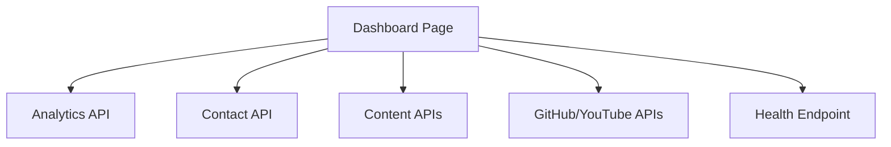

# Admin Dashboard

| Field | Value |
|-------|-------|
| Admin Section ID | `ADM-DASHBOARD` |
| Version | 1.0 |
| Status | Specification |
| Owner | Admin Platform |
| Last Updated | 2026-06-29 |

## Purpose

The Admin Dashboard is the landing page after authentication—surfacing at-a-glance metrics, recent activity, quick actions, and system health indicators so founders can assess site status and prioritize daily tasks.

## Scope

| In Scope | Out of Scope |
|----------|--------------|
| Traffic summary widgets (7-day) | Custom widget builder |
| Unread contact/inquiry count | Financial metrics |
| Recent content activity feed | Team productivity scoring |
| Quick links to create content | Embedded third-party BI |
| Integration sync status indicators | Real-time visitor counter |

## Business Context

Admin users need immediate situational awareness without navigating multiple sections. The dashboard reduces time-to-action for lead response and content publishing.

## Goals

1. Display key metrics within 500 ms of page load.
2. Highlight unread inbound leads prominently.
3. Provide one-click navigation to common tasks.
4. Show integration health (GitHub, YouTube cache age).
5. Adapt layout for single-founder vs. small team use.

## Functional Requirements

| ID | Requirement | Priority |
|----|-------------|----------|
| DASH-FR-01 | Page view chart (7 days) from Analytics | Must |
| DASH-FR-02 | Unread submissions count with link to inbox | Must |
| DASH-FR-03 | Recent publishes list (last 5) | Must |
| DASH-FR-04 | Quick action buttons: New Post, New Product | Must |
| DASH-FR-05 | Integration status cards (last sync time) | Should |
| DASH-FR-06 | System health indicator (API, DB) | Should |
| DASH-FR-07 | Role-based widget visibility | Should |

## Non-functional Requirements

| ID | Requirement | Target |
|----|-------------|--------|
| DASH-NFR-01 | Initial load p95 | < 800 ms |
| DASH-NFR-02 | Widget data refresh | On page load |
| DASH-NFR-03 | Mobile responsive layout | 2-column stack |

## User Stories

| ID | As a… | I want to… | So that… |
|----|-------|-------------|----------|
| DASH-US-01 | Founder | See traffic at a glance | I know if marketing is working |
| DASH-US-02 | Founder | See unread lead count | I prioritize responses |
| DASH-US-03 | Editor | Quick-create a blog post | I publish faster |
| DASH-US-04 | Admin | Check YouTube sync status | I know integrations are healthy |
| DASH-US-05 | Super Admin | See system health | I catch outages early |

## UX Requirements

- Layout: responsive grid of cards; priority order: leads, traffic, activity, integrations.
- Unread leads card: red badge if count > 0; click navigates to Content inbox.
- Traffic chart: simple line chart; no complex controls on dashboard.
- Quick actions: prominent buttons above fold.
- Empty states for new sites: onboarding checklist (v1.1).
- Dark mode consistent with admin theme.

## Technical Considerations

### Architecture

### Data Sources

| Widget | API Source |
|--------|------------|
| Page views | [Analytics API](../08_API/Analytics_API.md) |
| Unread leads | [Contact API](../08_API/Contact_API.md) |
| Recent activity | Blog, Product, Travel list endpoints |
| Integration status | Settings + integration cache meta |

### Permissions

| Widget | Required Permission |
|--------|---------------------|
| Traffic | `analytics:read` |
| Leads | `contact:read` |
| Content activity | `content:read` |
| System health | `admin:read` |

## Security Considerations

- Dashboard requires authenticated session.
- Widgets hidden if user lacks permission — no data leakage via API.
- No PII displayed on dashboard cards — counts and links only.
- Health endpoint does not expose internal hostnames.

## Acceptance Criteria

- [ ] Dashboard loads after login redirect.
- [ ] Unread count matches inbox filter.
- [ ] Traffic chart shows 7-day data when analytics enabled.
- [ ] Quick actions navigate to correct create forms.
- [ ] Widgets hidden for users without permissions.
- [ ] Mobile layout stacks cards vertically.

## Future Enhancements

| Version | Enhancement |
|---------|-------------|
| v1.1 | Onboarding checklist for new tenants |
| v1.2 | Customizable widget order |
| v1.5 | Scheduled report email |
| v2.0 | Multi-user activity feed |

## Open Questions

| ID | Question | Owner | Status |
|----|----------|-------|--------|
| OQ-DASH-01 | Default landing page for editor role (dashboard vs. content)? | UX | Open |
| OQ-DASH-02 | Show newsletter subscriber growth on dashboard? | Product | Open |

## Related Documents

- [Analytics Admin](./Analytics.md)
- [Content Admin](./Content.md)
- [Monitoring Admin](./Monitoring.md)
