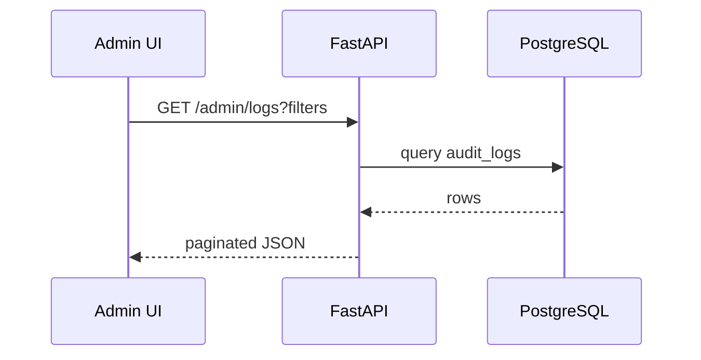

# Admin — Logs

| Field | Value |
|-------|-------|
| **Document ID** | ADMIN-LOG-001 |
| **Route** | `/admin/logs` |
| **Product** | Founder Portfolio Platform (FounderOS v1.0) |
| **Status** | Approved |
| **Last Updated** | 2026-06-29 |
| **Related** | [Monitoring (Admin)](./Monitoring.md) · [Audit](../11_Security/Audit.md) · [Observability](../04_Architecture/Observability.md) · [Tables](../03_Design_System/Tables.md) |

---

## Purpose

Specify the Admin Logs interface — viewing application, audit, and access logs for troubleshooting, security review, and compliance on FounderOS deployments.

---

## Scope

| In Scope | Out of Scope |
|----------|--------------|
| Log viewer UI in admin | Full ELK/Datadog setup (see Deployment Monitoring) |
| Audit trail display | Real-time log streaming WebSockets (v1.1) |
| Filter, search, export CSV | |

---

## Business Context

Enterprise tenants need visibility into who changed content and when. Operators debugging API failures need correlated request IDs without SSH access to VPS.

---

## Goals

1. Admins view last 30 days audit events in UI.
2. Filter by user, action, resource, date range.
3. Export filtered logs for compliance requests.
4. No PII beyond necessary in display (mask emails partial).

---

## Functional Requirements

| ID | Requirement | Priority |
|----|-------------|----------|
| FR-ALOG-001 | Tabs: Audit, Application, Access | P0 |
| FR-ALOG-002 | Audit log SHALL record CRUD on content, settings, users | P0 |
| FR-ALOG-003 | Table with pagination (50 per page) | P0 |
| FR-ALOG-004 | Filters: date range, user, action type, resource | P0 |
| FR-ALOG-005 | Export CSV of filtered audit logs | P1 |
| FR-ALOG-006 | Application logs read from API (tail last N lines) | P2 |
| FR-ALOG-007 | Access restricted to `admin` and `auditor` roles | P0 |

---

## Non-functional Requirements

| ID | Requirement | Target |
|----|-------------|--------|
| NFR-ALOG-001 | Query response | &lt; 2s for 10k rows filtered |
| NFR-ALOG-002 | Retention | 90 days audit in DB |

---

## User Stories

| ID | As a… | I want… | So that… |
|----|-------|---------|----------|
| US-ALOG-001 | Admin | see who published a post | I trace changes |
| US-ALOG-002 | Security | export audit CSV | I respond to audits |
| US-ALOG-003 | DevOps | view error logs | I debug without SSH |
| US-ALOG-004 | Editor | no access to logs | sensitive data protected |

---

## UX Requirements

- Reuse [Tables](../03_Design_System/Tables.md) with dense row height.
- Expandable row for JSON `metadata` diff.
- Color-coded severity for application logs.
- Empty state: "No events in this range."

---

## Technical Considerations

- Table `audit_logs`: `id`, `user_id`, `action`, `resource_type`, `resource_id`, `metadata`, `ip`, `created_at`.
- Indexes on `created_at`, `user_id`, `action`.
- Application logs: read-only file tail or Loki API on VPS.
- See [Audit](../11_Security/Audit.md) for event taxonomy.

---

## Security Considerations

- Logs immutable — no delete from UI.
- IP addresses hashed after 30 days (configurable).
- Rate limit export to prevent data exfiltration.

---

## Acceptance Criteria

- [ ] Log types and tabs documented
- [ ] Audit schema fields listed
- [ ] Filter and pagination specs defined
- [ ] RBAC requirements stated
- [ ] Export and retention policies documented

---

## Future Enhancements

- Live tail with SSE
- Alert rules on log patterns
- SIEM webhook integration

---

## Open Questions

| # | Question | Owner |
|---|----------|-------|
| OQ-1 | Store app logs in DB or file only? | Engineering |
| OQ-2 | Show failed login attempts to all admins? | Security |
| OQ-3 | GDPR erasure impact on audit logs? | Legal |
