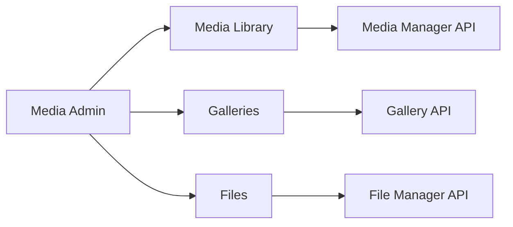

# Admin Media

| Field | Value |
|-------|-------|
| Screen ID | `ADM-MEDIA` |
| Version | 1.0 |
| Route | `/admin/media` |
| Last Updated | 2026-06-29 |

## Purpose

The Media admin screen manages the **visual and document asset library**—uploads, metadata, galleries, and file downloads—through unified access to [Media Manager](../06_Modules/Media_Manager.md), [Gallery](../06_Modules/Gallery.md), and [File Manager](../06_Modules/File_Manager.md) modules.

## Scope

| In Scope | Out of Scope |
|----------|--------------|
| Media library grid/list | CDN configuration UI |
| Gallery album management | Image editing/cropping (v1.1) |
| Document library (files tab) | Storage analytics billing |
| Media picker modal (embeddable) | |

## Business Context

Consistent asset management reduces duplicate uploads and broken image links across white-label deployments. Editors need fast search and usage visibility.

## Goals

1. Tabbed UI: Images | Galleries | Files.
2. Drag-drop multi-upload with progress.
3. Embeddable picker modal for content editors.
4. Usage references visible before delete.

## Functional Requirements

| ID | Requirement | Priority |
|----|-------------|----------|
| MED-FR-01 | Media grid with upload dropzone | Must |
| MED-FR-02 | Edit alt text, caption, folder | Must |
| MED-FR-03 | Galleries tab: album CRUD + item reorder | Must |
| MED-FR-04 | Files tab: document upload and download links | Must |
| MED-FR-05 | Search and filter by mime type | Must |
| MED-FR-06 | Delete with reference warning | Must |
| MED-FR-07 | Picker modal API for external editors | Must |
| MED-FR-08 | Copy URL action | Must |

## Non-functional Requirements

| ID | Requirement | Target |
|----|-------------|--------|
| MED-NFR-01 | Grid load 50 thumbnails | < 1 s |
| MED-NFR-02 | Concurrent uploads | 3 max |
| MED-NFR-03 | Picker modal open | < 300 ms |

## User Stories

| ID | As a… | I want to… | So that… |
|----|-------|-------------|----------|
| MED-US-01 | Editor | Upload images via drag-drop | I add assets quickly |
| MED-US-02 | Editor | Pick image from library in blog editor | I reuse assets |
| MED-US-03 | Creator | Manage gallery albums | I organize travel photos |
| MED-US-04 | Admin | Upload PDF product sheet | Buyers can download |

## UX Requirements

- Tabs: **Media** | **Galleries** | **Files**.
- Grid: square thumbnails, checkbox multi-select, bulk delete.
- Detail drawer: large preview, metadata form, references list, delete.
- Upload: progress per file, error retry.
- Picker modal: search, grid select, confirm button.
- Galleries: album list → album editor with sortable items.



## Technical Considerations

### Reusable Interfaces

```typescript
interface IMediaPickerProps {
  open: boolean;
  onSelect: (asset: IMediaAsset) => void;
  onClose: () => void;
  mimeFilter?: string[];
  multiple?: boolean;
}
```

### Module Dependencies

| Module | Tab |
|--------|-----|
| [Media Manager](../06_Modules/Media_Manager.md) | Media |
| [Gallery](../06_Modules/Gallery.md) | Galleries |
| [File Manager](../06_Modules/File_Manager.md) | Files |
| [Settings](../06_Modules/Settings.md) | Upload limits |

### Data Entities

See module specs: `media_assets`, `gallery_albums`, `file_assets`.

### API Endpoints

| Tab | APIs |
|-----|------|
| Media | [Media_API](../08_API/Media_API.md) |
| Galleries | [Gallery_API](../08_API/Gallery_API.md) |
| Files | [Media_API](../08_API/Media_API.md) |

### Permissions

| Permission | Access |
|------------|--------|
| `media.read` | Media + Galleries view |
| `media.write` | Upload, edit metadata |
| `media.delete` | Delete assets |
| `gallery.write` | Gallery tab write |
| `files.write` | Files tab write |

## Security Considerations

- Client-side mime check + server validation.
- Bulk delete requires `media.delete` and confirmation.
- Signed URLs for private files not exposed in grid URL copy.

## Acceptance Criteria

- [ ] Image upload appears in grid with thumbnail.
- [ ] Alt text editable and persisted.
- [ ] Gallery album create/add/reorder works.
- [ ] File upload appears in Files tab.
- [ ] Picker modal returns selected asset to blog editor.
- [ ] Delete blocked when references exist (with list).

## Future Enhancements

- In-browser image crop/resize
- Folder tree navigation
- Storage quota meter
- Duplicate detection hash

## Open Questions

| # | Question | Status |
|---|----------|--------|
| OQ-MED-01 | Infinite scroll vs pagination? | Pagination v1.0 |
| OQ-MED-02 | Video tab in v1.0? | No — images + files only |

## Related Documents

- [Media Manager](../06_Modules/Media_Manager.md)
- [Gallery](../06_Modules/Gallery.md)
- [File Manager](../06_Modules/File_Manager.md)
