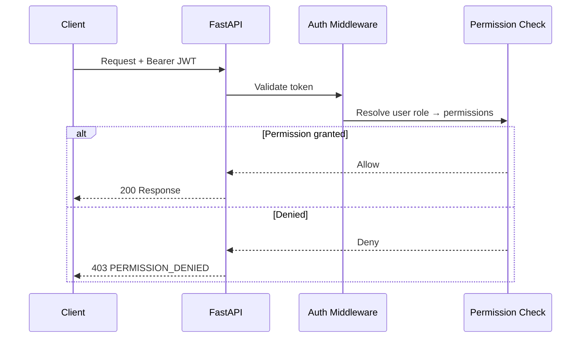

# Admin Permissions

| Field | Value |
|-------|-------|
| Admin Section ID | `ADM-PERMISSIONS` |
| Version | 1.0 |
| Status | Specification |
| Owner | Admin Platform |
| Last Updated | 2026-06-29 |

## Purpose

The Admin Permissions section documents and enforces the granular permission strings used across all protected API endpoints and admin UI actions—forming the authorization layer of FounderOS RBAC.

## Scope

| In Scope | Out of Scope |
|----------|--------------|
| Permission string registry | Attribute-based access control (ABAC) |
| Permission-to-endpoint mapping reference | Row-level content ownership |
| Server-side enforcement contract | Client-only permission checks |
| Permission matrix in admin (read-only) | Dynamic policy engine |

## Business Context

Enterprise customers expect least-privilege access. A explicit permission model enables security reviews, SOC2 narratives, and safe team delegation.

## Goals

1. Define consistent `resource:action` permission naming.
2. Map every protected endpoint to required permission.
3. Enforce permissions server-side on all mutations.
4. Document default grants per [Role](./Roles.md).
5. Enable permission audit for compliance.

## Functional Requirements

| ID | Requirement | Priority |
|----|-------------|----------|
| PERM-FR-01 | Permission format: `{resource}:{action}` | Must |
| PERM-FR-02 | Actions: `read`, `write`, `delete`, `manage` | Must |
| PERM-FR-03 | Server middleware checks permission per route | Must |
| PERM-FR-04 | Admin UI hides actions user cannot perform | Must |
| PERM-FR-05 | Permission registry API for admin UI | Should |
| PERM-FR-06 | Wildcard `content:*` for editor role | Should |

## Non-functional Requirements

| ID | Requirement | Target |
|----|-------------|--------|
| PERM-NFR-01 | Permission check overhead | < 2 ms per request |
| PERM-NFR-02 | Registry size | < 100 permissions |

## User Stories

| ID | As a… | I want to… | So that… |
|----|-------|-------------|----------|
| PERM-US-01 | Super Admin | Review permission matrix | I verify least privilege |
| PERM-US-02 | Developer | Know required permission per endpoint | I implement auth correctly |
| PERM-US-03 | Editor | Not see delete buttons I cannot use | UX matches my access |
| PERM-US-04 | Security reviewer | Audit permission documentation | Compliance review passes |

## UX Requirements

- Read-only permission reference page in admin (Super Admin only).
- Grouped by resource: Content, Media, Settings, Users, Analytics, etc.
- Each permission: string, description, affected endpoints.
- Matrix view shared with [Roles](./Roles.md) section.
- API returns 403 with clear error code `PERMISSION_DENIED`.

## Technical Considerations

### Permission Registry

| Permission | Description | Default Roles |
|------------|-------------|---------------|
| `content:read` | View all content types | all |
| `content:write` | Create/update content | super_admin, admin, editor |
| `content:delete` | Delete content | super_admin, admin |
| `media:read` | Browse media library | all |
| `media:write` | Upload/edit media | super_admin, admin, editor |
| `contact:read` | View submissions | super_admin, admin |
| `contact:write` | Mark read, delete submissions | super_admin, admin |
| `settings:read` | View settings | super_admin, admin |
| `settings:write` | Modify settings | super_admin |
| `users:read` | View admin users | super_admin |
| `users:write` | Manage admin users | super_admin |
| `analytics:read` | View analytics dashboard | super_admin, admin |
| `seo:write` | Edit SEO globals | super_admin, admin |
| `integrations:manage` | Invalidate integration caches | super_admin, admin |
| `logs:read` | View application logs | super_admin |

### Enforcement Flow

## Security Considerations

- Never trust client-side permission checks alone.
- JWT must not contain permission list (resolve server-side to allow revocation).
- 403 responses must not leak existence of protected resources.
- Permission changes take effect on next request (no stale JWT permissions).
- Log permission denials for security monitoring.

## Acceptance Criteria

- [ ] Every protected endpoint documented with required permission.
- [ ] Editor receives 403 on `settings:write` endpoints.
- [ ] Admin UI hides write actions for viewer role.
- [ ] Permission matrix matches seeded role_permissions.
- [ ] 403 response body includes `error.code: PERMISSION_DENIED`.

## Future Enhancements

| Version | Enhancement |
|---------|-------------|
| v1.1 | Custom permission assignment per role |
| v1.5 | Content-scoped permissions (own drafts only) |
| v2.0 | ABAC policies |

## Open Questions

| ID | Question | Owner | Status |
|----|----------|-------|--------|
| OQ-PERM-01 | Include permissions in JWT for UI or fetch on load? | Backend | Open |
| OQ-PERM-02 | Granular `blog:write` vs. unified `content:write`? | Product | Open |

## Related Documents

- [Roles Admin](./Roles.md)
- [Authentication API](../08_API/Authentication_API.md)
- All [08_API](../08_API/) documents
