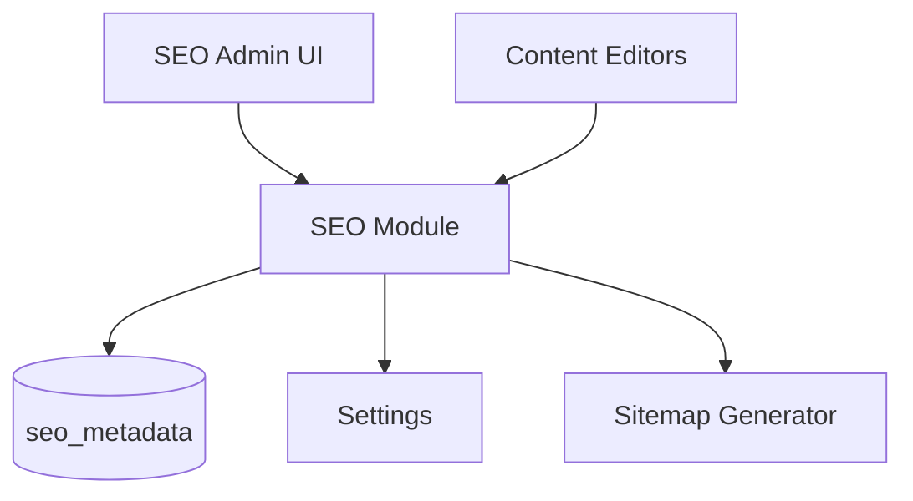

# Admin SEO

| Field | Value |
|-------|-------|
| Screen ID | `ADM-SEO` |
| Version | 1.0 |
| Route | `/admin/seo` |
| Last Updated | 2026-06-29 |

## Purpose

The SEO admin screen provides **global SEO configuration**, sitemap/robots management, structured data preview, and site-wide defaults—complementing per-entity SEO panels embedded in [Content](Content.md) editors.

## Scope

| In Scope | Out of Scope |
|----------|--------------|
| Global meta defaults | Keyword rank tracking |
| Sitemap preview and regenerate | Competitor analysis |
| robots.txt editor | Google Search Console OAuth (v1.2) |
| Site URL and OG default image | |
| SEO health checklist | |

## Business Context

SEO managers need centralized control over defaults while editors set per-page metadata. Poor global config undermines all content efforts.

## Goals

1. Configure site-wide title suffix, default description, OG image.
2. Preview and trigger sitemap regeneration.
3. Edit robots.txt with validation.
4. Display SEO health checklist with actionable fixes.

## Functional Requirements

| ID | Requirement | Priority |
|----|-------------|----------|
| ASEO-FR-01 | Edit global SEO defaults | Must |
| ASEO-FR-02 | Configure canonical site URL | Must |
| ASEO-FR-03 | Preview sitemap.xml content | Must |
| ASEO-FR-04 | Trigger sitemap regenerate | Must |
| ASEO-FR-05 | Edit robots.txt with save | Must |
| ASEO-FR-06 | SEO health checklist (missing meta, noindex pages) | Should |
| ASEO-FR-07 | Default OG image via media picker | Must |
| ASEO-FR-08 | Staging noindex override toggle | Must |

## Non-functional Requirements

| ID | Requirement | Target |
|----|-------------|--------|
| ASEO-NFR-01 | Sitemap preview load | < 2 s |
| ASEO-NFR-02 | Health scan | < 5 s |

## User Stories

| ID | As a… | I want to… | So that… |
|----|-------|-------------|----------|
| ASEO-US-01 | SEO manager | Set global title template | All pages have consistent branding |
| ASEO-US-02 | SEO manager | Preview sitemap | I verify indexed URLs |
| ASEO-US-03 | Admin | Block staging from indexing | Dev site isn't crawled |
| ASEO-US-04 | SEO manager | See pages missing meta description | I fix SEO gaps |

## UX Requirements

- Sections: **Global Defaults**, **Sitemap**, **Robots**, **Health Check**.
- Global form: site name, title separator, default description, OG image, Twitter handle.
- Sitemap: read-only XML preview + "Regenerate" button + last generated timestamp.
- Robots: textarea with syntax highlight + common presets dropdown.
- Health: checklist table with links to fix in Content admin.

## Technical Considerations

### Architecture

### Module Dependencies

| Module | Purpose |
|--------|---------|
| [SEO](../06_Modules/SEO.md) | Core SEO service |
| [Settings](../06_Modules/Settings.md) | `site_url`, staging flags |
| [Media Manager](../06_Modules/Media_Manager.md) | Default OG image |
| [CMS](../06_Modules/CMS.md), [Blog](../06_Modules/Blog_Manager.md) | Health scan sources |
| [Search](../06_Modules/Search.md) | Related discovery |

### Data Entities

`seo_metadata` global row (`entity_type='global'`) + per-entity rows.

### API Endpoints

| Method | Path | Permission | API Doc |
|--------|------|------------|---------|
| GET | `/api/v1/seo/defaults` | `seo.read` | [SEO_API](../08_API/SEO_API.md) |
| PUT | `/api/v1/seo/defaults` | `seo.write` | [SEO_API](../08_API/SEO_API.md) |
| GET | `/api/v1/seo/sitemap/preview` | `seo.read` | [SEO_API](../08_API/SEO_API.md) |
| POST | `/api/v1/seo/sitemap/regenerate` | `seo.write` | [SEO_API](../08_API/SEO_API.md) |
| GET | `/api/v1/seo/robots` | `seo.read` | [SEO_API](../08_API/SEO_API.md) |
| PUT | `/api/v1/seo/robots` | `seo.write` | [SEO_API](../08_API/SEO_API.md) |
| GET | `/api/v1/seo/health` | `seo.read` | [SEO_API](../08_API/SEO_API.md) |

### Permissions

| Permission | Roles |
|------------|-------|
| `seo.read` | `admin`, `seo_manager` |
| `seo.write` | `admin`, `seo_manager` |

## Security Considerations

- robots.txt changes affect crawl behavior — confirm modal.
- Staging `noindex` enforced via env + UI toggle (env wins).
- Sitemap preview admin-only; public served at `/sitemap.xml`.

## Acceptance Criteria

- [ ] Global defaults apply to pages without custom SEO.
- [ ] Sitemap lists all published content URLs.
- [ ] Robots.txt edits persist and serve publicly.
- [ ] Health check lists pages missing meta description.
- [ ] Staging toggle adds `noindex` globally when enabled.
- [ ] OG default image appears in social preview.

## Future Enhancements

- Google Search Console integration
- Structured data validator UI
- Redirect manager (301/302)
- Canonical conflict detector

## Open Questions

| # | Question | Status |
|---|----------|--------|
| OQ-ASEO-01 | Auto-regenerate sitemap on publish? | Yes — async |
| OQ-ASEO-02 | robots.txt version history? | v1.1 |

## Related Documents

- [SEO Module](../06_Modules/SEO.md)
- [10_SEO Technical](../10_SEO/Technical_SEO.md)
- [Content Admin](Content.md)
